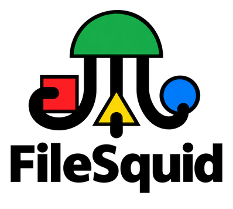

# About this project

**FileSquid** is a free, open-source file platform that keeps your files in an archival standard you own, with descriptions and provenance attached, on your own computer, on your own server, or in an encrypted cloud you can leave at any time ([product vision](./resources/product-vision.md)).

It is designed to look and work like a familiar cloud drive: folders, list and grid views. Underneath, every file is stored the way archives store them:

- **OCFL 1.1** objects on disk or S3-compatible storage: versioned, checksummed, readable without FileSquid, and enough to rebuild the whole application if its database is lost (`ocfl` module).
- **Metadata** in a human-readable record per file, `<file-uuid>.metadata.md` (the `metadata.md` format), using ISO 15836-2 Dublin Core `/terms/` (`dcterms:`), with Schema.org for anything Dublin Core cannot say and, once the planned namespace registry ships, any additional schema you register (for example RiC-O, or your own key:value namespace), next to the embedded EXIF, ID3, IPTC and XMP (`metadata` module).
- **A W3C PROV-O history** of every version and change, from the first import: what was done to a file and its metadata, by which FileSquid installation and tool, and when, written into the OCFL object with the change and readable without FileSquid (`prov` module, from the MVP; [ADR 040](./resources/architecture/040-prov-o-history.md)). Every imported file is stored under a universally unique name with a `<file-uuid>.metadata.md` record beside it that keeps its original file name, which the app shows everywhere.
- **C2PA Content Credentials** for media, recording what was done to a file and whether AI was involved (`c2pa` module; ships with the second consumer release, not the MVP or the first release, [ADR 037](./resources/architecture/037-c2pa-in-release-2.md)); files imported earlier receive honestly dated backfilled records.

FileSquid is one Rust backend with **one API**. Every user interface is plain HTML, CSS and TypeScript that calls that API. A **distribution** puts views, a theme, a vocabulary and a module set on top of the same backend:

| Distribution | Audience | Release |
|---|---|---|
| **FileSquid** (default) | Anyone who wants a private, durable cloud drive | First consumer release, preceded by an early-access macOS desktop MVP ([ADR 035](./resources/architecture/035-macos-first-desktop-mvp.md)) |
| **ImageSquid** | Consumers and families managing photos and videos | Second consumer release, together with FileSquid's Content Credentials (C2PA) |
| **Arkrim** | Digital archivists and records managers | Later |

FileSquid runs as a **desktop app** (Tauri 2; the API is served in-process with no network port), as a **multi-user `filesquid-server`** that you or your organisation operate, and later as an **encrypted browser host**. The paid offer is encrypted **backup and/or sync** at `*.filesquid.tech`: the service stores ciphertext only and never holds your keys. Next come version-compliant batch curation jobs (for example transcoding, Parquet datasets and FAIR reporting), with Arkrim as their UI ([ADR 029](./resources/architecture/029-filesquid-unified-product-and-distributions.md), [ADR 032](./resources/architecture/032-hosting-and-privacy-model.md)).

FileSquid is in development, and much of what is described above is still to be built. The [capability register](./resources/capability-register.md) lists each capability as supported, limited or unsupported, and names the task that delivers it. The [foundation evidence](./resources/foundation-evidence.md) lists the performance budgets. They are proposed and have not been measured yet.


# Setup Development Environment

## Native prerequisites (platform-agnostic)

Install [rustup](https://rustup.rs/) 1.28.1 or newer (1.28.0 does not install the pinned toolchain automatically). The workspace pins Rust to an exact stable release, **1.99.1**, in `apps/filesquid/rust-toolchain.toml`, so a new stable release cannot change lints or behaviour under an existing branch. The first `cargo` or `rustc` command run inside `apps/filesquid/` installs that toolchain with `rustfmt`, `clippy` and the browser target `wasm32-unknown-unknown` (the `filesquid-ocfl`, `filesquid-metadata`, `filesquid-c2pa` and `filesquid-prov` checks build for it). To install it ahead of time, run these from `apps/filesquid/` (some rustup versions skip the components and target the file declares, so add them explicitly, as `scripts/setup-dev-environment.sh` does): `rustup toolchain install`, then `rustup component add rustfmt clippy` and `rustup target add wasm32-unknown-unknown`. `rustc --version` there prints `rustc 1.99.1`. Install **Node.js** 22.12.0 or newer (Node.js 24 LTS is simplest, since it bundles npm 11) with a version manager such as [mise](https://mise.jdx.dev/) or [asdf](https://asdf-vm.com/), or the installer from [nodejs.org](https://nodejs.org/). Use **npm 11 or newer** (bundled with Node.js 24, or `npm install -g npm@11` on Node.js 22; do not use `npm@latest`, because npm 12 requires Node.js 22.22.2 or newer): npm 10 crashes with `Cannot read properties of null (reading 'edgesOut')` when it resolves the relative-path link from ImageSquid to `@filesquid/ui`. Both packages declare the requirement in `engines` and enforce it with `engine-strict`, so an old npm stops with a clear message instead. Desktop builds need the OS webview toolchain described in [Tauri 2 prerequisites](https://v2.tauri.app/start/prerequisites/): MSVC + WebView2 on Windows, Xcode Command Line Tools on macOS, WebKitGTK 4.1 on Linux. Docker (optional) runs the Compose services.

**libvips (thumbnails and previews).** The desktop media worker (the desktop executable started with `--filesquid-media-worker`, one process per thumbnail, Task DE-0.5) loads the libvips 8.13 or newer shared library at run time, so no build needs its headers: `libvips.so.42` on Linux, from a package that provides libvips 8.13 or newer (Debian 12's `libvips42` is 8.14, Ubuntu 24.04's `libvips42t64` is 8.15; Ubuntu 22.04's `libvips42` is 8.12, too old, and the worker refuses it), `libvips.42.dylib` on macOS (Homebrew's `vips`), `libvips-42.dll` on Windows (the libvips Windows build, on `PATH`). Without it, the worker answers `libvips_unavailable` and the media tests check that refusal instead of a thumbnail. Do not install ImageMagick for FileSquid ([ADR 006](./resources/architecture/006-libvips-native-stills-not-imagemagick.md)): where a libvips build carries its ImageMagick module, the worker blocks every Magick loader and saver before it reads a file, and `unit_media` fails if a Magick crate enters `Cargo.lock`.

**Bumping the Rust toolchain.** Change `channel` in `apps/filesquid/rust-toolchain.toml` in its own pull request on a `build/` branch (for example `build/bump-rust-1.100.0`), never inside a feature branch. Fix every new compiler warning and Clippy lint the new release reports in that same pull request, and run `FULL=1 bash scripts/pre-commit.sh` on its head commit (a toolchain change always selects the full scope). Feature branches pick up the new version when they next merge `origin/main`.

Language manifests live **inside** `apps/`, never at the repository root:

| Path | What it is |
|---|---|
| `apps/filesquid/` | Cargo workspace: `crates/{core,ocfl,metadata,c2pa,cli,api,native,server,desktop}` |
| `apps/filesquid/ui/` | `@filesquid/ui`: API client, custom elements, design tokens and the default FileSquid UI (vanilla TypeScript, Vite; ports 5173 dev / 4173 preview) |
| `apps/imagesquid/` | The ImageSquid distribution: views, tokens, labels, brand; no backend code (ports 5174 / 4174) |
| `scripts/docs/` | Documentation validators (requirement coverage, PRD allocation, links, ADR structure) |

Install the UI packages once. The pre-commit hook needs only `@filesquid/ui`; install ImageSquid as well to run its own scripts by hand (it links `@filesquid/ui` by relative path, so install that first):

```sh
cd apps/filesquid/ui && npm ci
cd ../../imagesquid && npm ci
```

Or let one script do all of the setup. `scripts/setup-dev-environment.sh` is idempotent and safe to run at the start of every session. It installs the toolchain pinned in `apps/filesquid/rust-toolchain.toml` and the `wasm32-unknown-unknown` target. It runs `cargo fetch --locked` and `npm ci` in both UI packages. When `python3` exists, it installs the community OCFL validator `ocfl-py` 2.1.0 with pip (it does not install `rocfl`). It registers the MVP progress merge driver (below) in the clone's git config. It then pre-warms the Cargo target with `cargo build --workspace --tests --locked`, using the same shared-target lock and Cargo settings as the pre-commit hook. Every step logs to stdout with a UTC timestamp. Each install, download or build command (rustup, cargo, npm, pip) has a time limit (`FILESQUID_SETUP_STEP_TIMEOUT`, default 1800 seconds; `FILESQUID_SETUP_BUILD_TIMEOUT`, default 3600 seconds for the pre-warm) when a `timeout` or `gtimeout` program is installed. Quick local checks such as `pip show` and `python3 -m venv` are not wrapped. Without a timeout program, the script warns and runs those commands without a limit (macOS has neither unless coreutils is installed); the lock wait is bounded either way. A failed required step (toolchain, fetch, `npm ci`) exits non-zero and names the step. A failed optional step (`ocfl-py`, merge driver, pre-warm) prints a warning and the script continues. In a cloud environment, put this one line in the environment's setup script; it runs from the repository checkout:

```sh
bash scripts/setup-dev-environment.sh
```

. The `ocfl`, `metadata`, `c2pa` and `prov` crates stay independently installable and publishable for programmes that never run the FileSquid app.

## Run the application

**Command line.** Every FileSquid CLI command runs through one tool, `fsquid`, built by `filesquid-cli` ([ADR 036](./resources/architecture/036-single-fsquid-cli.md)). From `apps/filesquid`:

```sh
cargo run -p filesquid-cli -- --help
cargo run -p filesquid-cli -- metadata validate dcterms:title
```

A command that only one module defines runs as `fsquid <command>`; any command also runs as `fsquid <module> <command>`; `validate` always needs the module name.

**Server host** (API plus the built default UI), from `apps/filesquid`:

```sh
cd apps/filesquid/ui && npm run build && cd ..
FILESQUID_BIND=127.0.0.1:8083 FILESQUID_UI_DIR=ui/dist cargo run -p filesquid-server
```

Open `http://127.0.0.1:8083`. Without `FILESQUID_UI_DIR` the server serves the API only. `FILESQUID_BIND` defaults to `127.0.0.1:8083`.

# License

FileSquid and the ImageSquid distribution are licensed under the [MIT License](./LICENSE). Copyright (c) 2026 Pieter Van Garderen. See [COPYRIGHT](./COPYRIGHT). 

# Open Agent Dev

This project is developed with AI coding agents (Claude and Grok) using the [Open Agent Dev](https://github.com/peterVG/open-agent-dev/) tooling and workflow developed by [@peterVG](https://vangarderen.net). Role prompts live in [.agents/agents/](./.agents/agents/README.md). Cubic.dev and CodeRabbit were used for initial code review. Each feature is developed in a separate branch and require human review and approval before merging to main branch.
