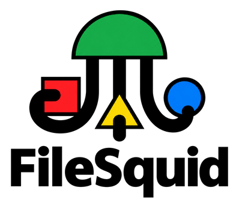

# About this project

**FileSquid** is a free, open-source file platform that keeps your files in an archival standard you own, with descriptions and provenance attached, on your own computer, on your own server, or in an encrypted cloud you can leave at any time ([product vision](./resources/product-vision.md)).

It is designed to look and work like a familiar cloud drive: folders, list and grid views. Underneath, every file is stored the way archives store them:

- **OCFL 1.1** objects on disk or S3-compatible storage: versioned, checksummed, readable without FileSquid, and enough to rebuild the whole application if its database is lost (`ocfl` module).
- **Metadata** in a human-readable record per file, `<file-uuid>.metadata.md` (the `metadata.md` format), using ISO 15836-2 Dublin Core `/terms/` (`dcterms:`), with Schema.org for anything Dublin Core cannot say and, once the planned namespace registry ships, any additional schema you register (for example RiC-O, or your own key:value namespace), next to the embedded EXIF, ID3, IPTC and XMP (`metadata` module).
- **A W3C PROV-O history** of every version and change, from the first import: what was done to a file and its metadata, by which FileSquid installation and tool, and when, written into the OCFL object with the change and readable without FileSquid (`prov` module, from the MVP; [ADR 040](./resources/architecture/040-prov-o-history.md)). Every imported file is stored under a universally unique name with a `<file-uuid>.metadata.md` record beside it that keeps its original file name, which the app shows everywhere.
- **C2PA Content Credentials** for media, recording what was done to a file and whether AI was involved (`c2pa` module; ships with the second consumer release, not the MVP or the first release, [ADR 037](./resources/architecture/037-c2pa-in-release-2.md)); files imported earlier receive honestly dated backfilled records.

FileSquid is one Rust backend with **one API**. Every user interface is plain HTML, CSS and TypeScript that calls that API. A **distribution** puts views, a theme, a vocabulary and a module set on top of the same backend:

| Distribution | Audience | Release |
|---|---|---|
| **FileSquid** (default) | Anyone who wants a private, durable cloud drive | First consumer release, preceded by an early-access macOS desktop MVP ([ADR 035](./resources/architecture/035-macos-first-desktop-mvp.md)) |
| **ImageSquid** | Consumers and families managing photos and videos | Second consumer release, together with FileSquid's Content Credentials (C2PA) |
| **Arkrim** | Digital archivists and records managers | Later |

FileSquid runs as a **desktop app** (Tauri 2; the API is served in-process with no network port), as a **multi-user `filesquid-server`** that you or your organisation operate, and later as an **encrypted browser host**. The paid offer is encrypted **backup and/or sync** at `*.filesquid.tech`: the service stores ciphertext only and never holds your keys. Next come version-compliant batch curation jobs (for example transcoding, Parquet datasets and FAIR reporting), with Arkrim as their UI ([ADR 029](./resources/architecture/029-filesquid-unified-product-and-distributions.md), [ADR 032](./resources/architecture/032-hosting-and-privacy-model.md)).


# Setup Development Environment

## Native prerequisites (platform-agnostic)

Install [rustup](https://rustup.rs/) 1.28.1 or newer (1.28.0 does not install the pinned toolchain automatically). The workspace pins Rust to an exact stable release, **1.99.1**, in `apps/filesquid/rust-toolchain.toml`, so a new stable release cannot change lints or behaviour under an existing branch. The first `cargo` or `rustc` command run inside `apps/filesquid/` installs that toolchain with `rustfmt`, `clippy` and the browser target `wasm32-unknown-unknown` (the `filesquid-ocfl`, `filesquid-metadata`, `filesquid-c2pa` and `filesquid-prov` checks build for it). To install it ahead of time, run these from `apps/filesquid/` (some rustup versions skip the components and target the file declares, so add them explicitly, as `scripts/setup-dev-environment.sh` does): `rustup toolchain install`, then `rustup component add rustfmt clippy` and `rustup target add wasm32-unknown-unknown`. `rustc --version` there prints `rustc 1.99.1`. Install **Node.js** 22.12.0 or newer (Node.js 24 LTS is simplest, since it bundles npm 11) with a version manager such as [mise](https://mise.jdx.dev/) or [asdf](https://asdf-vm.com/), or the installer from [nodejs.org](https://nodejs.org/). Use **npm 11 or newer** (bundled with Node.js 24, or `npm install -g npm@11` on Node.js 22; do not use `npm@latest`, because npm 12 requires Node.js 22.22.2 or newer): npm 10 crashes with `Cannot read properties of null (reading 'edgesOut')` when it resolves the relative-path link from ImageSquid to `@filesquid/ui`. Both packages declare the requirement in `engines` and enforce it with `engine-strict`, so an old npm stops with a clear message instead. Desktop builds need the OS webview toolchain described in [Tauri 2 prerequisites](https://v2.tauri.app/start/prerequisites/): MSVC + WebView2 on Windows, Xcode Command Line Tools on macOS, WebKitGTK 4.1 on Linux. Docker (optional) runs the Compose services.

**Bumping the Rust toolchain.** Change `channel` in `apps/filesquid/rust-toolchain.toml` in its own pull request on a `build/` branch (for example `build/bump-rust-1.100.0`), never inside a feature branch. Fix every new compiler warning and Clippy lint the new release reports in that same pull request, and run `FULL=1 bash scripts/pre-commit.sh` on its head commit (a toolchain change always selects the full scope). Feature branches pick up the new version when they next merge `origin/main`.

Language manifests live **inside** `apps/`, never at the repository root:

| Path | What it is |
|---|---|
| `apps/filesquid/` | Cargo workspace: `crates/{core,ocfl,metadata,c2pa,cli,api,native,server,desktop}` |
| `apps/filesquid/ui/` | `@filesquid/ui`: API client, custom elements, design tokens and the default FileSquid UI (vanilla TypeScript, Vite; ports 5173 dev / 4173 preview) |
| `apps/imagesquid/` | The ImageSquid distribution: views, tokens, labels, brand; no backend code (ports 5174 / 4174) |
| `scripts/docs/` | Documentation validators (requirement coverage, PRD allocation, links, ADR structure) |

Install the UI packages once (ImageSquid links `@filesquid/ui` by relative path, so install it first):

```sh
cd apps/filesquid/ui && npm ci
cd ../../imagesquid && npm ci
```

Or let one script do all of the setup. `scripts/setup-dev-environment.sh` is idempotent and safe to run at the start of every session. It installs the toolchain pinned in `apps/filesquid/rust-toolchain.toml` and the `wasm32-unknown-unknown` target. It runs `cargo fetch --locked` and `npm ci` in both UI packages. When `python3` exists, it installs the community OCFL validator `ocfl-py` 2.1.0 with pip (it does not install `rocfl`). It registers the MVP progress merge driver (below) in the clone's git config. It then pre-warms the Cargo target with `cargo build --workspace --tests --locked`, using the same shared-target lock and Cargo settings as the pre-commit hook. Every step logs to stdout with a UTC timestamp. Each install, download or build command (rustup, cargo, npm, pip) has a time limit (`FILESQUID_SETUP_STEP_TIMEOUT`, default 1800 seconds; `FILESQUID_SETUP_BUILD_TIMEOUT`, default 3600 seconds for the pre-warm) when a `timeout` or `gtimeout` program is installed. Quick local checks such as `pip show` and `python3 -m venv` are not wrapped. Without a timeout program, the script warns and runs those commands without a limit (macOS has neither unless coreutils is installed); the lock wait is bounded either way. A failed required step (toolchain, fetch, `npm ci`) exits non-zero and names the step. A failed optional step (`ocfl-py`, merge driver, pre-warm) prints a warning and the script continues. In a cloud environment, put this one line in the environment's setup script; it runs from the repository checkout:

```sh
bash scripts/setup-dev-environment.sh
```

**MVP progress merge driver** (once per clone; the setup script does it for you). Every task PR regenerates the progress block in [`resources/implementation-plan-checklist.md`](./resources/implementation-plan-checklist.md) and its bar `resources/assets/mvp-progress.svg`, so two open PRs would conflict there whenever one merges. [`.gitattributes`](./.gitattributes) assigns both files the `mvp-progress` merge driver, [`scripts/docs/merge_mvp_progress.py`](./scripts/docs/merge_mvp_progress.py). Register it from the repository root, in any shell on Windows, macOS or Linux (the settings live in the clone's `.git/config` and cover all its worktrees):

```sh
git config merge.mvp-progress.name "MVP progress block"
git config merge.mvp-progress.driver "python3 scripts/docs/merge_mvp_progress.py %O %A %B %L %P"
```

Git runs the driver from the repository's top-level directory, so the relative path works from any subdirectory. Where Python 3 is installed as `python` or `py` instead of `python3` (some Windows installs), use that name in the second command. The driver merges the rest of the checklist with `git merge-file` and regenerates the block offline from the merged ticks (no GitHub call): the recorded PRs are the union of both sides minus tasks that are now ticked, and the timestamp is the newer one. The SVG carries a hidden tick record, so the bar is merged row by row and redrawn whichever file git merges first. A real conflict outside the block (the same line edited differently, or ticks on adjacent lines) still stops the merge with conflict markers. The driver reads the module plans and the implementation plan from the working tree, which still holds your side while git merges; if the other side changed a Dependencies line, a plan tick or an estimate, the pre-commit hook's `update_mvp_progress.py --check` reports the block as stale, and `python3 scripts/docs/update_mvp_progress.py` fixes it. Without these two settings git ignores the undefined driver name and uses its normal text merge for both files, so the generated lines conflict as before.

## Project naming

Use **FileSquid** for displayed branding of the product and **filesquid** for technical identifiers (Cargo packages `filesquid-core`, `filesquid-ocfl`, `filesquid-metadata`, `filesquid-c2pa`, `filesquid-prov`, `filesquid-cli`, `filesquid-api`, `filesquid-native`, `filesquid-server`, `filesquid-desktop`; the one command-line tool is `fsquid`; npm scope `@filesquid`; desktop identifier `tech.filesquid.desktop`; hosted service domain `filesquid.tech`). **ImageSquid** is a distribution: displayed brand ImageSquid, npm package `@imagesquid/ui`, desktop identifier `app.imagesquid.desktop`, domain `imagesquid.app`. Internal code, schemas and APIs use FileSquid's internal names (repository, library, collection, virtual collection, virtual exhibit, file); a distribution changes only its UI labels ([terminology](./resources/product-vision.md#terminology)). The `ocfl`, `metadata`, `c2pa` and `prov` crates stay independently installable and publishable for programmes that never run the FileSquid app.

## Run the application

**Command line.** Every FileSquid CLI command runs through one tool, `fsquid`, built by `filesquid-cli` ([ADR 036](./resources/architecture/036-single-fsquid-cli.md)). From `apps/filesquid`:

```sh
cargo run -p filesquid-cli -- --help
cargo run -p filesquid-cli -- metadata validate dcterms:title
```

A command that only one module defines runs as `fsquid <command>`; any command also runs as `fsquid <module> <command>`; `validate` always needs the module name.

**Server host** (API plus the built default UI), from `apps/filesquid`:

```sh
cd apps/filesquid/ui && npm run build && cd ..
FILESQUID_BIND=127.0.0.1:8083 FILESQUID_UI_DIR=ui/dist cargo run -p filesquid-server
```

Open `http://127.0.0.1:8083`. Without `FILESQUID_UI_DIR` the server serves the API only. `FILESQUID_BIND` defaults to `127.0.0.1:8083`.

`FILESQUID_OPERATOR_NAME` names who runs the server, for example `FILESQUID_OPERATOR_NAME="Garderen Family"`. A server's operator can read the files it stores, so the name belongs in the UI's privacy disclosure; the host descriptor reports it now, and the default UI does not display it yet (its host privacy indicator is a later task). Surrounding whitespace is trimmed, and the name must be 1 to 256 characters with no control characters; a longer name, one with a control character, or a value that is not valid Unicode stops the server with an error that names the variable but not the value. When it is unset or blank, the server still starts, reports no operator name, and writes one `server.operator_unnamed` warning to stdout (whatever `RUST_LOG` says) and to the activity journal at every start. Any authenticated caller (any accepted credential, the administrator token included) can read the host descriptor (host type, operator name and hosted backup and sync state) at `GET /api/v1/host`.

Every API route except the liveness probe, plus the WebSocket event channel and `/metrics`, is **deny-by-default**: a call without the token answers `401 unauthorized`, and one with a wrong token `403 forbidden`, with a typed error body. HTTP requests, `/metrics` included, send the token as `Authorization: Bearer <token>`. The WebSocket event channel accepts that header too, but a browser cannot set headers on a WebSocket, so it offers the subprotocols `filesquid.events.v1` and `filesquid.bearer.<token>` instead. The liveness probe `GET /api/v1/health/live` is public for process supervisors and load balancers and answers only `{"status":"up"}`; the static UI is public too.

Until server accounts arrive, the token is the administrator token: the value of `FILESQUID_ADMIN_TOKEN` (surrounding whitespace is trimmed and a blank value counts as unset; any other value must be 64 hexadecimal characters, 256 bits, like a generated token, and the server refuses to start otherwise, never printing the value), or, on Linux and macOS only, the token generated at first start into `admin-token` in the data directory (`FILESQUID_DATA_DIR`, default `filesquid-data`). On Windows the server stores no token file and refuses to start until `FILESQUID_ADMIN_TOKEN` is set. On Linux and macOS the server refuses to start when the token file is unsafe, and names the case:

- **Readable by group or others:** `chmod 600 "$FILESQUID_DATA_DIR/admin-token"`, then restart.
- **Owned by another user:** `chown <server user> "$FILESQUID_DATA_DIR/admin-token"` (as an administrator), or delete the file and restart to generate a new token.
- **A symbolic link:** delete the link and restart to generate a new token, or replace it with a regular file that holds the token and `chmod 600` it.
- **Not a regular file** (for example a directory or a FIFO): remove it and restart to generate a new token.

In a second terminal in `apps/filesquid` (with the default data directory):

```sh
curl http://127.0.0.1:8083/api/v1/health/live
TOKEN=$(cat filesquid-data/admin-token)
curl -H "Authorization: Bearer $TOKEN" http://127.0.0.1:8083/api/v1/health
curl -H "Authorization: Bearer $TOKEN" http://127.0.0.1:8083/api/v1/host
```

The full health route returns `{"schema_version":1,"status":"ok","product":"filesquid"}`. The host route returns `{"schema_version":1,"host_type":"server","operator_name":null,"hosted_service":{"enrolled":false,"backup_enabled":false,"sync_enabled":false,"service_host":null}}` until a non-blank, valid `FILESQUID_OPERATOR_NAME` is set; encrypted backup and sync are reported as not enrolled until they exist.

On Windows, set `FILESQUID_ADMIN_TOKEN` yourself (the server stores no token file there) and reuse the same value for requests. In PowerShell 7, from `apps/filesquid`:

```powershell
Push-Location ui; npm ci; npm run build; Pop-Location
$TOKEN = -join (1..32 | ForEach-Object { '{0:x2}' -f [System.Security.Cryptography.RandomNumberGenerator]::GetInt32(256) })
$TOKEN                                   # note it; the server never prints it
$env:FILESQUID_ADMIN_TOKEN = $TOKEN
$env:FILESQUID_UI_DIR = "ui/dist"
cargo run -p filesquid-server
```

In a second PowerShell window, set `$TOKEN` to the same value, then:

```powershell
curl.exe http://127.0.0.1:8083/api/v1/health/live
curl.exe -H "Authorization: Bearer $TOKEN" http://127.0.0.1:8083/api/v1/health
```

The same `FILESQUID_ADMIN_TOKEN` flow works on Linux and macOS, where it takes precedence over the token file. Generate a well-formed token there with:

```sh
export FILESQUID_ADMIN_TOKEN=$(openssl rand -hex 32)
TOKEN=$FILESQUID_ADMIN_TOKEN    # for the curl examples
```

The desktop host needs no token from you: it generates a new per-launch token at every start and gives it only to its own pages. In the browser UI served by `filesquid-server`, enter the token on the **Monitor** page (`#/monitor`); how `@filesquid/ui` sends it is in its [README](./apps/filesquid/ui/README.md#authenticating-to-the-filesquid-api).

**UI development** with hot reload: start the server as above, then in another terminal:

```sh
cd apps/filesquid/ui && npm run dev      # FileSquid at http://127.0.0.1:5173
cd apps/imagesquid && npm run dev        # ImageSquid at http://127.0.0.1:5174
```

Both dev servers proxy `/api` (including the WebSocket event channel) to `FILESQUID_API_URL`, default `http://127.0.0.1:8083`.

**Desktop host** (native webview; not a Compose service). A debug build without installers:

```sh
cd apps/filesquid/ui && npm run desktop:build -- --debug --no-bundle    # FileSquid
cd apps/imagesquid && npm run desktop:build -- --debug --no-bundle      # ImageSquid (Tauri config overlay)
```

Both produce `apps/filesquid/target/debug/filesquid-desktop`, branded by the overlay. Installers stay disabled (`bundle.active` is false) until the [ADR 011](./resources/architecture/011-native-media-adapters-and-ffmpeg-license.md) licence review.

## Run tests

This repository has no hosted CI. The gate before every push is the local pre-commit hook. On every commit it runs the fast verifiers under `scripts/`: branch protection and the `<type>/<slug>` branch-name prefix, ports, document sync, traceability, links, workspace boundaries, logging, formatting, documentation checks, and the change-scope helper's own tests. Then it runs Clippy, Cargo and UI tests **for what changed**. Run it by hand from the repository root, or install it once as the git hook:

```sh
bash scripts/pre-commit.sh                     # change-aware run (the normal commit gate)
FULL=1 bash scripts/pre-commit.sh              # full suite: before a PR whose scope is full or includes rust: is first marked ready, and on its final commit
ln -s ../../scripts/pre-commit.sh .git/hooks/pre-commit   # or install as the git pre-commit hook
```

The lint and test step is change-aware. `scripts/changed_scope.sh` compares the working tree with its merge-base with `origin/main`. It counts committed, staged, unstaged and untracked files, and prints one scope; run it on its own to see the scope and the reason:

- `docs`: only Markdown, `resources/`, `.agents/`, or root `.claude/` or `docs/` files changed outside the crates and UI packages, or a text checker that the hook runs on every commit anyway (`verify_branch.sh`, `verify_isolated_ports.sh`, `verify_doc_sync.sh`, `verify_srs_traceability.sh`, `verify_relative_links.sh`, `verify_workspace_boundaries.sh`, `verify_centralized_logging.sh`, `verify_docs.sh`, `verify_task_cleanup.sh` or `scripts/docs/`). No Cargo or npm step runs, and each skipped step is printed with the reason. A file inside a crate or UI package, its `README.md` and `resources/` included, selects that crate's or package's scope instead, because its tests read those files.
- `rust:<crates>`: Clippy, tests and rustdoc with `-p` for the changed crates and every workspace crate that depends on them. Each listed module crate is also tested alone. The desktop `test-webdriver` steps run only when `filesquid-desktop` is listed.
- `npm:<packages>`: lint, typecheck and tests for the changed UI packages, including a change to a package's top-level `package.json` or `package-lock.json` (a nested manifest gives `full`). ImageSquid is included whenever `@filesquid/ui` changes.
- `full`: every step. This happens when `apps/filesquid/Cargo.toml` or `Cargo.lock`, a `rust-toolchain` file, any other `package.json` or `package-lock.json`, a script that decides or runs the scope (`pre-commit.sh`, `changed_scope.sh`, `verify_changed_scope.sh`, `verify_tests.sh`, `verify_formatting.sh`, `setup-dev-environment.sh`, `scripts/lib/`) or any other script not listed under `docs`, or a generated contract file (`openapi.json`, `schema.d.ts`) changed. It also happens for any unclassified file, when `FULL=1` is set, when `origin/main` is unknown (run `git fetch origin main`), or when detection fails.

The hook's first and last lines name the scope that ran (`✅ All Pre-Commit Hooks Passed! Test scope: full (…s)`), so a reviewer can tell whether a run was full. A PR whose scope is `docs` or npm-only needs only a passing ordinary run on its head commit; one whose scope is `full` or includes `rust:` needs `FULL=1`. On a warm Cargo cache, a docs-only commit takes seconds and a single-crate change takes about a minute; see the [walkthrough](./resources/tasks/Task-build-change-aware-pre-commit-Walkthrough.md) for measured timings. `bash scripts/verify_changed_scope.sh` tests the scope helper on its own, in a few seconds.

Every cargo command in the hook that builds, tests, documents or formats, and the setup script's pre-warm, holds an exclusive `flock` (the scope helper's `cargo metadata --no-deps` only reads manifests and is not locked) on a lock file beside the Cargo target directory. The target is `CARGO_TARGET_DIR`, else `CARGO_BUILD_TARGET_DIR`, else `apps/filesquid/target`. It is resolved to its physical path, with symlinks followed, and the lock is `<physical target path>.lock`. So when `CARGO_TARGET_DIR` is a symlink, the lock sits beside the real directory, not beside the link. The default `apps/filesquid/target.lock` is gitignored. The timeout message names the exact lock file. Where `flock` is installed, two hook or setup runs that share a target directory therefore never use it at the same time. Without `flock`, do not start two runs on one target directory at once. Cargo commands you run by hand or from an IDE do not take the lock, and the lock does not isolate worktrees: in a shared target, Cargo can reuse a test binary built from another worktree's sources ([known limitation](./resources/tasks/Task-build-change-aware-pre-commit-Walkthrough.md#known-limitation-a-shared-target-across-worktrees)). The wait is bounded by `FILESQUID_CARGO_LOCK_WAIT` seconds (default 1800). On timeout the command does not run and the message names the lock file. Where `flock` is not installed (for example macOS without util-linux) the hook warns and runs without the lock. The hook and the setup script also default `CARGO_INCREMENTAL=0` and `CARGO_PROFILE_DEV_DEBUG=0` (set either yourself to override), so both build the same, smaller artifacts.

`FILESQUID_SKIP_TESTS=1 git commit ...` skips the lint and test step for a work-in-progress commit; run `bash scripts/verify_tests.sh` before pushing. `FILESQUID_E2E=1` adds the Playwright end-to-end suites for the UI packages in scope, and `FILESQUID_DESKTOP_E2E=1` adds the desktop packaged-window suite when the desktop crate is in scope. Combine either with `FULL=1` to force it. The individual commands of a full run are listed below.

Rust workspace (lint first; the cucumber BDD features in each crate's `tests/features/` run as part of `cargo test` and write `tests/allure-results/cucumber-junit.xml` per crate):

```sh
cd apps/filesquid
cargo fmt --all --check
cargo clippy --workspace --all-targets --locked -- -D warnings
cargo test --workspace --locked
```

One module on its own, for example `cargo test -p filesquid-ocfl --locked`. That crate's BDD features also build it for the browser (`cargo build -p filesquid-ocfl --locked --no-default-features --target wasm32-unknown-unknown`, in a separate target directory under Cargo's test temp dir), so `cargo test` fails if the `wasm32-unknown-unknown` target is missing or the crate stops building for it. Its OCFL 1.1 community fixture tests (`integration_fixture_conformance`, which validates every good, warning and bad fixture object, `integration_fixture_inventories`, `integration_fixture_reads`, `integration_enumerate_state`, which enumerates every good and warning fixture from one storage root, and the `@fixtures` BDD feature) read the fixtures committed under the crate's `tests/fixtures/ocfl/1.1` (`OCFL/fixtures` commit `d323fc207126becec066998b43408d998bf0fb1b`, CC-BY-4.0), so they run offline in every `cargo test` and in the hook, and fail on any conformance failure. `FILESQUID_OCFL_FIXTURES` may name another `1.1` tree, for example a checkout at a new commit before the pin moves; see the [module README](./apps/filesquid/crates/ocfl/README.md#pinned-ocfl-community-fixtures). Its write conformance test (`integration_content_fixtures`, and the write scenario of the `@fixtures` feature) writes every `content` fixture through the engine and also runs the independent community validators `ocfl-validate.py` (from `ocfl-py`, `python3 -m pip install ocfl-py`) and `rocfl` (`cargo install rocfl --locked`) when they are on `PATH` and executable, or the one program named in `FILESQUID_OCFL_COMMUNITY_VALIDATOR` (on Windows the search also tries `PATHEXT` suffixes such as `rocfl.exe`, but does not run a bare `ocfl-validate.py` script, so use `rocfl` or name the `.exe` in that variable). They are optional test oracles: without one the community check prints `SKIPPED community OCFL validation` and the engine checks still run, unless `FILESQUID_OCFL_REQUIRE_COMMUNITY_VALIDATOR=1` makes that a failure. The validators add about 3 seconds; see [Community validators](./apps/filesquid/crates/ocfl/README.md#community-validators-test-oracles). `integration_opaque_bytes` writes the same fixtures sealed by a test-only caller transform and runs the same validators over them ([Opaque bytes](./apps/filesquid/crates/ocfl/README.md#opaque-bytes)). `integration_independent_recovery` (and `independent_recovery_OCFL-S-022.feature`) copies a completed snapshot with ordinary filesystem tools. It checks that the engine and an independent JSON-and-SHA-2 reader recover the copy, and that the community validators (when one is installed) accept it. It also checks that altered originals and inventories are detected ([Independent recovery](./apps/filesquid/crates/ocfl/README.md#independent-recovery)). Run it alone with `cargo test -p filesquid-ocfl --test integration_independent_recovery --locked`. `integration_change_model` commits through the forward-delta change model (stage, commit, revert, reinstate, rebase and conflict) on the in-memory and filesystem backends and runs the same validators over the result ([Change model](./apps/filesquid/crates/ocfl/README.md#change-model)). `integration_view_api` lists, reads, checks fixity and writes through the UI view API on the in-memory and filesystem backends and runs the same validators over the result ([UI view API](./apps/filesquid/crates/ocfl/README.md#ui-view-api)).

`cargo test -p filesquid-metadata --locked` runs only the default `sidecar` features; the `ocfl`, `ocfl-fs` and `cli` tests (including the F-052 BDD feature) need `--all-features`. The pre-commit hook runs both whenever `filesquid-metadata` is in the change scope, plus `cargo check --lib --target wasm32-unknown-unknown` for the crate with default features off and with `ocfl` (MD-S-009). The `wasm32-unknown-unknown` target is installed automatically by `apps/filesquid/rust-toolchain.toml`; the F-052 BDD scenarios run the same checks and are skipped only with `FILESQUID_SKIP_WASM32=1`.

`cargo test -p filesquid-c2pa --locked` (also part of `cargo test --workspace`) builds the C2PA module for `wasm32-unknown-unknown`, with default features on and off, into `filesquid-c2pa-wasm32-check/` under the Cargo target directory. The pinned toolchain in `apps/filesquid/rust-toolchain.toml` installs the target; only when rustup bypasses that file (for example a `RUSTUP_TOOLCHAIN` override) add it with `rustup target add wasm32-unknown-unknown`. Without it the check fails, unless `FILESQUID_SKIP_WASM32=1` is set to skip it explicitly (the skip is printed). The same run executes the `c2patool` oracle harness on the C2PA conformance files when `FILESQUID_C2PA_CONFORMANCE_DIR` holds the absolute path of a checkout of `c2pa-org/public-testfiles` (`FILESQUID_C2PATOOL` names the tool if it is not on `PATH`); otherwise that test is skipped and prints why. Until the engine reads manifests (CP-0.2 to CP-0.5) the harness only records `c2patool`'s verdicts and counts every file as pending; it does not yet compare the engine with the oracle. The oracle run takes about 10 seconds; see the [module README](./apps/filesquid/crates/c2pa/README.md#interoperability-oracle).

`cargo test -p filesquid-prov --locked` (also part of `cargo test --workspace`) runs the PROV-O module's unit tests and its BDD features, including a `@wasm32` scenario that builds the crate for `wasm32-unknown-unknown` into `filesquid-prov-wasm32-check/` under the Cargo target directory (skipped only with `FILESQUID_SKIP_WASM32=1`, which is printed). `cargo test -p filesquid-prov --all-features --locked` adds the `ocfl` feature's tests (records in OCFL objects, PV-0.2). The pre-commit hook runs clippy and tests with `--all-features` and `cargo check -p filesquid-prov --lib --target wasm32-unknown-unknown --locked`, with default features and with `--features ocfl`, whenever `filesquid-prov` is in the change scope. The run takes a few seconds on a warm cache; see the [module README](./apps/filesquid/crates/prov/README.md#build-and-test).

FileSquid UI and the ImageSquid distribution (unit and DOM tests in jsdom; end-to-end tests run Playwright against the **built** UI served by the real `filesquid-server`). Install the Playwright browser once with `npx playwright install chromium`:

```sh
cd apps/filesquid/ui
npx prettier --check . && npm run lint && npm run check && npm test && npm run test:e2e
cd ../../imagesquid
npx prettier --check . && npm run lint && npm run check && npm test && npm run test:e2e
```

`npm test` clears `tests/allure-results/` (with a Node script, so it works on every OS) and writes the Vitest results there: Allure raw results in `vitest/` and `vitest-junit.xml`. `npm run test:e2e` clears only the Playwright results, so it keeps existing unit results; a later `npm test` removes all earlier results, Playwright and unit, before it recreates the unit results. The end-to-end command runs two Playwright suites in turn (both always run, and the command fails if either fails): the server-backed specs against the real `filesquid-server` (port 4173 for FileSquid, 4174 for ImageSquid), then the static production proofs in `tests/e2e/preview/`, which run against `vite build` plus `vite preview` on the same port with no server behind them ([UI-S-013](./apps/filesquid/ui/resources/srs.md)). Both write Allure raw results to `tests/allure-results/playwright/` and JUnit beside them. Every Playwright spec uses the shared strict-DOM helper `tests/e2e/support/strict-dom.ts`: any console or page error fails the test (the only tolerated lines are the browser's own network messages for a call the spec deliberately has refused, such as a 401, 403 or 503), custom elements must be defined, words come from the label table and token colours are read as computed. The BDD scenarios are in `tests/features/` (for example [`production_test_suite_UI-S-013.feature`](./apps/filesquid/ui/tests/features/production_test_suite_UI-S-013.feature)); Playwright is their first runner.

To build and open the Allure report after a run, from the same package directory (the `allure` command line tool is an npm dev dependency, so no Java or system install is needed):

```sh
npm run report                              # writes tests/allure-report/ (untracked)
npx allure open tests/allure-report         # serves it locally; or open index.html through any static server
```

The API contract (`apps/filesquid/crates/api/openapi.json`, OpenAPI 3.1, versioned by `info.version` = `filesquid_api::API_VERSION`), the Rust routes and payload types, and the generated TypeScript types (`apps/filesquid/ui/src/api/schema.d.ts`, `openapi-typescript` 7.13) must agree. The Rust `unit_contract` test fails when a routed path is undocumented (or the reverse), when a serialized Rust type no longer matches its component schema, or when an event topic or the payload a publisher emits drifts from the `EventTopic` enum and `x-filesquid-event-payloads` map. The Vitest `contract.test.ts` fails when `schema.d.ts` differs from a fresh generation. Both run in the pre-commit hook. After changing the contract, regenerate the types and run both drift tests:

```sh
cd apps/filesquid/ui
npm run contract:types
npx vitest run tests/unit/contract.test.ts
cd ..
cargo test -p filesquid-api --locked --test unit_contract --test unit_errors
```

The event channel's limits (256 buffered events per subscriber, 65,536-byte events, 64 subscriptions) are tested at their boundaries, together with the routes answering the same through every host's address form and the BDD scenarios in `crates/api/tests/features/`:

```sh
cd apps/filesquid
cargo test -p filesquid-api --locked --test unit_events --test unit_routes --test features
```

Deny-by-default authorisation (API-S-004) is tested on every route, the 404/405 fallbacks and the host routes: no token, a wrong token, no installed authoriser, a principal the policy does not permit, the WebSocket subprotocol carrier, the journaled refusals and the desktop per-launch token through the custom scheme:

```sh
cd apps/filesquid
cargo test -p filesquid-api --locked --test unit_auth --test features
cargo test -p filesquid-server --locked --test integration_auth
cargo test -p filesquid-desktop --locked --test integration_api_protocol
```

The host descriptor (API-S-020, `GET /api/v1/host` and the `host.change` event) is tested through the router on every host type, with spoofed request headers, the operator-name bounds, the not-enrolled default and redaction of the answer, the event and the `server.operator_unnamed` entry. The `@server-start` scenarios of `crates/api/tests/features/host_descriptor_API-S-020.feature` run in the server's own cucumber harness, which starts the server in-process and runs the real `filesquid-server` binary for the refusal to start (JUnit in `crates/server/tests/allure-results/`):

```sh
cd apps/filesquid
cargo test -p filesquid-api --locked --test unit_host --test features
cargo test -p filesquid-server --locked --test integration_host --test features
cargo test -p filesquid-desktop --locked --test integration_api_protocol
```

The navigation listing (API-S-021, `GET /api/v1/navigation` and the `navigation.change` event) is tested through the router against the in-memory catalog and a real OCFL storage root: every level of the tree, folders implied by nested logical paths, hidden and deleted files leaving no folder, the breadcrumb, stable paging across 1,001 siblings, the cursor and limit refusals, identical `not_found` answers, per-user readability and the per-subscriber event filter. The route answers `503 unavailable` until a host installs a `NavigationService` with `ApiState::install_navigation`, and a host serving authenticated clients opens each subscription with `EventBus::subscription_filtered` and `NavigationService::event_filter` so a client is told only about parents it may read:

```sh
cd apps/filesquid
cargo test -p filesquid-api --locked --test unit_navigation --test integration_navigation --test features
```

The application-layer boundary (API-S-006) is guarded twice, and both guards must find nothing. `unit_isolation` runs `cargo tree` for `filesquid-api` with the default, no-default and all-features sets and fails on Tauri, libvips, FFmpeg, a SQLite driver, `fs4`, `filesquid-native`, a network client or an async runtime other than Tokio. It also scans every file in `crates/api/src/`, with comments and string literals removed, for `std::fs`, `tokio::fs`, `fs4`, the OS file-system extensions, file handles and network clients, including grouped `use std::{...}` imports that span lines:

```sh
cd apps/filesquid
cargo test -p filesquid-api --locked --test unit_isolation
```

The library domain commands and queries (API-S-019: create and open a library, collections, virtual collections, membership, hide and recoverable delete, permanent deletion with a scope confirmation, paged listing) run against the in-memory reference catalog, so they need no database:

```sh
cd apps/filesquid
cargo test -p filesquid-api --locked --test unit_library --test unit_library_queries --test features
```

The local library operations (CL-1.1: create and open a library on an owner-chosen OCFL storage root, copy a completed snapshot, rebuild from files) and the owner-consented version-inventory repair with its candidate query (API-S-023) run against an in-memory OCFL storage root, so they need no folder or database:

```sh
cd apps/filesquid
cargo test -p filesquid-api --locked --test unit_local_library --test unit_version_inventory_repair --test features
```

The OCFL validation findings (API-S-022: scheduled, on-request and takeover validation runs, the findings store and cursor, the `ocfl_validation_errors` health reason and the findings and validation-run routes) run against in-memory OCFL roots and one real directory; the native SQLite findings store has its own tests:

```sh
cd apps/filesquid
cargo test -p filesquid-api --locked --test unit_ocfl_validation --test features
cargo test -p filesquid-native --locked --test unit_findings
```

The replica (API-S-024: the permission-aware cache identity, visible coverage with `not_cached` and `evicted` recovery states, and the ledger of pending changes that become canonical only after a fenced head publication) is pure computation over an injected cache, so it needs no database or browser:

```sh
cd apps/filesquid
cargo test -p filesquid-api --locked --test unit_replica --test features
```

The file operation routes (API-F1.3: folder listing with cursor paging, file details, version history, object versions, ranged reads capped at 16 MiB per answer, upload, pending folders, move, remove and restore, each write publishing exactly one OCFL version through the `filesquid-ocfl` change model; files are shown and downloaded under the owner's original name through `Content-Disposition`, tested with a non-ASCII name with spaces) and the content handles media elements read through (API-S-018: minting, sliding 300 s and absolute 3,600 s expiry with an injected clock, eviction at 1,024 per credential, invalidation when the credential or the permission ends, one identical denial for every unusable handle, the privacy headers and redaction) are tested through the router against a real OCFL storage root in the system temporary directory, which each test removes. The BDD features build one 100 MB video root, shared by their scenarios and removed after the run; the hosts' wiring of the file service is tested in `filesquid-native` (`unit_files`) and through the desktop scheme (`integration_api_protocol`); the server's `integration_auth` tests that the content route answers its one denial, `GET` and `HEAD`, on `filesquid-server`:

```sh
cd apps/filesquid
cargo test -p filesquid-api --locked --test integration_files --test integration_content_handles --test features
cargo test -p filesquid-native --locked --test unit_files
cargo test -p filesquid-server --locked --test integration_auth
cargo test -p filesquid-desktop --locked --test integration_api_protocol
```

The library and repair routes (API-F1.12, API-S-025: create, open, copy a completed snapshot, rebuild from files, the version-inventory repair candidates and the owner-consented repair under `/api/v1/libraries`) are tested through the router on the desktop owner's and the server administrator's mount, against real OCFL storage roots in the system temporary directory that a test host registers under opaque location IDs; each test removes its directory:

```sh
cd apps/filesquid
cargo test -p filesquid-api --locked --test integration_library_routes --test features
```

The host-side I/O the API must not do lives in the native-processing library `filesquid-native` (`crates/native`): the SQLite journal store, the data-directory checks (write probe, free space) and `HostMonitor`, which both hosts link ([ADR 033](./resources/architecture/033-activity-journal-and-live-health-monitoring.md) amendment 2026-10-18). Its unit tests and BDD features run alone:

```sh
cd apps/filesquid
cargo test -p filesquid-native --locked
```

The per-library SQLite catalog (Task DE-0.2, DE-S-009) is desktop-only, so it sits behind `filesquid-native`'s `desktop` feature, which only `filesquid-desktop` enables. The desktop keeps one catalog file per library, `<library-id>.sqlite`, in the `libraries/` folder of its application data directory, beside the journal. A catalog is a rebuildable index of the library's OCFL objects, never the only copy; to back one up, use the host's consistent backup (`VACUUM INTO`), not a copy of the live file. Its integration tests run against SQLite files on disk, with its BDD features in `crates/native/tests/catalog_features/`:

```sh
cd apps/filesquid
cargo test -p filesquid-native --features desktop --locked --test unit_catalog --test catalog_features
cargo test -p filesquid-desktop --locked --test integration_library_catalog
```

Every library change is also canonical OCFL (Task DE-0.3, DE-S-010, API-S-026): the desktop records the command's intent, publishes the entities it touched as one version of the library's collection snapshot in `libraries/<library-id>.ocfl/` (staging and leases in `libraries/<library-id>.work/`), and only then updates the catalog from the receipt. A file's original is stored in its own object under its identifier and extension (`original/<file-id>.<ext>`); the file `original/<file-id>.metadata.md` beside it records the original file name, extension and media type, so a copied library shows every file's own name. At launch each catalog is reconciled with its snapshot head, so a crash after publication loses nothing, and a deleted catalog file is rebuilt from the OCFL files. The application profile's tests run on the in-memory backend; the crash-injection tests stop a commit just before or just after publication and reopen the files on disk:

```sh
cd apps/filesquid
cargo test -p filesquid-api --locked --test unit_canonical
cargo test -p filesquid-native --features desktop --locked --test unit_canonical_commit
```

The desktop transport (DE-S-005): the event channel's forwarder (one counted subscription, resync hints, the `event-forwarder` process, navigation kept on the app's origins), ranged reads through the `filesquid://localhost` scheme (`http://filesquid.localhost` on Windows and Android) with its 16 MiB response cap, and typed host errors. The 100 MB range fixture and the BDD features in `crates/desktop/tests/features/` exist only in the test-instrumented build (`--features test-webdriver`, never shipped), so the hook runs the desktop crate a second time with that feature:

```sh
cd apps/filesquid
cargo test -p filesquid-desktop --locked --test integration_event_channel
cargo clippy -p filesquid-desktop --all-targets --features test-webdriver --locked -- -D warnings
cargo test -p filesquid-desktop --features test-webdriver --locked
```

The desktop capability policy (DE-S-001, DE-S-002): the main window may only listen for and stop listening for API events; no fs, SQL, shell, dialog, HTTP, process or opener plugin, no `core:path`, no asset protocol, no remote pages and no custom command. `build.rs` checks the capability files, the effective Tauri configuration (`tauri.conf.json` with the platform file and any `--config` overlay merged), `Cargo.toml`, the linked Tauri plugins, `permissions/app-acl.toml` and the sources against `src/capability_policy.rs` and fails the build on a violation; the same checks run as tests:

```sh
cd apps/filesquid
cargo test -p filesquid-desktop --locked --test integration_capabilities
```

Packaged-window tests (ADR 017): WebdriverIO with `@wdio/tauri-service` drives the test-instrumented desktop binary through its embedded WebDriver server (on `127.0.0.1`, port `TAURI_WEBDRIVER_PORT`, default 4445): the per-launch token, a 100 MB `Range` read through the scheme, an event subscription, a refused navigation to a foreign site, the IPC commands Tauri allows (event listen and unlisten) and a selection it refuses (core event emit, path, window, webview and app commands; the fs, sql, shell, dialog and http plugins; an unlisted app command), and content handles for media elements (ADR 030 S1 item (a), API-F1.3): minting, capped range reads of a VP8 video of more than 100 MB through content URLs without a token (`filesquid://localhost/api/v1/content/<handle>` on macOS and Linux, `http://filesquid.localhost/api/v1/content/<handle>` on Windows), the denial of an unknown handle, an `` loaded through a handle, and on macOS and Windows a `<video>` that seeks and keeps playing past the handle's 300 s idle window (about 320 s of playback). WebKitGTK does not play a `<video>` from the custom scheme, so on Linux the suite instead checks that measured limitation, a known limitation for release 1 that the MediaSource player of UI-F3.3 removes ([ADR 030](./resources/architecture/030-filesquid-api-and-transports.md) S1 item (a)). Before the run the launcher builds that media library as an OCFL root in the run's temporary directory, encoding the video and the image with `ffmpeg`, which must be on `PATH` with its `libvpx` encoder (install it from your platform's package manager or from ffmpeg.org); the test-instrumented app opens it from `FILESQUID_E2E_LIBRARY`, which the launcher sets. Build the binary, then run the suite from `apps/filesquid/crates/desktop/tests/e2e`. On Linux the webview is WebKitGTK and a headless machine needs Xvfb (`xvfb-run`, from your distribution's `xvfb` package); on macOS and Windows run `npm run test:e2e` without it:

```sh
cd apps/filesquid
cargo build -p filesquid-desktop --features test-webdriver --locked
cd crates/desktop/tests/e2e
npm ci
npm run test:e2e                  # macOS, Windows, or Linux with a display
# headless Linux instead: xvfb-run -a npm run test:e2e
```

The suite drives `<target>/debug/filesquid-desktop`, where `<target>` is `CARGO_TARGET_DIR` (a relative value is resolved against `apps/filesquid`, where the build ran) or `apps/filesquid/target`; set `FILESQUID_DESKTOP_BIN` to drive another binary. Before launching, it copies the binary into a fresh temporary directory, so a concurrent Cargo build cannot replace it mid-run, and removes that directory afterwards. On Linux each run uses a fresh temporary `XDG_DATA_HOME`, so the tests never write into your own FileSquid data. `npm run test:e2e` clears and rewrites `apps/filesquid/crates/desktop/tests/allure-results/wdio/` (JUnit). `FILESQUID_DESKTOP_E2E=1 bash scripts/verify_tests.sh` builds the binary and runs the suite as part of the hook (with `xvfb-run` on Linux when no display is set).

Documentation checks, from the repository root:

```sh
python3 scripts/docs/check_prd_allocation.py        # every vision ID allocated in the PRD
python3 scripts/docs/check_links.py                 # relative links and anchors resolve
python3 scripts/docs/check_distribution_links.py    # no link crosses the FileSquid/ImageSquid boundary
node --test scripts/docs/validate-adrs.test.mjs    # ADR structure (ISO 42010)
python3 scripts/docs/update_mvp_progress.py --check # MVP progress block and bar match the ticks (offline)
python3 -m unittest discover -s scripts/docs -p 'test_*.py'   # MVP queue and merge driver tests
```

The merge driver tests (`scripts/docs/test_merge_mvp_progress.py`) build throwaway git repositories in the system temporary directory (`TMPDIR` is honoured), run real `git merge`s with the global and system git config ignored, and delete the repositories afterwards. They take a few seconds.

## View logs

Every FileSquid process writes JSON events to **stdout** and never writes log files ([ADR 014](./resources/architecture/014-stdout-observability.md)). `filesquid-server` and `filesquid-desktop` print JSON lines with UTC timestamps to the terminal that started them; set `RUST_LOG` (for example `RUST_LOG=debug`) to change the level. On the desktop every line is one JSON object, flushed as it is written. Each `tracing` event and each of Tauri's own `log` records carries an RFC 3339 UTC `timestamp` in milliseconds (the journal's own format, for example `2026-10-19T00:00:00.123Z`), its `level`, `target` and `fields`. Two kinds of line use the journal entry's shape instead (`operation`, `actor`, `outcome`, `level`, `error_code`, with no timestamp): a desktop refusal's redacted record, and a record written while the journal cannot be reached, marked `"journal_unavailable": true` (a launch failure, a panic before the journal opens, or a logging stack that could not be installed). If the journal store rejects a write, the API's journal writer prints the rejected entries the same way, marked `"journal_write_failed": true` instead, after one `journal write failed` error line. The desktop links no Tauri log plugin and runs no telemetry server. Its tests: `cd apps/filesquid && cargo test -p filesquid-desktop --locked --test integration_stdout_logging`.

FileSquid's own tooling records **100% of activity** in its activity journal and shows **live health** of the system and its processes in the **Monitor** dashboard, on desktop and server alike ([ADR 033](./resources/architecture/033-activity-journal-and-live-health-monitoring.md)). Everything runs locally; no external service is needed.

- **Where the journal lives:** `filesquid.sqlite` in the host's data directory. The desktop app uses its application data directory. `filesquid-server` uses `FILESQUID_DATA_DIR` (default `./filesquid-data`, relative to where it starts) and creates it on first start.
- **`fsquid` CLI journal (planned, Task CLI-0.2; not implemented yet):** `fsquid` commands do not write journal entries today. Once Task CLI-0.2 lands, each `fsquid` command that changes something or fails will write one redacted entry (`cli.<module>.<command>`) to `filesquid.sqlite` in `FILESQUID_DATA_DIR` when that variable is set, and otherwise in the desktop app's data directory, beside a running desktop app. A command that cannot open that journal will refuse to run ([ADR 036](./resources/architecture/036-single-fsquid-cli.md) Decision 8).
- **Desktop refusals:** everything the desktop shell refuses is journaled: IPC calls refused by the host or by Tauri (`desktop.ipc.refused`), navigation off the app (`desktop.navigation.refused`), new windows (`desktop.window.refused`), permission requests (`desktop.permission.refused`) and foreign downloads (`desktop.download.refused`), plus window opening and closing and host panics (`desktop.panic`). A failure before the journal opens at launch, and the record of a panic on the journal writer's own thread, are written straight to stdout as a redacted JSON line marked `journal_unavailable`, whatever `RUST_LOG` says; Rust's default panic hook still prints the panic message to stderr. Entries name the command, window or permission kind as an opaque id, never a payload, address, path or key ([ADR 002](./resources/architecture/002-tauri2-desktop-shell.md), Task DE-0.9).
- **Monitor dashboard:** open the app and choose **Monitor** in the navigation (route `#/monitor`). On the desktop the owner needs no sign-in: the host hands its own pages the per-launch token. On `filesquid-server`, enter the admin token: the value of `FILESQUID_ADMIN_TOKEN`, or the token generated at first start into `<data dir>/admin-token` (owner-only file permissions on Unix; the server logs the path, never the token). Until then the shell's API status reads **Missing credentials**; a wrong token reads **Invalid credentials**. The UI keeps the token in memory only, so enter it again after a reload ([`@filesquid/ui` README](./apps/filesquid/ui/README.md#authenticating-to-the-filesquid-api)).

To run `filesquid-server` with the default UI and read the journal from a terminal, change to `apps/filesquid` and run:

```sh
(cd ui && npm run build)
FILESQUID_UI_DIR=ui/dist cargo run -p filesquid-server
```

Then open `http://127.0.0.1:8083/#/monitor`. In a second terminal in `apps/filesquid`:

```sh
TOKEN=$(cat filesquid-data/admin-token)
curl -H "Authorization: Bearer $TOKEN" http://127.0.0.1:8083/api/v1/admin/health
curl -H "Authorization: Bearer $TOKEN" "http://127.0.0.1:8083/api/v1/admin/journal?order=desc&limit=20"
curl -H "Authorization: Bearer $TOKEN" "http://127.0.0.1:8083/api/v1/admin/journal/export?operation=host.started" > journal.jsonl
curl -H "Authorization: Bearer $TOKEN" http://127.0.0.1:8083/metrics
```

On Windows there is no token file: start the server with `FILESQUID_ADMIN_TOKEN` set as shown under **Server host**, set `$TOKEN` to the same value in PowerShell, and call `curl.exe` with the same arguments.

---

# License

FileSquid and the ImageSquid distribution are licensed under the [MIT License](./LICENSE). Copyright (c) 2026 Pieter Van Garderen. See [COPYRIGHT](./COPYRIGHT). 

# Open Agent Dev

This project is developed with Claude Code and Grok Build using the [Open Agent Dev](https://github.com/peterVG/open-agent-dev/) tooling developed by [@peterVG](https://vangarderen.net)
