# System Architecture Document: FileSquid

**Product:** FileSquid, with the white-label UI distributions ImageSquid and (later) Arkrim. **Status:** Target architecture for the full product; stack ADRs 001–016 and 021–028 Accepted, several amended or superseded by ADRs [029](./architecture/029-filesquid-unified-product-and-distributions.md)–[032](./architecture/032-hosting-and-privacy-model.md); remaining operations and supplier decisions pending. **Prepared:** 2026-09-13T18:00:00Z. **Revised:** 2026-10-15T18:00:00Z. Synthesized from the [FileSquid vision](./product-vision.md), the ImageSquid vision, [prd.md](./prd.md), [srs.md](./srs.md) and the [ADRs](./architecture/README.md). Internal names: repository, library, collection, virtual collection, virtual exhibit, file.

## 1. Introduction

### 1.1 Purpose

This document describes the system this repository delivers: **FileSquid**, one Rust backend with **one API** for all features, built from module crates (`filesquid-core`, `filesquid-ocfl`, `filesquid-metadata`, `filesquid-c2pa`, later media, import and migration, clipping, AI connections, curation jobs and sync), served by a desktop host and a multi-user server host, with paid ciphertext-only backup and sync at `*.filesquid.tech`. Every user interface is a **distribution**: plain HTML, CSS and vanilla TypeScript that calls the FileSquid API and nothing else. FileSquid's own Drive-style UI is the default distribution and the first consumer release; **ImageSquid** (the photo-album UI) is the second; **Arkrim** (the digital-archives dashboard) comes later ([ADR 029](./architecture/029-filesquid-unified-product-and-distributions.md)).

The document covers the complete product the PRD defines, including the ImageSquid distribution's photo workflows (migration, editing, discovery, protection, collaboration, publication), each delivered as FileSquid modules behind the API plus ImageSquid views. Canonical OCFL collections; private HTTP source evidence; retained PROV-O transformations and import-time C2PA records; free collection scans and Dublin Core `/terms/` metadata; the paid publisher/watermark capability when selected; user-owned AI connections; and verified privacy exports remain in scope. High performance is a defining free core requirement. Later institutional DAM and IIIF interoperability (primarily through Arkrim) are allocated separately. It does not claim that benchmarks passed or that remaining providers and licences have been approved.

The user requested this end-state exercise after completion of the PRD. That instruction overrides the architecture writer skill's normal restriction to implemented code. Viewpoints retain the [architecture template](./templates/architecture-template.md) hierarchy. Requirements govern behaviour; this document allocates responsibilities and explains data, trust and failure boundaries. The [implementation plan](./implementation-plan.md) owns sequencing; architectural modules do not depend on release numbers.

### 1.2 Scope

The modelled product includes the FileSquid default UI (Drive-style browser with Details, Versions, Metadata and Content Credentials panels); the desktop host (account-optional, offline, no TCP port); the owner-operated multi-user `filesquid-server`; the ciphertext-only backup and sync service at `*.filesquid.tech`; the roadmap encrypted browser host; the ImageSquid and Arkrim distributions; requirement groups F-001–F-060, NFR-001–010 and TC-001–005. Capture-dependent features have explicit supported-format contracts. Preservation of inaccessible Apple data is distinct from an implemented editing equivalent. "All file types" means FileSquid is not limited to photo and video; unknown types stay exact-byte preservable with disclosed interpretation limits ([C-027](./product-vision.md#release-sequence)).

**Repository reality at this revision:** `apps/filesquid/` is a product-local Cargo workspace with `filesquid-core`, `filesquid-ocfl`, `filesquid-metadata`, `filesquid-api`, `filesquid-server` and `filesquid-desktop` (crates under `crates/`), plus `@filesquid/ui` in `apps/filesquid/ui`. `filesquid-c2pa` has documentation and a feature file; its crate is created by CP-0.1. `apps/imagesquid` holds the ImageSquid distribution (no Rust). Implemented behaviour is the scaffold proved by the product-switch task: the health route served through both hosts, the OCFL and metadata foundations, and the themed vanilla TypeScript shells. The [root Compose file](../docker-compose.yml) and [configuration directory](../config) are inherited infrastructure. Schemas, APIs and remaining algorithms below describe the target system.

The adopted [future IIIF milestones](./prd.md#future-iiif-milestones) implement committed later [institutional scope](./prd.md#f-047-institutional-dam-and-iiif-interoperability). Partnership and funding gates govern the supported profiles. Release order is FileSquid first, encrypted backup and sync at `*.filesquid.tech` next, then ImageSquid; after ImageSquid the owner chooses the order of Arkrim, IIIF/GLAM and ProofMode ([C-025](./product-vision.md#release-sequence), [C-052](./product-vision.md#release-sequence)). The first paid core is subscription encrypted backup and/or sync at personal-to-institutional scale ([C-031](./product-vision.md#platforms-originals-and-service-limits)). A later paid layer is version-compliant OCFL curation jobs, Parquet projection and FAIR reporting, exposed through the API to Arkrim ([C-051](./product-vision.md#platforms-originals-and-service-limits)). No IIIF server, dependency or implemented interface is implied by this architecture.

### 1.3 References

- **PRD:** [Complete requirements, acceptance budgets and release order](./prd.md).
- **Visions:** [FileSquid](./product-vision.md) (platform, modules, hosts, distributions); ImageSquid (photo distribution).
- **SRS:** [Global SRS](./srs.md) and module SRS files for [core](../apps/filesquid/crates/core/resources/srs.md), [ocfl](../apps/filesquid/crates/ocfl/resources/srs.md), [metadata](../apps/filesquid/crates/metadata/resources/srs.md), [c2pa](../apps/filesquid/crates/c2pa/resources/srs.md), [api](../apps/filesquid/crates/api/resources/srs.md), [server](../apps/filesquid/crates/server/resources/srs.md), [desktop](../apps/filesquid/crates/desktop/resources/srs.md), [`@filesquid/ui`](../apps/filesquid/ui/resources/srs.md) and ImageSquid.
- **Implementation Plan:** [Implementation Plan: FileSquid](./implementation-plan.md) (phases F0–F5, I1–I7, A, L).
- **ADRs:** [Architecture decision index](./architecture/README.md): stack ADRs 001–016, identifiers [021](./architecture/021-uuid-v4-identifiers.md), descriptive metadata [022](./architecture/022-dublin-core-descriptive-metadata.md), module ADRs 023–028, and the FileSquid ADRs [029](./architecture/029-filesquid-unified-product-and-distributions.md) (unified product and distributions), [030](./architecture/030-filesquid-api-and-transports.md) (API and transports), [031](./architecture/031-vanilla-typescript-ui-and-white-label-theming.md) (vanilla TypeScript UI and white-label theming) and [032](./architecture/032-hosting-and-privacy-model.md) (hosting and privacy model). [Section 8](#8-technology-decisions-summary) links those records and remaining gaps.
- **Domain sources:** [Migration Playbook](./references/filesquid-migration-playbook.md) and [reference guidance](./references/README.md).
- **Adopted decisions:** The PRD defines the private-preservation, source-clipping, C2PA-boundary, BYO AI and metadata-privacy requirements, including: full HTTP evidence includes secrets within encrypted private preservation, every import starts a C2PA record, selected paid publication includes linked watermarking, and free metadata scrubbing supports enabled/disabled modes and chosen retained fields.
- **Research and governance:** Primary technical sources are linked beside the relevant claims below; [AGENTS](../AGENTS.md) and the [architecture skill](../.agents/skills/architecture-writer/SKILL-architecture-writer.md) record governance.

### 1.4 Architectural Principles

- **One product, one API:** FileSquid is one Cargo workspace of module crates behind one versioned API ([ADR 029](./architecture/029-filesquid-unified-product-and-distributions.md), [ADR 030](./architecture/030-filesquid-api-and-transports.md)). Every feature is reachable through that API; UIs never call modules, the filesystem or a database directly.
- **Distributions are UI layers:** a distribution is a UI bundle, design tokens, a label table, brand assets and a module set. It contains no backend code. A capability a distribution needs is a FileSquid module, switchable per distribution ([ADR 031](./architecture/031-vanilla-typescript-ui-and-white-label-theming.md)).
- **Module independence:** a module crate takes no default dependency on another module (except the metadata module's optional `ocfl` store), builds and tests on its own, and stays publishable. `apps/filesquid/` stays extractable to its own repository; each distribution stays extractable.
- **KISS:** two hosts now (desktop, server) over the same router, one hosted ciphertext service, internal modules. Separately deployed workers only for isolation, different resource needs or measured scaling pressure.
- **Scale-to-Zero:** stop optional client/worker computation when idle. Durable storage, recovery copies and baseline service operations still cost money; no universal zero-cost claim follows.
- **Security and privacy by host:** each host states who can read files there: the desktop (the owner's device only), `filesquid-server` (that server's operator), `*.filesquid.tech` (ciphertext only; the operator holds no keys), the roadmap browser host (the owner's browser only) ([ADR 032](./architecture/032-hosting-and-privacy-model.md)). Account authorisation, content keys, device trust, resource integrity and release delivery are distinct controls. A separate selected-publication boundary receives only explicitly approved output and claims.
- **Observability:** redacted stdout event streams, metrics and traces reveal failures without collecting private libraries. Durable product journals are not application log files.
- **Local authority and preservation:** documented owner-readable OCFL media, sidecars and collection snapshots are canonical for every plaintext host. Operational indexes are reconstructable; pending database changes are not durable completion. Original bytes remain immutable. Offline ownership outlives paid services.
- **High-performance UX:** interactive feedback and useful previews take priority over speculative work within finite CPU/GPU/I/O/memory budgets. Progressive rendering, correct bounded caches, adjacent prefetch, fair scheduling and durable batch recovery are required; each release gate requires evidence under concurrent load.
- **Honest capability states:** device/runtime, codec, capture metadata, key access, host and original availability determine operations. Unsupported input stays preserved and is never called editable parity.
- **Evidence has a scope:** source claims, recorded HTTP observations, ciphertext fixity, client recovery, unsigned prepared C2PA records and validated signed credentials answer different questions. Neither a signature nor a watermark proves depicted truth.
- **User-owned inference:** local Ollama/llama.cpp, enrolled workers and authorised BYO provider connections serve task-specific models. The user alone pays frontier inference; FileSquid does not purchase, subsidise or resell it.

## 2. Context & Stakeholder Viewpoint (ISO 42010)

### 2.1 Stakeholders & Concerns

| Stakeholder | Concern | Architectural response |
|---|---|---|
| Self-hoster and server operator | Run one shared drive for a family, team or institution; know what the operator can see | `filesquid-server`: multi-user accounts, groups and collection permissions; OCFL root on local or S3-compatible storage; a stated operator privacy boundary |
| Distribution builder (ImageSquid, Arkrim, third parties) | Ship a branded product without writing a backend | Tokens, label tables, brand assets, view modules and a module set over one API and `@filesquid/ui` custom elements |
| Digital archivist and records manager (Arkrim) | Versioned batch curation, datasets and FAIR reports on standard OCFL | Curation-job, Parquet and FAIR modules behind the API; Arkrim dashboard distribution |
| Local owner and migrating archivist | Offline independence, direct file access, responsive large collections, every source item accounted for | Canonical local OCFL files/snapshots, reconstructable indexes, bounded processing and free resumable migration/scans |
| Editor and enthusiast | Original safety, RAW/color/HDR fidelity, reversible versions | Versioned render graph, isolated processors, capability fixtures and immutable originals |
| Family or non-family group member and invited contributor | Personal privacy, understandable collaboration and departure | Separate personal/shared key domains, signed membership, explicit contribution and retained-copy policies |
| Browser/mobile user | Access through `filesquid-server`, or (roadmap) to the encrypted backup while every desktop is off | Server-served UI over the same API; later the encrypted browser host running `filesquid-api` with the `ocfl` and `metadata` modules as WASM against the encrypted hosted OCFL root; declared resource/format limits |
| Payer and service operator | Quotas, predictable cost, cancellation, recoverable service | Operational catalog, idempotent accounting, retained backup manifests, observable ciphertext transport |
| Authorized specialist and partner | Scoped support, ordering, interoperability | Reviewed support bundles, explicit short-lived capabilities and selected export/print boundaries |
| Source collector and publishing creator | Recoverable context, complete recorded exchanges, attribution and verifiable publication | Encrypted evidence vault, PROV-O claims/observations, import C2PA history and selected publisher/watermark verification |
| GLAM collection manager and institutional publisher | Professional metadata, collection-system exchange, authorized IIIF delivery and batch publication | F-047 profile contracts, reversible mappings, bounded per-item outcomes and scoped institutional subscription/service terms |
| Maintainer, security reviewer and accessibility reviewer | Small components, auditable trust, supported distributions, verifiable behavior | Isolated workspaces, decision register, signed releases, fault fixtures and packaged UI validation |

### 2.2 Context Diagram

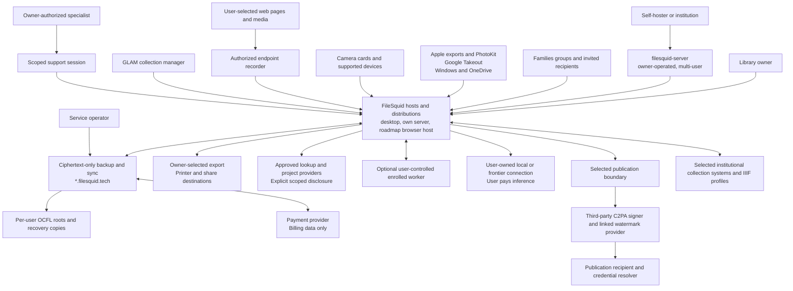

Source providers are migration inputs, not continuing authorities for destination deletion or subscription status. The source remains untouched. The operator of an owner-run `filesquid-server` can read the files it stores; that is a stated deployment property, not a leak. The ciphertext-only service at `*.filesquid.tech` may learn account identifiers, authorized membership, opaque object IDs, sizes, timing and necessary billing/traffic records. It does not receive private titles, locations, face names, recipes, embeddings, HTTP evidence or original hashes in plaintext. Deliberately disclosed publication claims and BYO AI inputs have separate recipient, purpose and retention records; they do not expand ordinary storage permissions.

Print orders, external editors, OS sharing, lookup/translation, BYO AI, public galleries and paid C2PA publication are owner-chosen disclosure boundaries. Each operation previews its selected content, destination and metadata policy, using saved bounded grants where applicable. Private HTTP evidence can contain authorization headers, cookies and uploaded bodies; it is never automatically included in those outputs. Paying for family or non-family group storage does not grant the payer a member's keys. Anonymous gallery access does not grant access to private library objects.

## 3. Functional/Logical Viewpoint (ISO 42010)

### 3.1 Logical Architecture

**Component view.** FileSquid has three layers: distributions (UI only), hosts, and the API with its modules ([ADR 029](./architecture/029-filesquid-unified-product-and-distributions.md)). Storage sits below the modules; the ciphertext-only hosted service is a separate deployment with its own dependency graph ([ADR 032](./architecture/032-hosting-and-privacy-model.md)).

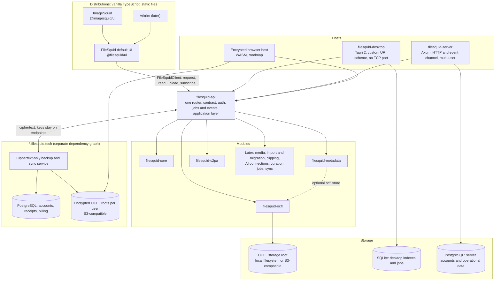

| Layer | Components | Responsibilities | MUST NOT |
|---|---|---|---|
| Distributions | `@filesquid/ui` (default; component library: `FileSquidClient`, `<fs-app-shell>`, `<fs-file-browser>`, `<fs-metadata-panel>`, `<fs-credentials-panel>`, …), `@imagesquid/ui`, later Arkrim | Views, design tokens (light and dark), label table keyed by internal names, brand, `distribution.json` | Contain backend code; call anything except the API |
| API | `filesquid-api` | One versioned contract (OpenAPI 3.1, generated TypeScript types, drift test); transport-agnostic router; authentication and authorisation; jobs and events; distribution manifest; application layer (catalog, search, replica, FileSquid OCFL application profile) | Link Tauri host APIs, libvips, FFmpeg or a SQLite driver; do storage I/O itself; return raw paths or SQL |
| Hosts | `filesquid-desktop`, `filesquid-server`, roadmap browser host | Bind the router to a transport; inject storage backends; OS integration (desktop); accounts and static UI (server) | Re-implement API meaning |
| Modules | `filesquid-core`, `-ocfl`, `-metadata`, `-c2pa`, later modules | Shared contracts; storage facts; every other file fact; Content Credentials; later capabilities ([C-055](./product-vision.md#module-rules)) | Take a default dependency on another module or on any UI |
| Storage | OCFL root (local or S3-compatible); SQLite (desktop); PostgreSQL (server, hosted service) | Canonical accepted state in OCFL; rebuildable indexes and operational data in databases | Treat a database row as durable completion |
| Hosted service | `*.filesquid.tech` | Ciphertext storage and relay, key authorisation, fenced head publication, receipts, accounts and billing | Link modules that process private plaintext; parse OCFL; hold library keys ([T-054](./product-vision.md#api-and-hosts)) |

**Functional modules.** The diagram below shows the functional responsibilities inside the API and modules at an authorised endpoint (desktop, an owner-run server, or the browser host), and the operated service boundary of `*.filesquid.tech`. Labels are logical ownership boundaries; each becomes a FileSquid module crate or a part of the application layer as the implementation plan schedules it.

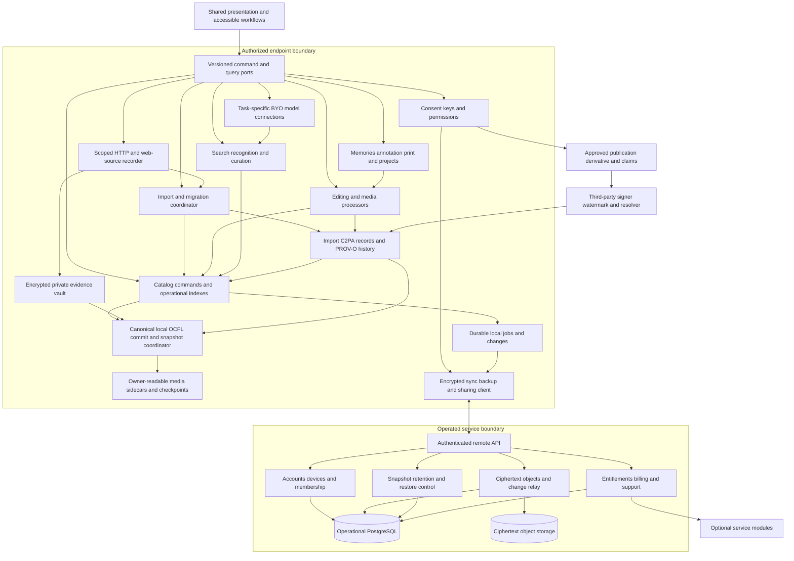

**Module responsibilities and interfaces.** Labels below are logical ownership boundaries, not a requirement to create one deployable service per feature.

| Module | Owns | Explicit interfaces and invariants |
|---|---|---|
| Catalog | Domain commands, operational indexes of libraries/assets/metadata/relationships, pending changes and availability | Transactional commands/query pages; coordinates canonical file commits before durable completion and can rebuild committed state without the operational database |
| Import/Migration | Source inventory, adapter capabilities, staged extraction, matching, reconstruction and reports | `inventory`, `readResource`, `readCollections`, `refreshAuthorization`, `reconcileSource`; free self-service batch tooling retains completed work, reads source only and never issues source delete |
| Source Capture/Evidence | User-invoked capture scope, complete observed request/response exchanges, context extraction and completeness | `startCapture`, `appendExchange`, `sealCapture`, `readEvidence`; dedicated encrypted evidence handles, never telemetry payloads or credential replay |
| Provenance/C2PA (`filesquid-c2pa`) | Resource-bound import/history records, retained-transformation PROV-O graphs, immutable signed credentials and collection scan reports, implemented by the from-scratch `filesquid-c2pa` module ([ADR 026](./architecture/026-filesquid-provenance-engine.md)) | `beginImportRecord`, `appendAction`, `validateCredential`, `prepareClaims`, `scanCollection`, `exportScanReport`; free bounded resumable scans, explicit coverage/trust state and disclosure-safe reports |
| Preservation | Canonical local OCFL files, per-user hosted roots, asset versions, collection snapshots and independent recovery | `prepareVersion`, `commitVersion`, `verifyPackage`, `restoreSnapshot`; durable completion follows canonical commit; readable local and encrypted hosted profiles preserve required metadata/evidence/envelopes |
| Publication | In-app approved derivatives/claims, third-party C2PA signing, linked watermarking and resolution verification | `preparePublication`, `submitPublication`, `verifyPublishedOutput`; desktop/browser review, progress, permitted recovery and output retrieval; both credential and watermark outcomes required when selected |
| AI Connections | User-owned endpoint/authentication, task/model bindings, capability evidence, bounded requests, and standing/per-job disclosure | `listModels`, `probeTask`, `runTask`; direct user payment, explicit destination changes and no funded fallback; results are proposals to domain commands; configuration shows standing copy plus inspectable **How AI Connections work**; a new remote job previews destination, extra hop, file count, image size, metadata policy and payer |
| Media/Editing | Decode, orientation/color, immutable recipes/versions, previews, photo/video/audio and capture-specific operations | `probeCapabilities`, `renderVersion`, `exportResource`; isolated worker inputs include allowed handles, byte/time budgets and engine/model versions |
| Metadata (`filesquid-metadata`) | Extract from OCFL logical files; namespaced CRUD; create/enhance Dublin Core and Schema.org; canonical `metadata.md` (YAML front matter); the append-only import file record `file-record.md` of source-system and host facts ([ADR 038](./architecture/038-import-file-record.md)); persist through `filesquid-ocfl` | `extractFromOcfl`, `assertStatement`, `readStatements`, `suggestSchemaTerm`, `commitToOcfl`; stand-alone FOSS module; runs behind `filesquid-api` on the desktop, on `filesquid-server` and (as WASM) in the browser host, never in the ciphertext-only hosted service ([ADR 025](./architecture/025-client-side-filesquid-engines.md), [ADR 032](./architecture/032-hosting-and-privacy-model.md)); distributions reach it only through the API |
| Discovery/Curation | OCR, semantic/face/pet indexes, visual lookup, subject extraction, identity corrections, Trips and saved-query evaluation | Local index queries and scheduled analysis; consent and access filtering precede result/suggestion generation |
| Presentation/Projects | Memory/slideshow timelines, soundtracks, markup objects, print layouts and provider projects | Reuses catalog references/rendering; deleting a project retains source assets; partner submission requires explicit approval |
| Privacy/Identity | Local unlock, enrolled devices, key hierarchy, consent and signed access records | Distinguishes authenticated account, unlocked content and permission; no hidden operator key escrow |
| Exchange/Protection | Encrypted change exchange, resumable transfers, key envelopes, conflicts, snapshot creation and restore verification | Applies verified authorized operations idempotently; never equates a synced tombstone with deletion of independent backups |
| Hosted Control | Accounts, public device keys, sessions, membership permissions and protocol compatibility | Deny-by-default authorization, signed membership transitions and audit correlation; no private-content querying |
| Hosted Transport/Recovery | Ciphertext receipts, confirmed parts, immutable encrypted manifests, cursors, retention and garbage collection | Commit acknowledgments describe durability level; no plaintext decode, search, thumbnail or AI worker |
| Billing/Service | Plans, usage, payment events, retention terms, service notices and customer-authorized support | Provider-event idempotency, payer/access separation, cancellation does not revoke local functionality |
| Platform/Extension adapters | Cameras, PhotoKit, placeholders, file access, OS sharing/picker, external editor, print and companion pairing | Scoped capability handles, validated return formats, explicit provenance, no unrestricted catalog/path access |
| Institutional interoperability within Platform/Publication | Selected collection-system and IIIF profiles, professional metadata mappings, institutional batch publication and service terms | Versioned import/exchange/delivery contracts with per-item outcomes and explicit authorization; no implied support for every IIIF API or institutional identity system |
| Compatibility/Diagnostics | Platform-format-model register, release evidence, redacted diagnostics and update compatibility | Capability answers drive visible UI states; aggregate parity cannot conceal unavailable child features |

**Institutional boundary.** F-047 commits later GLAM DAM workflows separately from the consumer baseline. Selected collection-system and IIIF profiles declare supported import, metadata/rights mappings, export or authorized delivery, unsupported/lossy fields and per-item outcomes. Professional task evidence and partnership/funding gates determine implementation scope. Batch C2PA/watermark publication reuses the scoped output pipeline with resumable item receipts; no institutional grant implicitly exposes private originals or HTTP evidence. Billing provides an annual institutional subscription option with explicit usage, support, cancellation and export terms, without assumed prices/contracts. This does not imply institutional SSO or replace optional professional galleries.

**Optional service boundary, modeled as enabled.** F-035 adds service modules without changing the private-content boundary: an assistance case tracks scope and owner-reviewed evidence; NAS management connects to a user-owned destination through a scoped agent; multi-destination assurance verifies independent encrypted snapshot copies and scheduled restore exercises; extended retention pins snapshots under published terms; physical seeding/restore uses encrypted media and custody manifests; priority support consumes reviewed redacted diagnostics; supporter payments grant no private access; professional galleries add branding, selections and encrypted guest intake to the existing gallery model. Trusted-contact/inheritance releases owner-created recovery envelopes only under an agreed opt-in trigger and authorization policy, never through an operator override. Each module has its own entitlement, consent, billing evidence and cancellation state; leaving it disabled leaves the core application intact. Self-service bulk migration/upload tooling, local OCFL, metadata controls and collection scans/reports remain free; paid hosted capacity/transport, sync/preservation operations and human assistance have separate terms, with no artificial local performance throttling.

### 3.2 Frontend Architecture

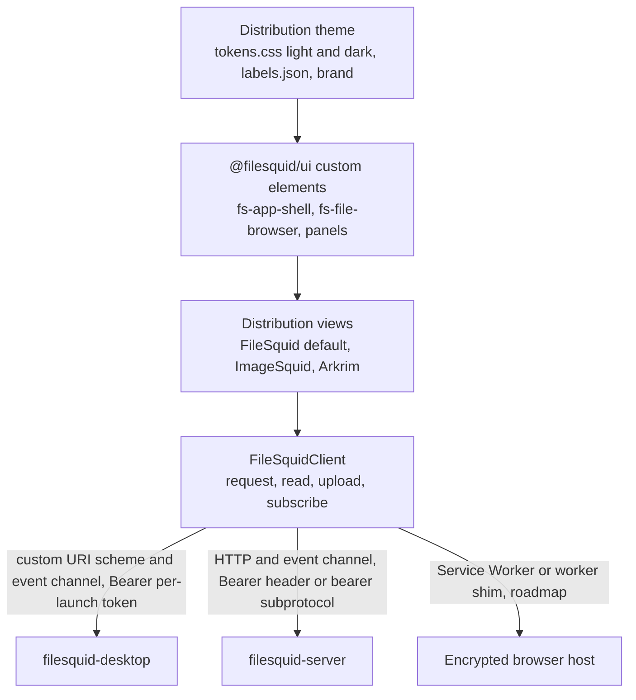

**Vanilla TypeScript and custom elements.** Every UI is vanilla TypeScript (strict) compiled with Vite, with standard custom elements and no UI framework ([ADR 031](./architecture/031-vanilla-typescript-ui-and-white-label-theming.md), superseding [ADR 003](./architecture/003-svelte-client-rendered-ui.md) and the UI packages of [ADR 028](./architecture/028-filesquid-ui-packages-and-panel-composition.md)). `@filesquid/ui` (`apps/filesquid/ui`) holds the API client, the custom elements and the default Drive-style app; `@imagesquid/ui` (`apps/imagesquid`) depends on it and supplies ImageSquid views, tokens, labels and brand. Components are styled only through design tokens (CSS custom properties named after the existing Arkrim token scheme, light and dark) and worded only through a label table keyed by internal names. A unit test fails when a distribution's label table misses a default key or its token file misses a default token. One small, documented state and event pattern keeps vanilla TypeScript from turning into an ad-hoc framework.

**Composable panels.** The default browser `<fs-file-browser>` shows storage facts (paths, versions, agents, digests, size) and exposes named sidebar and preview slots. `<fs-metadata-panel>` and `<fs-credentials-panel>` provide the Metadata and Content Credentials panels; Details and Versions panels show storage facts. Every file fact has one owner ([C-055](./product-vision.md#module-rules)); panels never depend on each other. ImageSquid composes the same panels in its inspector and keeps its own photo views, Source panel, wording and theme.

**One client, every host.** `FileSquidClient` exposes `request()`, `read()`, `upload()` and `subscribe()` and hides which transport answered: the Tauri custom URI scheme plus the event channel on desktop, same-origin HTTP plus the event channel on `filesquid-server`, and later a Service Worker or worker shim in the browser host ([ADR 030](./architecture/030-filesquid-api-and-transports.md)). With a known token it sends `Authorization: Bearer <token>` on every request. WebSocket upgrades accept that header too, for clients that can set it; a browser cannot, so the client offers the ordered subprotocols `filesquid.events.v1` then `filesquid.bearer.<token>` instead; the token is the desktop's per-launch token or, on `filesquid-server`, the one the operator supplies, kept in memory only, and a denial reaches views with its reason (`missing_credentials`, `invalid_credentials`, `not_permitted`) ([UI-S-014](../apps/filesquid/ui/resources/srs.md)). Media elements cannot send that header, so `` and `<video>` previews load `/api/v1/content/<handle>` with a short-lived, read-only content handle for one file version, minted by an authenticated request; a handle is not a token, expires after 300 idle seconds or 60 minutes, ends with the credential that minted it and is never logged ([ADR 030](./architecture/030-filesquid-api-and-transports.md) Decision 5, [API-S-018](../apps/filesquid/crates/api/resources/srs.md)). The UI shows which host it is connected to and who can read files there ([FileSquid U-20](./product-vision.md#one-api-hosts-and-distributions)).

**Framework and state.** Settings for AI Connections MUST show standing disclosure and an inspectable **How AI Connections work** explanation; a newly authorised remote job MUST use a preview overlay with Confirm and Cancel ([F-045](./prd.md#f-045-byo-ai-connections-and-per-task-model-choice)). Domain state resides behind the API; ephemeral focus, selection, viewport, playhead and unsaved control interaction remain presentation state. Commands use operation IDs and return committed state or explicit pending/error/conflict states. UI state is never treated as durable completion evidence.

The private application is client-rendered. `filesquid-server` delivers static application assets and the API, without rendering private metadata into HTML. If public or account pages use server rendering, their serialised state excludes private content and must pass the same production DOM checks. Virtualised lists retain stable keys, accessible semantics and focus; queries page by stable cursors rather than materialising a million-item result. Selection of all results is a frozen query/revision plus exceptions, with its count and scope shown before a batch action.

**Useful images and continuous navigation.** Supported thumbnail/viewer paths MUST paint a correct available display derivative before refining quality; navigation cannot wait for whole-library generation or repeatedly decode full originals. Bounded prefetch prepares items before and after the viewport and upcoming slideshow images, adapting to direction, size, availability and resource pressure. Jumps, reversals, sort/filter changes and permission changes cancel obsolete speculation and reject stale results. Ordering, focus and selection remain stable; a failed or unavailable slide is visible rather than silently skipped. Placeholders do not count as useful-image readiness. Prepared-image coverage, cache-miss readiness and final-quality readiness are measured separately under the budgets in [7.1](#71-scalability-constraints).

**Desktop.** The Tauri 2 host owns SQLite connections, scoped native file handles, secure key storage, durable workers and platform adapters ([ADR 002](./architecture/002-tauri2-desktop-shell.md), amended by [ADR 030](./architecture/030-filesquid-api-and-transports.md)). It serves `filesquid-api` in-process through a custom URI scheme (`filesquid://localhost/api/...`; `http://filesquid.localhost/api/...` on Windows) with no TCP listener, guarded by a per-launch token. The webview gets opaque handles and API responses, not arbitrary filesystem paths or SQL execution. One binary serves every distribution through a Tauri config overlay. Trusted application assets are packaged; remote pages do not inherit privileged IPC. Tauri uses different native webviews, so codec, canvas, color, input and layout support require real platform validation. Universal CSS and function parity are required; pixel-identical screenshots are not. [Tauri process model](https://v2.tauri.app/concept/process-model/).

**Browser and mobile web.** Through `filesquid-server`, the browser is an ordinary client of the same API. In the roadmap encrypted browser host (phase F5), an unlocked browser downloads encrypted catalog/index pages and authorized ciphertext media, decrypts locally (WebCrypto and WASM for envelopes, hashes, replica queries and the `filesquid-ocfl`/`filesquid-metadata` engines; [ADR 008](./architecture/008-browser-wasm-scope.md), [ADR 025](./architecture/025-client-side-filesquid-engines.md)), and maintains a bounded browser replica in encrypted caches. Browser storage is never canonical: the browser host commits OCFL versions to the encrypted hosted root. Supported basic edits use workers and available browser media APIs; optimized previews permit useful viewing independently of RAW decoding. Encrypted metadata/index shards enable client-side search without sending plaintext queries or embeddings to PostgreSQL. Initial index download can be incomplete: the UI displays indexed/accessible coverage, pending shards and unsupported semantic models. Signed client-generated index snapshots accelerate bootstrap; the browser can rebuild supported indexes from authorized metadata/content.

An ordinary browser session must unlock, browse, organize, search accessible supported content and export available originals while every desktop is off. Advanced RAW, 10-bit HDR, depth, large video, audio separation or generative work runs locally only when the declared runtime budget and codec/model support pass. Otherwise it shows unavailable or an explicit task waiting for a chosen enrolled worker or supported user-selected external service. It cannot silently disclose plaintext to compensate for browser limits. A precomputed advanced rendition can still be viewed in its supported browser format. Paid publication is a separate explicit output workflow, not a replacement for private browser rendering.

Mobile web supplies the precise focused operations in F-036, including supported Live Photo playback, memory requests, simple presentation/markup/trim work and migration/protection review. Its installable PWA includes a manifest, explicit install/update flow and scoped offline cache on supported browsers. Foreground uploads may resume after reacquiring user source access; suspended/closed browsers do not promise continued local work. Offline preview selection and storage quotas are visible. Lock/logout clears decrypted memory/object URLs and session secrets; persistent private caches remain encrypted or are removed according to the chosen shared-device policy. Service-worker cache updates respect schema/version boundaries. The product does not claim reliable continuous mobile camera backup.

**Media interaction contract.** The same versioned recipe represents composition, six selective-color samples, tone, curves/levels/histogram, color/monochrome/detail, filters, retouch and markup controls. The native and browser render implementations are checked against shared fixtures; they need not execute identical code to meet the declared tolerances. Copy/paste explicitly excludes Photos-incompatible crop/retouch/red-eye/extension categories by default. Video tools apply supported whole-clip changes and time-based edits; still-only tools are absent from video workflows. Resource probes distinguish capture-aware styles, Portrait/Cinematic/audio capabilities and generic effects.

**Accessibility and privacy presentation.** Keyboard alternatives accompany drag/reorder/brush controls. Screen-reader labels, focus recovery, reduced motion, contrast, text scaling and locale/RTL layouts are first-class component contracts. Hidden/deleted filtering is applied to every collection, suggestion, memory, preview and notification. Activity retention, location disclosure, analysis and notification preferences are accessible independently of subscriptions. OS dialogs/biometrics strengthen local view unlock but are not advertised as encrypting an otherwise ordinary local library.

**Source, evidence and publication workflows.** Save-to-FileSquid (or Save-to-ImageSquid in that distribution) context-menu actions, explicit URL capture and source-supplied file imports enter the common import coordinator. Source & History distinguishes observed page/media/request/final URLs, supplied URLs, source-claimed creator/license/dates, acquired bytes, transformations and missing evidence. A link, screenshot, poster or remux is labeled as its actual result. Later enrichment preserves the initial observation and creates another event. Metadata enrichment failure cannot discard verified media; an incomplete history remains visible.

**Metadata inspection and correction.** The metadata panel combines a readable effective-value view with the original namespaced fields and their extraction provenance. It shows contradictory values, unknown units/zones, malformed or unsupported fields and whether a value is observed, inferred or owner-corrected. Single/batch date, location, caption, rights and keyword changes preview affected assets, preserve prior values and support undo. Effective accepted values feed collections, virtual collections, search and chronology; collection membership remains a catalog relationship rather than an invented embedded tag. Local inspection and ordinary corrections require no cloud AI connection.

Descriptive-metadata controls create, inspect, edit and remove `dcterms:` statements (and confirmed `schema:` overflow and statements in registered extension namespaces) for a single file or a bounded selected batch. They distinguish owner assertions from extracted source metadata, show namespace prefixes, list populated keys only, and expose supported search and saved-query operators. Statements persist in resource-bound versioned sidecars and participate in the same undo, recovery and outgoing privacy rules; unrecognized extracted fields are preserved rather than silently discarded. Keys in an undeclared namespace are not accepted; extension namespaces (for example RiC-O, or an owner-declared custom namespace for free key:value pairs) are registered in `filesquid-metadata` first ([ADR 022](./architecture/022-dublin-core-descriptive-metadata.md)).

Metadata changes normally create application overlays and versioned sidecars. The export preview distinguishes private archival originals, metadata-updated private copies and sharing/publication derivatives. Free privacy controls let the user enable/disable scrubbing and choose EXIF or native-video fields to retain; they show scope, expected retained/removed values, any required remux/re-encoding and C2PA consequences. The default enables scrubbing with no user-selected retained fields. Disabled mode is visibly unsanitized and never earns a clean-metadata claim. A saved rule applies only to its named route/audience scope; users can inspect or override it for an individual operation, and explicit changes create a new policy revision. Failed or incomplete verification of an enabled policy blocks that route and offers a supported derivative or an explicit policy change, never automatic disabling. Clearing a catalog value or adjacent sidecar does not establish removal from media bytes.

The full HTTP recording route starts before the selected acquisition and shows its page/session/network scope, sensitive capture behavior and finite byte/time limits. Saved user grants can avoid repetitive prompts within that scope; capturing unrelated browsing is outside it. The owner can inspect encrypted raw exchanges separately from a safe source summary. Evidence rendering disables active HTML/scripts and automatic remote loads, conceals secret values on locked/ordinary surfaces, and never retries a captured POST, uses stored cookies, or opens an authenticated URL merely to display history. User-directed evidence export previews its sensitive content and recipient; normal media/publication exports use a separately constructed disclosure projection.

Every imported asset displays its C2PA record even offline: prepared/unsigned, preserved signed credential with dated validation status, or verified published/watermarked output. Import time is not represented as original camera capture. Unsupported embedding retains a resource-bound record and supported sidecar path; it never suppresses record initialization. The paid action shows the exact derivative, claims, third-party recipients, watermark changes, price/terms and disclosure before submission. Success requires verifying the returned signed bytes and linked watermark/resolver result; provider failure remains pending/failed rather than silently producing a signature-only substitute.

Collection-wide provenance/C2PA scans are free, user-invoked bounded jobs with visible scope, progress, cancellation/resumption and exportable item/summary results. They distinguish missing credentials, prepared records, binding failures, unavailable checks and trust outcomes at a stated validation time/policy. Coverage includes inaccessible, incomplete and failed items. A scan does not rewrite originals or sign claims; exported reports apply the chosen disclosure policy and exclude private HTTP secrets by default.

The complete paid publication workflow MUST be available inside supported desktop and browser applications: select output, review price/claims/disclosure, submit, inspect progress, cancel or retry where permitted, inspect validation and retrieve retained outputs. Scoped authentication/payment handoffs return to the app. An external provider website alone does not satisfy this contract. Institutional batches reuse the workflow with per-item authorization, progress and outcomes under F-047.

**Specialized media processing contracts.** The capability probe supplies a nonempty supported baseline for every committed operation. Render jobs pin source resources, recipe schema, engine/model, color/output settings and budgets; approved outputs become linked immutable derivatives. The following contracts describe completed processing responsibilities, not just preservation:

| Capability | Required inputs | Recipe and processing | Outputs and unsupported fallback |
|---|---|---|---|
| RAW/ProRAW and RAW+JPEG | Original sensor/capture resource, camera profile, embedded orientation/color and pair association | Selected editing original, versioned development/demosaic path, white balance and tonal/color graph; deliberate reprocessing keeps prior approved render | Developed still and chosen export profile/bit depth; exact RAW export remains possible when development is unsupported |
| Cleanup and face obscuring | Decodable still, user/suggested mask and selected local model; face regions for obscuring | Mask refinement, fill/inpaint generation or explicit pixelation, preview and accepted output with original-preserving history | New still derivative and retained edit provenance; failed generation remains unapplied, while supported deterministic obscuring can remain available |
| Capture-aware styles | Decodable still plus understood capture/style auxiliary data | Style selection/replacement with tone/color parameters, then versioned style transform in the render graph | Styled derivative with interpretation status; generic filters are separately labeled when capture metadata cannot be interpreted |
| Portrait/refocus/lighting | Still, understood depth/disparity and calibration/focus or subject data | Effect toggle, selected focus plane/subject, blur/depth parameter and supported lighting transform before output color conversion | Re-rendered portrait with original auxiliary resources retained; flat source appearance is viewable but not claimed refocus-capable without the required data |
| Live/motion and effects | Associated still/video/audio components, timing and key-frame association | Time trim, chosen frame, motion/sound flags, Loop repeated segment, Bounce forward/reverse timing, Long Exposure multi-frame integration and applicable photo graph | Updated motion presentation, still or eligible GIF; incomplete pairs remain partial and cannot pass a complete motion-render test |
| Video/HDR/slow motion | Decodable clip, stream timebase, frame rate, color-transfer/bit-depth metadata and audio tracks | Non-destructive in/out, poster selection, time-remap/slow ranges, whole-clip tone/crop/filter graph; encode under declared HDR/SDR output contract | Rendered clip plus extracted stills; unsupported codec/HDR paths retain original and identified compatible preview, never silent HDR loss |
| Cinematic focus/depth | Video frames, understood per-time depth/focus track and subject/point associations | Effect toggle, focus keyframes, held-distance/automatic/manual selection, depth blur and audio choices evaluated along the timeline | Rendered clip with editable focus recipe; flattened source rendition when auxiliary interpretation is unavailable, explicitly a compatibility gap |
| Audio Mix equivalents | Supported spatial/multichannel/source audio and timing; any required visual/subject context | Original, in-frame emphasis, noise/reverberation reduction or dialogue/environment mix, with intensity and mute; synchronize processed audio with video | Encoded audio/video streams and preserved original sound; ordinary stereo enhancement is labeled separately from capture-dependent spatial interpretation |
| Annotation and companion input | Still/version, authenticated companion strokes, text/style and image-description fields | Editable vector-like annotation objects, shape recognition preference, pressure samples, text/shapes/highlights/magnifier/stickers and composition | Flattened selected image export with independent description policy; unsupported pressure/companion paths retain standard keyboard/pointer alternatives |
| Memories/slideshows/print projects | Authorized asset versions, timeline/layout objects, selected licensed/local soundtrack and provider specifications | Curation followed by editable sequencing, timing/transitions/looks/text or paginated print layout; render only selected references | Playable/exported presentation, print-ready pages/PDF or approved provider payload; missing resources/rights stop the affected export with a repair action |

External-editor output enters as a new rendition/version after validation, not as a claim to understand the editor's private history. Capture-specific controls require compatible fixtures proving input interpretation, recipe replay, visual output and export; preserving opaque auxiliary bytes alone cannot satisfy these contracts.

### 3.3 Backend Architecture

**Local runtime.** A Rust domain host (`filesquid-desktop` over `filesquid-api`) with SQLite and bounded out-of-process media/inference workers is the accepted desktop backend ([ADR 001](./architecture/001-shared-rust-core-with-tauri-and-axum-hosts.md), [ADR 002](./architecture/002-tauri2-desktop-shell.md), [ADR 005](./architecture/005-sqlite-local-postgres-hosted.md)). Beyond the scaffold it is not yet implemented. One library coordinator serializes pending commands and canonical OCFL commits, updates operational indexes and leases durable jobs; read snapshots feed the UI. `filesquid-server` runs the same coordinator in the same `filesquid-api` application layer against its own OCFL root, and the roadmap browser host runs it as WASM against the encrypted hosted root; writers to one hosted root are fenced by head compare-and-swap ([ADR 025](./architecture/025-client-side-filesquid-engines.md)). Canonical commit receipts determine durable collection completion, independently of database job progress. Resource operations explicitly name their side effects. A headless mode can power the same migration engine or a user-controlled enrolled worker without requiring the visible window. It retains task state on shutdown and closes files, connections, requests and child processes on success, cancellation and failure.

Metadata adapters reuse the isolated media-worker boundary instead of adding a cloud service. They receive read-only resource handles for extraction and a separate new-output handle for authorized writing. Parser processes have no general filesystem or network authority; namespace/field count, packet size, recursion, embedded-preview expansion and execution time have finite budgets. Metadata text is untrusted data and cannot become shell arguments, executable markup, remote XML/JSON-LD loads or AI instructions. A malformed extraction returns a retained failure observation while leaving the verified original usable. Native-write and verification capabilities are tested separately from extraction support.

**Recorder boundary.** Full HTTP evidence requires a purpose-built native recorder/proxy with authorized browser instrumentation, or another tested route that observes the complete declared exchanges. A context-menu URL, ordinary download event or sanitized HAR alone cannot establish full request/response coverage. The supported full route records selected browser/form/API/upload traffic before acquisition, streams bodies to encrypted evidence storage and identifies each observed protocol hop. Capture sessions use isolated permissions and an explicit routing policy; if an interception certificate/profile is required, it is scoped to that authorized session and removed with its owned resources. The application does not silently alter the system trust store or intercept unrelated applications. Exact recorder technology and browser/HTTP coverage require an ADR and synthetic end-to-end fixtures; they are not reasons to label a metadata-only adapter complete.

Browser instrumentation alone has known gaps: CDP's `Network.getRequestPostData` omits uploaded files from multipart data and `Fetch.getResponseBody` excludes redirect responses. The recorder must supply those bytes through a validated route or mark the capture incomplete with a reason. A later refetch is a new request/observation, never reconstructed historical evidence. HTTP/2 or HTTP/3 protocol data may be normalized by a recording layer; preserve the observed representation and transformation/hop metadata instead of claiming unavailable wire bytes. [CDP Network](https://chromedevtools.github.io/devtools-protocol/tot/Network/#method-getRequestPostData), [CDP Fetch](https://chromedevtools.github.io/devtools-protocol/tot/Fetch/#method-getResponseBody).

**BYO model connections.** A focused task/connection module supports user-run Ollama/llama.cpp and user-owned frontier access. OpenAI-compatible Chat Completions is the interoperability baseline; Responses, embeddings/model discovery and native/specialist adapters are distinct capability profiles. Models are configured explicitly when discovery is absent. Advertised metadata plus synthetic probes establish image input, schema/tools, dimensions and actual limits; model listing alone does not. Dedicated face/pet embeddings and clustering keep their own contracts. Local failure, quota exhaustion or provider refusal pauses work unless a previously authorized route fits; no FileSquid-funded account exists. Credentials bind to a destination and cannot follow a changed base URL automatically. [Ollama compatibility](https://docs.ollama.com/api/openai-compatibility), [llama.cpp server](https://github.com/ggml-org/llama.cpp/tree/master/tools/server), [OpenAI Responses](https://developers.openai.com/api/docs/guides/migrate-to-responses).

LiteLLM may implement adapters or be a user-operated endpoint. Its Python SDK/proxy is not a required additional desktop service until packaging and maintenance justify it. The configuration UI MUST treat that endpoint as one OpenAI-compatible destination among others and MUST disclose it as an extra hop when it is remote. Standing disclosure, the inspectable **How AI Connections work** explanation, and the per-job overlay are required product copy ([F-045](./prd.md#f-045-byo-ai-connections-and-per-task-model-choice), [FE-067](./product-vision.md#ai-the-user-chooses)); they are not LiteLLM's own UI. Supported account-login runtimes remain distinct from generic API credentials; a compatibility adapter does not confer subscription entitlement. User limits are advisory unless enforced by the chosen provider; unsupported caps/parameters are exposed rather than silently advertised as enforced. The module records provider/model/revision and selected disclosure, returns structured proposed changes, and leaves permission/revision validation, preview, execution and undo to the catalog. Embedding indexes are partitioned by model/revision/dimensions/preprocessing, with a new index built before switching incompatible models. [LiteLLM overview](https://docs.litellm.ai/docs/), [account/runtime distinction](https://learn.chatgpt.com/docs/auth).

**Server runtime.** `filesquid-server` is an Axum binary on Tokio that mounts the `filesquid-api` router, serves the selected distribution's static UI (`FILESQUID_UI_DIR`), keeps users, groups, sessions and other operational data in PostgreSQL (SQLx) and stores files in a local or S3-compatible OCFL root ([ADR 030](./architecture/030-filesquid-api-and-transports.md), [ADR 032](./architecture/032-hosting-and-privacy-model.md)). It is multi-user from the start: personal and group-owned libraries and collection-level permissions are checked on every call. Its operator can read the files it stores, and the UI says so. Blocking native media work runs in bounded workers, never on the Tokio runtime.

**Hosted runtime.** The ciphertext-only service at `*.filesquid.tech` (formerly the ImageSquid.app mailbox, [ADR 004](./architecture/004-axum-hosted-ciphertext-mailbox.md) as amended by ADR 032) is a separate Axum binary with its own dependency graph: accounts, devices, encrypted change relay, ciphertext object sessions, fenced head publication, receipts, retention and billing. It compiles hosted-safe types only (envelopes, opaque IDs, job protocol, ciphertext transport). It MUST NOT compile `filesquid-ocfl`, `filesquid-metadata`, `filesquid-c2pa`, the `filesquid-api` read paths over private plaintext, or libvips/FFmpeg, MUST NOT parse OCFL and MUST NOT hold library keys; CI fails the build if such a crate enters its graph, and Cargo features are not the boundary ([T-054](./product-vision.md#api-and-hosts), [FileSquid U-30](./product-vision.md#one-api-hosts-and-distributions), [U-31](./product-vision.md#one-api-hosts-and-distributions)). Hosted jobs are Rust plus PostgreSQL, not Oban. Phoenix, LiveView and FastAPI are rejected as parallel application backends.

**API style and consistency.** One versioned FileSquid API exposes every feature: browse, details, versions, ranged content, upload, rename/move/remove/restore as OCFL versions, metadata properties, credentials, jobs and events, users, groups and permissions, and the distribution manifest. The contract is owned by `filesquid-api` (OpenAPI 3.1, generated TypeScript types, a drift test). The desktop serves it through the custom URI scheme; `filesquid-server` serves it over HTTP; both use one event channel chosen in ADR 030. The hosted service exposes its own versioned HTTPS routes for accounts/devices, ciphertext object sessions, encrypted change batches/cursors, snapshots and entitlements, called by `filesquid-api` on the owner's endpoints. Contracts define schema/protocol version, operation/idempotency key, expected revision, permitted scope, bounded page/batch size, error code and retryability. Event-channel notifications carry opaque change/job hints; clients reread durable state after disconnect. There is no correctness dependency on receiving each live notification.

Transfer sessions accept only bounded ciphertext chunks/parts and opaque metadata. OAuth provider secrets live on the initiating authorized endpoint for plaintext migration routes; the hosted service is not a hidden source downloader. Selected resource exports, print submissions and external editor round trips have separate permissioned APIs. Incoming extension results pass size/schema/hash checks before registering a new version. All account/membership changes are authorized in the service and verified through signed content-access records on clients.

| Domain API | Contract and trust scope |
|---|---|
| Capture session/exchange | User grant, recorder profile/version, selected request graph, opaque session/exchange IDs, start/end, completeness and bounded streaming body handles; raw headers/bodies never enter ordinary control payloads |
| Import/provenance action | Import operation/resource digest, source relationship, prepared claim schema and action inputs/outputs; atomic resource registration and record creation, idempotent append-only events |
| OCFL commit/checkpoint | Stable object/version, expected prior head, content receipts and inventory/digest pair; serialized recoverable commit and signed collection snapshot referencing completed versions |
| Evidence read/export | Separate unlocked evidence capability, exact scope and owner-selected destination; raw archive access is independent of ordinary media sharing permissions |
| Publication job | Frozen derivative/version, approved claim projection, provider/price/terms, consent revision and idempotency key; only selected output handles and disclosure-safe claims reach the third party |
| Publication status/result | Provider operation ID, immutable returned bytes, signed manifest/validation report, watermark identifier/resolution outcome and failure/retention receipt; callback authentication and client validation precede success |
| AI task | Connection/model/task revision, required capabilities, bounded input handles, disclosure grant and limits; outputs become validated proposals, with direct user payment |
| Metadata extraction/correction | Immutable input resource digest, extractor/mapping version and field namespace/path; correction commands use expected catalog revision, per-field intent and provenance, with bounded batch scope and undo |
| Metadata export/verification | Frozen source/version, private-archive versus sharing/publication purpose, policy revision/scope, enabled/disabled scrub mode and explicit retained fields, native/sidecar profile and permitted codec/container operations; independent output readback returns expected retained/removed fields, stream results, C2PA status and explicit loss/unsupported outcomes |
| Custom field definition/value | Stable namespace/field ID, supported type/schema revision, expected asset/definition revision, bounded batch selection and collision policy; resource-bound sidecars preserve unknown fields and provide supported search operators |
| Collection provenance scan | Frozen or explicitly incremental scope/revision, validation time/trust policy, bounded checkpoint/cursor and item outcomes; disclosure-scoped report export and completed-work reuse, without signing or original mutation |
| Institutional exchange/delivery | Selected collection-system/IIIF profile and version, source/target identifiers, reversible metadata mappings, rights/access projection and per-item outcomes; explicit operation authorization and service terms |

Publication adapters cannot access the evidence vault or library unwrap keys. An isolated FileSquid publication coordinator may transiently stage the selected output only when its explicit authorization names that recipient/processing step; a direct client-to-provider path can avoid that staging. Both paths enforce deletion/retention terms and use separate credentials/queues from private preservation. Provider callbacks reference a job, not arbitrary library object paths.

**Workspace layout.** These paths exist after the product switch (crates not yet created are marked):

| Workspace | Contents | Dependency contract |
|---|---|---|
| `apps/filesquid/` | Product-local Cargo workspace (`Cargo.toml`, one `Cargo.lock`, `rust-toolchain.toml`); crates under `crates/{core,ocfl,metadata,c2pa,api,server,desktop}/`, each with `resources/{plan,srs}.md`, `resources/tasks/` and `tests/` | Module crates build, test and publish alone (`cargo test -p <crate>`); no root `Cargo.toml` |
| `apps/filesquid/ui/` | `@filesquid/ui`: `FileSquidClient`, custom elements, theme defaults, the default app; `tests/{unit,ui,e2e,features}/` | Consumed by distributions by path in development and by published version for release |
| `apps/imagesquid/` | `@imagesquid/ui`: views, theme, labels, brand, `distribution.json`, Tauri overlay; ImageSquid vision, PRD, SRS and plan; photo Gherkin | No Rust and no API code; extractable |
| `apps/arkrim/` (later) | Arkrim dashboard distribution | Same as ImageSquid |
| Hosted-service crate (planned, SV-F4.1) | Ciphertext-only `*.filesquid.tech` service | Separate dependency graph with a CI gate |
| `scripts/docs/` (repository tooling, not a workspace) | Traceability, ADR validator, requirement-coverage, task-ID and link checks; documentation-task records in `resources/tasks/` | Documentation only |

Distributions and the hosted service consume FileSquid through the published API contract and packages, not checkout-relative imports, once released. Root Compose remains centralised for backing services and the `filesquid-server` container; Tauri is never containerised.

**Complete requirement allocation.** Each row names a responsible boundary and a design location. These are architecture allocations, not implemented/tested claims; future SRS and test links must be bidirectional and item-specific. Optional and conditional requirements retain the PRD's activation/capability semantics.

| Requirement | Responsible component | Design allocation |
|---|---|---|
| [F-001 — Independent local library and ownership](./prd.md#f-001-independent-local-library-and-ownership) | Catalog; Privacy | [4.2 Database Decisions](#42-database-decisions) — Account-optional local authority and portable ownership |
| [F-002 — Safe file, folder and device import](./prd.md#f-002-safe-file-folder-and-device-import) | Import/Migration; Platform | [4.1 Data Architecture](#41-data-architecture) — Verified import, native device adapters and restartable source copies |
| [F-003 — Browsing, selection and viewing](./prd.md#f-003-browsing-selection-and-viewing) | Presentation; Media | [3.2 Frontend Architecture](#32-frontend-architecture) — Virtualized accessible grid, selection, viewer and playback |
| [F-004 — Collections, folders and navigation](./prd.md#f-004-collections-folders-and-navigation) | Catalog; Presentation | [4.1 Data Architecture](#41-data-architecture) — Folder/album hierarchy, ordered memberships and navigation preferences |
| [F-005 — Favorites, metadata and keywords](./prd.md#f-005-favorites-metadata-and-keywords) | Catalog; Privacy | [4.1 Data Architecture](#41-data-architecture) — Favorites, keywords, technical metadata and provenance-preserving corrections |
| [F-006 — Virtual collections and metadata search](./prd.md#f-006-virtual-collections-and-metadata-search) | Discovery; Catalog | [3.2 Frontend Architecture](#32-frontend-architecture) — Local metadata search and versioned saved-query rules/index coverage |
| [F-007 — Automatic and activity collections](./prd.md#f-007-automatic-and-activity-collections) | Discovery/Curation; Privacy | [3.1 Logical Architecture](#31-logical-architecture) — Media, activity and generated collections with visibility/analysis controls |
| [F-008 — Deletion, hidden files and duplicate review](./prd.md#f-008-deletion-hidden-files-and-duplicate-review) | Catalog; Privacy | [6.2 Security Measures](#62-security-measures) — Hidden/deleted policy, recoverable duplicates and orphan review |
| [F-009 — Multiple libraries and filesystem administration](./prd.md#f-009-multiple-libraries-and-filesystem-administration) | Catalog; Platform | [4.2 Database Decisions](#42-database-decisions) — Multiple libraries, referenced files, safe relocation/repair and volume identity |
| [F-010 — Export and portable backup](./prd.md#f-010-export-and-portable-backup) | Media; Protection | [4.1 Data Architecture](#41-data-architecture) — Versioned export and complete portable resource/catalog snapshots |
| [F-011 — Non-destructive editing workflow](./prd.md#f-011-non-destructive-editing-workflow) | Media/Editing | [3.2 Frontend Architecture](#32-frontend-architecture) — Immutable recipes, undo/revert, branches and explicit copy exclusions |
| [F-012 — Composition and tonal/color editing](./prd.md#f-012-composition-and-tonalcolor-editing) | Media/Editing; Presentation | [3.2 Frontend Architecture](#32-frontend-architecture) — Composition, tone/color, histogram and six selective-color controls |
| [F-013 — Detail, filters, retouch and RAW](./prd.md#f-013-detail-filters-retouch-and-raw) | Media/Editing | [8. Technology Decisions Summary](#8-technology-decisions-summary) — Finishing/retouch plus RAW-pair engine/camera and rendering contracts |
| [F-014 — AI-assisted cleanup and styles](./prd.md#f-014-ai-assisted-cleanup-and-styles) | Media/Editing; Discovery | [6.2 Security Measures](#62-security-measures) — Endpoint AI cleanup/styles with reversible provenance and safe exported obscuring |
| [F-015 — Portrait, depth, Cinematic and spatial media](./prd.md#f-015-portrait-depth-cinematic-and-spatial-media) | Media/Editing; Compatibility | [4.1 Data Architecture](#41-data-architecture) — Depth/focus/spatial resources and capability-gated processing |
| [F-016 — Live Photos, bursts and motion images](./prd.md#f-016-live-photos-bursts-and-motion-images) | Media/Editing; Catalog | [4.1 Data Architecture](#41-data-architecture) — Coherent motion/burst resources, versions and partial-pair states |
| [F-017 — Video and audio editing](./prd.md#f-017-video-and-audio-editing) | Media/Editing | [3.2 Frontend Architecture](#32-frontend-architecture) — Video/audio clip and time controls, HDR and format-specific tool sets |
| [F-018 — Markup and companion annotation](./prd.md#f-018-markup-and-companion-annotation) | Projects; Platform | [3.2 Frontend Architecture](#32-frontend-architecture) — Editable annotation operations, descriptions and authorized companion input |
| [F-019 — People, pets and groups](./prd.md#f-019-people-pets-and-groups) | Discovery; Catalog | [4.1 Data Architecture](#41-data-architecture) — Identity regions, corrections, rejections and editable groups |
| [F-020 — Semantic search, OCR and visual understanding](./prd.md#f-020-semantic-search-ocr-and-visual-understanding) | Discovery; Privacy | [5.2 CI/CD Pipeline](#52-cicd-pipeline) — Local OCR/semantic/video indexes, lookup/subject actions and relevance corpus |
| [F-021 — Places, Trips and curation controls](./prd.md#f-021-places-trips-and-curation-controls) | Discovery/Curation; Privacy | [3.1 Logical Architecture](#31-logical-architecture) — Places/Trips grouping, inference provenance and location disclosure |
| [F-022 — Memories and storytelling](./prd.md#f-022-memories-and-storytelling) | Projects; Discovery; Media | [3.1 Logical Architecture](#31-logical-architecture) — Memory timelines/generation, licensed music and suppression preferences |
| [F-023 — Slideshows, printing and photo projects](./prd.md#f-023-slideshows-printing-and-photo-projects) | Projects; Media; Platform | [3.1 Logical Architecture](#31-logical-architecture) — Saved slideshows, print/PDF layouts and authorized product adapters |
| [F-024 — System sharing and extension interfaces](./prd.md#f-024-system-sharing-and-extension-interfaces) | Platform/Extension adapters | [3.3 Backend Architecture](#33-backend-architecture) — Scoped system sharing, external-editor versions and extension contracts |
| [F-025 — Migration selection, inventory and pilot](./prd.md#f-025-migration-selection-inventory-and-pilot) | Import/Migration | [4.1 Data Architecture](#41-data-architecture) — Scope/preflight, durable inventory, ambiguous matching and representative pilot |
| [F-026 — Migration preservation and reconstruction](./prd.md#f-026-migration-preservation-and-reconstruction) | Import/Migration; Catalog | [4.1 Data Architecture](#41-data-architecture) — Raw preservation/provenance and cross-part relationship reconstruction |
| [F-027 — Migration execution, recovery and reconciliation](./prd.md#f-027-migration-execution-recovery-and-reconciliation) | Import/Migration; Protection | [4.1 Data Architecture](#41-data-architecture) — Checkpointed extraction/transfer/verification and complete reconciliation |
| [F-028 — Supported migration routes](./prd.md#f-028-supported-migration-routes) | Platform/Source adapters | [4.1 Data Architecture](#41-data-architecture) — Apple/Google/Microsoft route contracts, placeholders and optional direct APIs |
| [F-029 — Client encryption and key custody](./prd.md#f-029-client-encryption-and-key-custody) | Privacy/Identity | [6.1 Authentication Flow](#61-authentication-flow) — Endpoint key hierarchy, enrollment, recovery, authenticated encryption and revocation |
| [F-030 — Personal synchronization and availability](./prd.md#f-030-personal-synchronization-and-availability) | Exchange; Catalog | [4.2 Database Decisions](#42-database-decisions) — Encrypted replica availability, causal conflicts, eviction and tombstone epochs |
| [F-031 — Encrypted backup and verified restore](./prd.md#f-031-encrypted-backup-and-verified-restore) | Exchange/Protection; Recovery | [4.2 Database Decisions](#42-database-decisions) — Independent snapshots, verified protection and isolated clean-device restore |
| [F-032 — Accounts, entitlements, billing and cancellation](./prd.md#f-032-accounts-entitlements-billing-and-cancellation) | Billing; Hosted Control | [3.1 Logical Architecture](#31-logical-architecture) — Operational entitlements/accounting and cancellation with local ownership intact |
| [F-033 — Shared albums and hosted galleries](./prd.md#f-033-shared-albums-and-hosted-galleries) | Exchange; Privacy; Hosted Control | [6.1 Authentication Flow](#61-authentication-flow) — Recipient galleries, comments/contributions and explicit public bearer access |
| [F-034 — Family/group accounts and shared libraries](./prd.md#f-034-family-accounts-and-shared-libraries) | Exchange; Privacy; Billing | [4.2 Database Decisions](#42-database-decisions) — Private/shared library keys, contribution, departure and payer/access separation |
| [F-035 — Optional service extensions](./prd.md#f-035-optional-service-extensions) | Optional service modules | [3.1 Logical Architecture](#31-logical-architecture) — Enabled assistance/NAS/assurance/contact/physical/supporter/professional boundaries |
| [F-036 — Browser and mobile-web experience](./prd.md#f-036-browser-and-mobile-web-experience) | Presentation; Browser services | [3.2 Frontend Architecture](#32-frontend-architecture) — Independent installable PWA, focused mobile operations and visible lifecycle limits |
| [F-037 — Setup, updates and diagnostics](./prd.md#f-037-setup-updates-and-diagnostics) | Platform; Compatibility/Diagnostics | [5.2 CI/CD Pipeline](#52-cicd-pipeline) — Automatic initialization, signed updates, schema rollback and redacted diagnostics |
| [F-038 — Open interfaces and product exit](./prd.md#f-038-open-interfaces-and-product-exit) | Contracts; all module owners | [3.3 Backend Architecture](#33-backend-architecture) — Versioned replaceable interfaces, exportable packages and complete product exit |
| [F-039 — Consent, notifications and activity privacy](./prd.md#f-039-consent-notifications-and-activity-privacy) | Privacy; Presentation; Operations | [6.2 Security Measures](#62-security-measures) — Consent, private notification defaults, activity retention and optional analytics |
| [F-040 — Compatibility and parity register](./prd.md#f-040-compatibility-and-parity-register) | Compatibility/Diagnostics | [5.2 CI/CD Pipeline](#52-cicd-pipeline) — Nonempty supported capability sets and item-level evidence/limitations register |
| [F-041 — Source-aware web clipping and HTTP evidence](./prd.md#f-041-source-aware-web-clipping-and-http-evidence) | Source Capture/Evidence; Provenance | [4.1 Data Architecture](#41-data-architecture) — Complete private exchanges, PROV-O observations/claims and honest acquisition gaps |
| [F-042 — OCFL preservation and portable recovery](./prd.md#f-042-ocfl-preservation-and-portable-recovery) | Preservation; Privacy; Recovery | [4.2 Database Decisions](#42-database-decisions) — Canonical owner-readable local roots, separate ciphertext hosted profile, full collection snapshots and independent reconstruction |
| [F-043 — Import-time C2PA records and action disclosure](./prd.md#f-043-import-time-c2pa-records-and-action-disclosure) | Import; Provenance; Media | [4.1 Data Architecture](#41-data-architecture) — Free resource-bound records, retained PROV-O transformations, immutable prior credential continuity and resumable collection reports |
| [F-044 — Paid C2PA publishing and watermarking](./prd.md#f-044-paid-c2pa-publishing-and-watermarking) | Publication; Privacy; Billing | [6.1 Authentication Flow](#61-authentication-flow) — Approved output/claims, third-party signing, mandatory linked watermark and verification |
| [F-045 — BYO AI connections and per-task model choice](./prd.md#f-045-byo-ai-connections-and-per-task-model-choice) | AI Connections; Discovery; Catalog; Presentation | [3.3 Backend Architecture](#33-backend-architecture) — User-funded endpoints, capability profiles, task bindings, standing/per-job disclosure and reviewable portable results |
| [F-046 — Media metadata inspection, correction and privacy exports](./prd.md#f-046-media-metadata-inspection-correction-and-privacy-exports) | Metadata adapters; Catalog; Media; Provenance; Preservation | [4.1 Data Architecture](#41-data-architecture) — Exact extraction, normalized corrections, OCFL sidecars and independently verified photo/video privacy outputs |
| [F-047 — Institutional DAM and IIIF interoperability](./prd.md#f-047-institutional-dam-and-iiif-interoperability) | Platform/Institutional interoperability; Metadata; Publication; Billing | [3.3 Backend Architecture](#33-backend-architecture) — Selected collection-system/IIIF contracts, professional metadata mappings, scoped batch publication and institutional service boundary |
| [F-048 — Later hosted private OSS inference](./prd.md#f-048-later-hosted-private-oss-inference) | AI Connections; Billing; Privacy | [3.3 Backend Architecture](#33-backend-architecture) — Later optional OSS inference on FileSquid-operated GPUs with quota limits, separate from the mailbox after verified encrypted preservation |
| [F-049 — Product component terminology and item type](./prd.md#f-049-product-component-terminology-and-item-type) | Catalog; all module owners | [4.1 Data Architecture](#41-data-architecture) — Repository, library, collection, virtual collection, virtual exhibit and file |
| [F-050 — FileSquid platform and distributions](./prd.md#f-050-filesquid-platform-and-distributions) | API; all modules; Platform | [3.1 Logical Architecture](#31-logical-architecture) — One product, three layers (distributions, hosts, API with modules); first consumer release ([ADR 029](./architecture/029-filesquid-unified-product-and-distributions.md)) |
| [F-051 — OCFL module](./prd.md#f-051-ocfl-module) | Preservation; Platform | [4.2 Database Decisions](#42-database-decisions) — Generic OCFL 1.1 module and library; the FileSquid application profile is a caller; later optional Parquet projection |
| [F-052 — Metadata module](./prd.md#f-052-metadata-module) | Metadata; Preservation | [3.1 Logical Architecture](#31-logical-architecture) — Stand-alone metadata CRUD through pluggable stores, `ocfl` store canonical in FileSquid |
| [F-053 — Virtual exhibit](./prd.md#f-053-virtual-exhibit) | Catalog; Presentation; Privacy | [4.1 Data Architecture](#41-data-architecture) — Public curator query across libraries and repositories |
| [F-054 — C2PA module](./prd.md#f-054-c2pa-module) | Provenance/C2PA | [3.1 Logical Architecture](#31-logical-architecture) — From-scratch C2PA read, validate, mint, edit, embed and scan ([ADR 026](./architecture/026-filesquid-provenance-engine.md)) |
| [F-055 — Default UI and panel composition](./prd.md#f-055-default-ui-and-panel-composition) | Distributions; Presentation | [3.2 Frontend Architecture](#32-frontend-architecture) — Drive-style browser and slotted Details, Versions, Metadata and Content Credentials panels as custom elements |
| [F-056 — Single FileSquid API](./prd.md#f-056-single-filesquid-api) | API | [3.3 Backend Architecture](#33-backend-architecture) — One versioned contract, transport-agnostic router, event channel ([ADR 030](./architecture/030-filesquid-api-and-transports.md)) |
| [F-057 — Desktop and server hosts](./prd.md#f-057-desktop-and-server-hosts) | Hosts | [3.4 Hosts, Data Flow and Privacy Boundaries](#34-hosts-data-flow-and-privacy-boundaries) — Custom-URI-scheme desktop; multi-user `filesquid-server`; roadmap browser host |
| [F-058 — White-label distributions](./prd.md#f-058-white-label-distributions) | Distributions; API | [3.2 Frontend Architecture](#32-frontend-architecture) — Tokens, label tables, brand, view modules and module sets; one binary per host ([ADR 031](./architecture/031-vanilla-typescript-ui-and-white-label-theming.md)) |
| [F-059 — Hosted encrypted backup and sync service](./prd.md#f-059-hosted-encrypted-backup-and-sync-service) | Hosted service; Exchange/Protection | [3.4 Hosts, Data Flow and Privacy Boundaries](#34-hosts-data-flow-and-privacy-boundaries) — Ciphertext-only `*.filesquid.tech` with its own dependency graph ([ADR 032](./architecture/032-hosting-and-privacy-model.md)) |
| [F-060 — Archival curation jobs and datasets](./prd.md#f-060-archival-curation-jobs-and-datasets) | Curation jobs; Preservation | [7.1 Scalability Constraints](#71-scalability-constraints) — Durable versioned curation jobs, Parquet projection and FAIR reports behind the API; Arkrim dashboard |
| [NFR-001 — Preservation and transactional integrity](./prd.md#nfr-001-preservation-and-transactional-integrity) | Catalog; Import/Migration | [4.1 Data Architecture](#41-data-architecture) — Original hashes, atomic/reconciled registration and zero false-complete records |
| [NFR-002 — Benchmark envelope and responsiveness](./prd.md#nfr-002-benchmark-envelope-and-responsiveness) | Presentation; Catalog; Discovery | [7.1 Scalability Constraints](#71-scalability-constraints) — Large-library and 100 GB/250 GB streamed input envelope; latency targets |
| [NFR-003 — Bounded processing and migration endurance](./prd.md#nfr-003-bounded-processing-and-migration-endurance) | Job coordinators; Media | [7.1 Scalability Constraints](#71-scalability-constraints) — Exact staging, reserve, concurrency, attempts, memory and soak budgets |
| [NFR-004 — Security and privacy](./prd.md#nfr-004-security-and-privacy) | Privacy; all boundaries | [6.2 Security Measures](#62-security-measures) — Authorization, crypto review, hostile input and redacted telemetry |
| [NFR-005 — Recovery and service reliability](./prd.md#nfr-005-recovery-and-service-reliability) | Protection; Hosted Recovery | [5.1 Infrastructure Architecture](#51-infrastructure-architecture) — Protected resource associations and separately bounded control-plane disaster recovery |
| [NFR-006 — Accessibility and usability](./prd.md#nfr-006-accessibility-and-usability) | Presentation; Platform | [3.2 Frontend Architecture](#32-frontend-architecture) — Accessible keyboard/screen-reader workflows and built DOM validation |
| [NFR-007 — Compatibility, rendering and localization](./prd.md#nfr-007-compatibility-rendering-and-localization) | Media; Compatibility; Presentation | [7.1 Scalability Constraints](#71-scalability-constraints) — Golden color tolerance, capture/runtime fixtures and locale/RTL behavior |
| [NFR-008 — Maintainability and verified engineering](./prd.md#nfr-008-maintainability-and-verified-engineering) | All workspace owners | [5.2 CI/CD Pipeline](#52-cicd-pipeline) — Small documented code, bounded resources, isolated reports and verified commands |
| [NFR-009 — Observability and capacity economics](./prd.md#nfr-009-observability-and-capacity-economics) | Operations; Billing | [7.2 Observability & Monitoring](#72-observability--monitoring) — Stdout-only redacted events, metrics/traces and measured recurring costs |
| [NFR-010 — Accurate public claims](./prd.md#nfr-010-accurate-public-claims) | Product operations | [7.2 Observability & Monitoring](#72-observability--monitoring) — Accurate migration-scope, encryption, provider/geography and cancellation claims; hypotheses distinguished from measured results |
| [TC-001 — Immutable originals and explicit identity](./prd.md#tc-001-immutable-originals-and-explicit-identity) | Catalog; Import/Migration | [4.1 Data Architecture](#41-data-architecture) — Immutable originals and separate logical/source/storage/version identities |
| [TC-002 — Endpoint processing and hosted encryption](./prd.md#tc-002-endpoint-processing-and-hosted-encryption) | Privacy; Browser; Hosted Control; Publication | [6.1 Authentication Flow](#61-authentication-flow) — Encrypted private preservation, independent browser keys and explicitly scoped publication/BYO disclosure |
| [TC-003 — Platform and provider limits](./prd.md#tc-003-platform-and-provider-limits) | Platform; Compatibility | [4.1 Data Architecture](#41-data-architecture) — Provider, browser, capture and codec contracts verified per supported version |
| [TC-004 — Decision status and repository alignment](./prd.md#tc-004-decision-status-and-repository-alignment) | Architecture governance | [8. Technology Decisions Summary](#8-technology-decisions-summary) — Hypothetical model, current repository reality and explicit proposed ADR gaps |
| [TC-005 — Shared Rust graph, hosted mailbox isolation and OCFL writer](./prd.md#tc-005-shared-rust-graph-hosted-mailbox-isolation-and-ocfl-writer) | Preservation; Job isolation; Hosted Control | [3.3 Backend Architecture](#33-backend-architecture) — Isolated native Rust OCFL writer, hosted-safe mailbox modules only, and scoped failure containment |

### 3.4 Hosts, Data Flow and Privacy Boundaries

The same `filesquid-api` router runs in every host; what differs is the transport, the storage, and who can read the files ([ADR 030](./architecture/030-filesquid-api-and-transports.md), [ADR 032](./architecture/032-hosting-and-privacy-model.md)).

| Host | Transport to the UI | Storage | Who can read the files | Delivery |
|---|---|---|---|---|
| `filesquid-desktop` (Tauri 2) | API in-process through a custom URI scheme (`filesquid://localhost/api/...`; `http://filesquid.localhost/api/...` on Windows); event channel per ADR 030; per-launch token; no TCP port | Owner-readable local OCFL root; SQLite indexes and jobs | Only the owner, on their device | FileSquid release 1 (phase F3) |
| `filesquid-server` (Axum) | HTTP plus the event channel on a TCP port; serves the selected UI's static files | Local or S3-compatible OCFL root; PostgreSQL accounts, groups and operational data | The owner and whoever operates that server (self-hosters, families, institutions) | FileSquid release 1 (phase F3) |
| `*.filesquid.tech` ciphertext service | HTTPS routes called by `filesquid-api` on the owner's endpoints (not by UIs directly) | Encrypted OCFL root per user on S3-compatible storage; PostgreSQL accounts, receipts and billing | Only the owner: the service stores ciphertext and never holds library keys | Phase F4, before the ImageSquid release |
| Encrypted browser host (roadmap) | Same API as WASM in the browser behind a Service Worker or worker shim | The encrypted hosted root; bounded encrypted browser cache (never canonical) | Only the owner, in their browser | Phase F5 |

**Data flow: desktop.** The distribution UI calls `FileSquidClient`, which issues requests to the custom URI scheme. `filesquid-desktop` passes each request to the `filesquid-api` router in process. The router authorises the per-launch token, then calls the modules: `filesquid-ocfl` reads and commits versions in the local root through the local-filesystem backend, `filesquid-metadata` reads and writes `metadata.md` through its `ocfl` store, `filesquid-c2pa` validates and records credentials. Indexes and job checkpoints go to SQLite and reconcile to OCFL commit receipts. Events (job progress, changes) reach the UI over the event channel. Nothing leaves the device unless the owner enables backup or sync.

```mermaid
sequenceDiagram
    participant UI as Distribution UI
    participant C as FileSquidClient
    participant D as filesquid-desktop (custom URI scheme)
    participant A as filesquid-api
    participant M as Modules (ocfl, metadata, c2pa)
    participant R as Local OCFL root
    participant Q as SQLite indexes and jobs
    UI->>C: upload(file)
    C->>D: PUT filesquid://localhost/api/v1/... (per-launch token)
    D->>A: Route request in process
    A->>A: Authorise, start durable job
    A->>M: Stage, commit version, extract metadata, init C2PA record
    M->>R: Write vN content, version inventory, root inventory last
    R-->>M: Commit receipt
    A->>Q: Update indexes from receipt
    A-->>C: Committed result; progress over event channel
    C-->>UI: Render committed state
```

**Data flow: `filesquid-server`.** The browser loads the selected distribution's static UI from the server and calls the API over HTTP with a session. `filesquid-api` checks the user's group and collection permissions on every call, then drives the same modules against the server's OCFL root (local disk or S3-compatible with head compare-and-swap). PostgreSQL holds accounts, groups, sessions and rebuildable operational indexes; the OCFL root remains canonical and readable without the server. Events reach each signed-in browser over the event channel.

**Data flow: encrypted backup and sync (`*.filesquid.tech`).** On the desktop or an owner-run server, `filesquid-api` encrypts content, metadata and manifests with library keys that never leave the owner's endpoints, then uploads immutable ciphertext units to the hosted service and publishes encrypted OCFL versions to the user's hosted root, fenced by head compare-and-swap. The service records receipts, relays encrypted change batches between enrolled devices, keeps independent backup recovery points and bills by quota. Restore goes to an isolated destination and is verified before it is offered.

**Data flow: encrypted browser host (roadmap).** The browser downloads the static UI and the WASM build of `filesquid-api` with the `ocfl` and `metadata` modules, unlocks key material locally, reads and commits the encrypted hosted root directly, and keeps a bounded encrypted cache. Changes stay visibly pending until the fenced head publication succeeds.

**Privacy boundary per host.** Each UI states which host it is connected to and who can read files there ([FileSquid U-20](./product-vision.md#one-api-hosts-and-distributions)). A plaintext `filesquid-server` is a deliberate deployment type for people who run their own server; it does not weaken the `*.filesquid.tech` promise, which stays ciphertext-only. Private-library processing defaults to authorised endpoints: the desktop, an owner-run `filesquid-server`, or the encrypted browser host ([T-001](./product-vision.md#client-processing-and-hosted-mailbox)). The owner MAY authorise selected inputs to their own AI provider or the paid C2PA publisher; those grants do not give backup operators access to keys or unrelated content ([T-003](./product-vision.md#client-processing-and-hosted-mailbox)).

| Boundary | Inside | Outside, never by default |
|---|---|---|
| Desktop | Plaintext library, keys in OS secure storage, SQLite, workers | Network, unless backup, sync, AI or publication is enabled |
| `filesquid-server` | Plaintext library of its users, server-side indexes, the operator's administrative access | Other servers; `*.filesquid.tech` sees only ciphertext from it |
| `*.filesquid.tech` | Ciphertext, opaque IDs, sizes, timing, account and billing records | Library keys, plaintext names, metadata, previews, embeddings, HTTP evidence, original hashes |
| Browser host | Decrypted working set in the unlocked tab and workers | The service operator; other tabs after lock/logout |

## 4. Information/Data Viewpoint (ISO 42010)

### 4.1 Data Architecture

```mermaid
erDiagram
    Repository ||--o{ Library : hosts
    Library ||--o{ File : contains
    File ||--o{ FileResource : associates
    Resource ||--o{ FileResource : supplies
    File ||--o{ FileVersion : versions
    FileVersion ||--o{ RecipeOperation : describes
    FileVersion ||--o{ Derivative : renders
    Resource ||--o{ Derivative : stores
    Library ||--o{ Collection : organizes
    Collection ||--o{ CollectionMembership : includes
    File ||--o{ CollectionMembership : referenced_by
    Library ||--o{ VirtualCollection : queries
    Repository ||--o{ VirtualExhibit : curates
    VirtualExhibit ||--o{ VirtualExhibitMembership : includes
    File ||--o{ VirtualExhibitMembership : referenced_by
    File ||--o{ MetadataValue : describes
    SourceRecord |o--o{ MetadataValue : provenance
    File ||--o{ IdentityRegion : depicts
    Identity ||--o{ IdentityRegion : identifies
    MigrationJob ||--o{ SourceRecord : inventories
    SourceRecord ||--o{ SourceResource : enumerates
    SourceResource ||--o{ TransferCheckpoint : resumes
    Library ||--o{ ChangeOperation : changes
    ChangeOperation ||--o{ Conflict : retains
    File ||--o| Tombstone : deletes
    Library ||--o{ BackupSnapshot : protects
    BackupSnapshot ||--o{ SnapshotEntry : references
    Resource ||--o{ SnapshotEntry : preserves
    Library ||--o{ Project : presents
    Project ||--o{ ProjectItem : sequences
    FileVersion ||--o{ ProjectItem : uses
    File ||--o{ C2PARecord : records
    C2PARecord ||--o{ ProvenanceAction : appends
    C2PARecord ||--o{ CredentialArtifact : retains
    CaptureSession ||--o{ HTTPExchange : observes
    HTTPExchange ||--o{ EvidenceResource : preserves
    SourceRecord ||--o{ ProvenanceBundle : explains
    EvidenceResource ||--o{ ProvenanceBundle : supports
    File ||--o{ PreservationVersion : packages
    BackupSnapshot ||--o{ PreservationVersion : selects
    FileVersion ||--o{ PublicationJob : publishes
    PublicationJob ||--o{ CredentialArtifact : returns
    PublicationJob ||--o| WatermarkBinding : resolves
```

The diagram is the logical decrypted model at an authorized endpoint. It is not a plaintext cloud database schema. Each library owns a private namespace. Newly generated domain IDs are RFC 4122 / RFC 9562 UUID version 4 ([ADR 021](./architecture/021-uuid-v4-identifiers.md)), stored as lowercase 8-4-4-4-12 hexadecimal with hyphens. They do not encode capture dates or file paths. One logical **file** can contain original still/motion, RAW/JPEG, depth, spatial audio, source adjustment and source-rendered resources. Multiple source records can legitimately refer to identical bytes without becoming one file. A user or group MAY own more than one library on a repository. A collection belongs to exactly one library. A virtual collection belongs to exactly one library. A virtual exhibit belongs to a user on a repository and MAY span public collections across libraries and other repositories. Distributions word these through their label tables: ImageSquid MAY label a file photo, image or video, a collection an album, a virtual collection a gallery, and a virtual exhibit an exhibit. Primary chrome uses **Archives** for the preservation store. Collection skim origin labels are **AI** or **RW** (Real World). The Content Credentials pin MAY remain **CR**.

| Record family | Essential fields and ownership |
|---|---|
| Repository | One FileSquid installation (a desktop, a `filesquid-server` or a hosted account); distinct from the Git source repository |
| Library | ID, schema/version, owner (user or group), local storage mode, default integration choice, volume identity, access/key epoch and retention policy. A repository MAY host several libraries |
| File / FileResource / Resource | File ID/status; resource ID/role/pair association; byte length, cryptographic hash, immutable storage identity, format/codec, integrity state and available locations. Item type is file |
| SourceRecord / SourceResource | Provider/export namespace, source ID/version, raw names/sidecars, expected bytes/checksum, adapter version, logical matching decision and destination associations |
| MetadataExtraction / MetadataValue / MetadataCorrection / CustomFieldDefinition | Immutable resource digest and raw extraction artifact; extractor/mapping/schema versions, namespace/tag/group/track path and occurrence, original representation/type/unit, normalized value/unit, source/confidence and absent/malformed/unsupported/loss state; stable custom namespace/field identity, type and schema version; overlay intent/revision, prior value, actor/time and correction provenance retain conflicts |
| MetadataExportProfile / MetadataVerification | Versioned scope/audience, enabled/disabled scrub mode, target namespaces and explicitly retained fields/values; output/sidecar and rendition scope, frozen input/correction/policy revision, permitted remux/re-encode operations, actual output hashes, independent retained/removed-field and stream checks, C2PA before/after status and per-field loss/failure results |
| FileVersion / RecipeOperation / Derivative | Parent/base versions, selected original representation, ordered operations and parameters, engine/model/profile version, render settings, output resource and approved appearance |
| Collection / Folder / Membership / VirtualCollection | Stable IDs, hierarchy, names, order keys, cover, member links and versioned Any/All expression; a collection belongs to exactly one library; a file's bytes live in exactly one collection; a virtual collection is a query inside one library. ImageSquid UI: album / gallery |
| VirtualExhibit / VirtualExhibitMembership | Stable IDs, curator repository, names, order keys, cover, member links; every member is public; MAY span libraries and other repositories; not a second store. ImageSquid UI: exhibit |
| Identity / Region / Group / AnalysisResult | Names and accepted/rejected assignments, face/pet regions or video time ranges, model version, confidence, group membership and manual corrections |
| SearchIndex / CollectionPreference / Activity | Local metadata terms, OCR, embeddings/timecodes, generated grouping, coverage/version, suppressions, retained viewing/sharing activity and consent |
| MigrationJob / JobLease / TransferCheckpoint | Stage, input/capability manifest, bounded work pages, source fingerprint, confirmed offset/part/ciphertext version, attempt count, lease fencing value, error/outcome and report |
| ChangeOperation / Cursor / Conflict / Tombstone | Operation ID, device, causal base, entity revision, encrypted payload, signature/key epoch, acknowledged cursor, concurrent alternatives and deletion/recovery state |
| BackupSnapshot / SnapshotEntry | Encrypted consistent catalog snapshot, referenced resource/version set, integrity manifest, retention/pin, destination receipts and restore coverage |
| Project / ProjectItem / Annotation | Memory/slideshow/print/provider kind, referenced asset versions, timing/layout/text/soundtrack rights, editable annotation objects and external project provenance |
| Account / Device / Membership / KeyEnvelope | Operational identity, public verification keys, enrollment/revocation state, role, membership epoch, encrypted key package and signed transitions; private keys never appear in operational rows |
| Share / Grant / Comment / Contribution | Audience scope, role, expiration, separate gallery key domain, encrypted comments/likes/activity, signed contributor operations and source-copy provenance |
| Plan / Entitlement / Usage / BillingEvent / ServiceCase | Versioned public terms, payer, storage/traffic counters, provider event/idempotency key, cancellation/deletion date and approved service scope; no private-content permission implied |
| CaptureSession / HTTPExchange / EvidenceResource | User scope, recorder/browser/protocol versions, request graph/redirect hop, ordered header fields, body resource handles/digests, time/length, evidence layer, absent/unobserved/truncated/error state and encrypted storage association |
| ProvenanceBundle / SourceClaim / ProvenanceAction | Versioned JSON-LD profile, entity/activity/agent IDs, observed versus source-asserted or user-corrected status, extraction location, inputs/outputs, event time, disclosure relevance and preserved exact serialization |
| C2PARecord / CredentialArtifact / ValidationObservation | Asset/resource binding, prepared unsigned claim/action data, parent/ingredient references, immutable signed bytes/sidecars, issuer/trust list/policy and validation time/results; prepared, signed and published status are distinct |
| PreservationRoot / PreservationVersion / CollectionSnapshot | Local or hosted root/profile, deterministic layout, OCFL object/version, SHA-256 inventory and digest over stored bytes, readable local or encrypted hosted resource/metadata associations, separately encrypted evidence envelopes, consistent library revision, canonical commit state and replica receipts. Job checkpoints remain separate from OCFL snapshots |
| PublicationJob / PublicationConsent / WatermarkBinding | Selected immutable output, approved claim projection/digest, recipient and terms, provider job/idempotency state, returned signed resource, linked watermark identifier/algorithm/version/resolver, verification evidence and cleanup outcome |
| ModelConnection / TaskModelBinding / AITaskResult | User-owned endpoint/protocol/credential reference, capabilities and limits, model/revision/task defaults, disclosure grant, input scope, proposed/accepted changes and portable result provenance; no FileSquid inference balance |
| ProvenanceScan / ScanFinding / ScanReport | Scope/revision, validation time and trust policy, bounded cursor/checkpoint, credential/binding/source outcomes, unavailable/incomplete counts and report disclosure policy; item findings never imply depicted truth |
| InstitutionalProfile / CollectionMapping / DeliveryProjection | Versioned supported system/IIIF profile, source/target identifiers, reversible mapping and loss declarations, rights/access scope, authorized output versions and per-item exchange/publication outcomes |

**Metadata fidelity and correction model.** F-046 extends F-005's catalog corrections and F-010's export contract. Every import invokes supported extraction against verified immutable resources in isolated bounded workers, recording unsupported/unreadable outcomes separately. Preserve exact extraction output and readable native packets/opaque source sidecars as versioned artifacts, linked to the original bytes; the extraction is an observation by a named tool/version, not proof that every proprietary field was understood. Namespace, group/track path, duplicate occurrence, raw type/unit/representation and mapping version survive normalization. Unknown, absent, invalid, unsupported, conflicting and lost-at-export values have different states. Re-extraction creates a new observation rather than overwriting a prior tool's result. A generic extraction JSON artifact is neither a native EXIF block nor an interoperable XMP sidecar; those representations have separate schemas and validation.

Operational events use RFC 3339 UTC. Capture time is a separate structured field: retain source text, date precision, subsecond data and offset if supplied; a date without time zone cannot be coerced to a fabricated UTC instant. Camera-clock corrections retain their explicit offset and basis. Video container/track creation times, filesystem times and actual capture-time claims remain distinct, including source-specific UTC/local-time ambiguity. The reviewed-correction → stable-ID sidecar → embedded metadata → labeled file-time fallback order follows the PRD, with every conflicting raw value retained. Unit conversion retains its source and precision; inference never fills a missing field as if extracted. Versioned correction overlays record the user's intended value or removal, not a mutation of embedded originals. They drive effective album/search/chronology/Places/Trips/camera-grouping values and have ordinary revision/conflict/undo semantics.

Photo adapters map supported EXIF, IPTC and XMP/native fields. Video adapters map supported QuickTime/MP4 container, track and timed metadata plus available XMP/sidecars; video does not universally carry EXIF. A common semantic field such as location can have multiple native encodings, so detection, safe writing and complete removal each require explicit format/namespace capabilities. Raw native values and unsupported structures remain preserved even where a normalized field or portable sidecar cannot express them. [QuickTime metadata structure](https://developer.apple.com/documentation/quicktime-file-format/metadata_atoms_and_types).

Every imported file also carries an append-only `file-record.md` in its OCFL object, committed in the same OCFL version as the imported content, or for an explicit referenced import in the OCFL version that records the reference (the record then says the bytes were referenced, not copied); import completion requires both. It holds the source-system and host facts captured at import (original name and path, filesystem timestamps, ownership, permissions, extended attributes, volume and host), with unavailable facts listed and a reason given. It is evidence, not description: it is never edited, it is not a C2PA record, and its identity fields are scrubbed from exports and shares by default ([ADR 038](./architecture/038-import-file-record.md)).

Descriptive statements are canonical versioned sidecar data, linked by stable file/resource identity rather than filenames. Each statement is `{namespace, term, value}` with namespace `exif`, `dcterms` or `schema`. The `/terms/` register is closed; unknown `dcterms:` local names are rejected; collection-domain `accrual*` terms are not authored on a file. Extracted IPTC/XMP title, creator, caption, keywords and copyright map onto the matching `dcterms:` properties for the owner-facing record. Renaming a label cannot silently change field identity or overwrite an extracted native field. Single/batch operations use expected revisions and resumable item outcomes. Export/reimport and metadata-only OCFL reconstruction retain statements and source-versus-owner assertions. Institutional standards mappings name their supported profile and expose unmapped/lossy values; arbitrary custom JSON is not automatically standards-conformant metadata ([ADR 022](./architecture/022-dublin-core-descriptive-metadata.md)).

**Verified metadata/privacy export.** Configurable EXIF and native-video metadata scrubbing is a free core capability. Every sharing/publication route applies the user's selected policy: shared albums/libraries, hosted links/galleries, native/system sharing, external recipient delivery and the selected payload sent to a third-party publisher. Enabled mode removes target EXIF and declared native-video privacy fields except fields the user explicitly chooses to retain; it supports complete EXIF removal with an empty retention list. Disabled mode deliberately skips privacy stripping and displays that consequence. A paid entitlement cannot gate these controls, and the application cannot silently change the mode to complete a failed job. Private original export, owner backup, OCFL recovery and personal-device synchronization retain originals/metadata under their separate private contracts. `dcterms:` / `schema:` statements, report sidecars and institutional projections obey the same outgoing scope; they cannot reintroduce excluded data.

The client freezes source, correction revision, policy revision and output purpose; builds a derivative; applies the chosen native and XMP/IPTC/sidecar/timed-metadata rules; then independently reopens and inspects the actual output before delivery. Verification compares both intended retained values and intended absence by namespace and does not rely on the writer's success flag. Mirrored/duplicate values, nested EXIF/GPS directories, MakerNotes, embedded previews, tracks and compound companions participate so removing one field cannot silently leave an unapproved copy elsewhere. Retaining one field does not authorize retaining an entire enclosing opaque block. Accompanying filenames, album fields, sidecars and C2PA assertions also obey the reviewed disclosure profile; they cannot silently reintroduce excluded values. Structural playback metadata and user-descriptive privacy fields have explicit format-specific treatment rather than a universal delete-all-video-tags assumption. Required orientation or other interpretation is applied before its controlling metadata is removed, with any resulting re-encoding explicit. Unknown locations that prevent establishing the enabled policy block the route, offering a supported converted derivative or a user-authorized policy change. Deleting an XMP sidecar, changing the catalog or running a blanket removal switch alone is never proof of sanitized media. A metadata privacy profile does not remove visible faces, location clues or spoken information from image/audio content; content redaction uses its own reviewed render operation.

Video metadata exports prefer a supported remux/stream-copy path without re-encoding, but do not equate that with whole-file byte identity or universal metadata preservation. Check selected encoded streams, track inventory, timing/time bases, rotation/display transforms, color/HDR signaling and required playback associations against the declared profile; changing stream selection, removing timed data or re-encoding must be explicit. Only a validated profile can claim preservation of these properties. Unavailable safe metadata updates remain sidecar-only or require a separately approved rendition. [FFmpeg stream-copy and container model](https://ffmpeg.org/ffmpeg.html#Streamcopy).

Original resources and existing signed credentials remain byte-preserved. Metadata rewriting or stripping can invalidate a prior C2PA binding: output preparation evaluates F-043, records applicable correction/export/removal actions and creates a new resource/history relationship. It does not transplant an old signature and claim it remains valid. A valid new signature requires the appropriate signer route; otherwise the resulting record remains prepared/unsigned with honest validation status. F-044 receives only the selected derivative prepared under the approved policy, performs watermarking/final binding, and returns output checked again against the retained/removed-field contract as well as credential/watermark requirements. Reintroducing an unapproved field fails an enabled policy; silently removing it after signing does not preserve the signature. Disabled-mode outputs are not labeled metadata-scrubbed. The asset's canonical local OCFL content, and its encrypted hosted counterpart when enabled, include raw extraction artifacts, normalized mappings, `dcterms:` / `schema:` statements, correction history, supported JSON/XMP sidecars, export profiles and verification evidence; exact sidecar bytes have resource/package bindings. Metadata-only corrections create F-042 versions/checkpoints and become protected only with their complete recovery associations. Full private HTTP evidence is retained under its separate contract and is never replaced by a sanitized metadata export.

**Complete private HTTP evidence.** Evidence resources retain the actual observations below, including secrets when present. This is deliberately sensitive preservation content, not an operational log schema or a header allowlist. Separate ordered header entries preserve duplicates where exposed; exact request/body bytes are distinguished from parsed forms, decoded content and normalized representations. Source URL fields preserve page/frame, selected media, actual target, observed final destination and source-declared canonical URL separately.

| Exchange side | Required recorded information within the selected capture scope |
|---|---|
| Request | Method including GET, POST and other observed methods; exact target including query; protocol version/hop; complete observed headers including Authorization, Cookie, User-Agent, Referer, Accept, Accept-Language and content negotiation; body bytes including forms, multipart file uploads, API payloads and uploaded data |
| Response | Status code and reason where the protocol exposes it; protocol version/hop; complete observed headers including Content-Type/Encoding/Length, cache controls, Date/Last-Modified, ETag, Location and Set-Cookie; body bytes including error pages and partial/failed responses |
| Exchange relationships | Redirect chain and individual hop exchanges, retry/request identity, initiator/frame/page relationships where observed, cache/service-worker origin and revalidation, selected stream/range/segment associations, start/end times and acquisition result |
| Observation coverage | Proven absence versus not observed/unsupported; body length expected/recorded; truncation or connection failure, recorder transformation, compression/decompression layer, capture start relative to page activity and versioned capability profile |

An empty body for an observed HEAD or 304 response is different from an unavailable response body; a cached representation is not invented as a new network body. The recorder retains any captured cache entity and its relationship separately. A successful verified media import may coexist with incomplete HTTP evidence, but cannot be reported as complete full-profile capture. Bounds stop or pause acquisition visibly instead of silently dropping headers or request/error bodies. Direct files precede supported streaming adapters: playlists/segments, selected variants, missing audio and remux/transcode inputs retain separate identities; a blob URL or poster is not proof of a downloaded video original. DRM limitations remain visible and are not bypassed.

**Provenance profile and dependency order.** Versioned JSON-LD uses PROV-O entities for source representations, preserved bytes and evidence; activities for retrieval/extraction/editing/validation/publication; and agents for software and attributed actors. Named bundles separate machine observations, extracted source claims and later corrections. `prov:wasAttributedTo` targets an Agent; finding an image on a page does not automatically establish `prov:hadPrimarySource`. Pin or inline contexts to avoid private-record viewing triggering network requests. Preserve the graph's exact bytes and validate semantics/required relationships, not just JSON syntax. [PROV-O](https://www.w3.org/TR/prov-o/), [JSON-LD 1.1](https://www.w3.org/TR/json-ld11/).

Every retained media or metadata transformation MUST create recoverable PROV-O inputs/outputs, actor/tool/model and version/time relationships, with applicable C2PA actions. Accepted catalog-only metadata changes preserve their metadata lineage without inventing pixel modifications. Ephemeral thumbnail/cache generation is excluded unless its output becomes a retained or disclosed resource. Edit, correction, scrub/export and undo/revert history survive reconstruction.

Build packages in acyclic order: acquired media/evidence resources → provenance sidecars and prepared C2PA data → stored content under the selected readable-local or ciphertext profile → OCFL inventory → inventory digest sidecar. A sidecar can bind stable IDs, target object/version/path and input digests, but never its own final digest or the containing inventory's digest. Later signed output is another immutable resource with its own lineage/package version; do not overwrite the bytes that existing evidence binds. Identical bytes acquired from different sources retain distinct observations even when eligible storage is reused.

**C2PA record lifecycle.** Every camera-roll, desktop, device, file, migration, web, received-share and generated-resource import creates a resource-bound record in the canonical collection commit, including free/offline and explicit referenced imports. A prepared claim/action definition is application data awaiting signing, not a valid signed C2PA manifest. Preserve any original embedded/detached credentials byte-for-byte, link the new import/action record to that prior history and record offline/unavailable trust checks explicitly. Prior source capture claims remain distinguishable from FileSquid observations; continuity never means modifying the supplied signed bytes. A source without credentials gets an import event with source uncertainty; it does not acquire a fabricated camera-capture assertion. Referenced-source mutation produces a new observation/resource identity before the associated record can apply to changed bytes.

The provenance coordinator appends disclosure-relevant actions with inputs, outputs, actor/tool/model, parameters needed for interpretation, event time and claim origin. Editing/generation, composition, metadata changes/removal, source correction, transcode, external-editor returns, undo/revert, export, watermarking and publication evaluate a versioned C2PA action policy; applicable actions enter prepared claim history even while offline. Catalog organization remains preserved without inventing pixel changes. Existing signed manifests never change in place. A new signed derivative carries appropriate ingredient/history relationships and preserves prior signed resources; restricted C2PA Update Manifests apply only when their unchanged-content/action conditions hold. Local signing may use a validated compliant credential route when available; it is neither a prerequisite to starting the record nor an assumption that an arbitrary self-signed key is accepted by C2PA tooling. Clients receive no shared test or production private signing key. Signature validity, signer trust, timestamp/revocation status, available history and depicted truth remain separate outcomes. [C2PA claims, actions and manifests](https://spec.c2pa.org/specifications/specifications/2.4/specs/C2PA_Specification.html).

**Ingestion and encryption sequence.** The same engine underlies ordinary import and migration; the cloud leg is optional. This diagram depicts managed copy import and migration. Explicit referenced import instead verifies the selected external resource, records its volume/path/fingerprint and reports its backup/availability limitations without pretending to have copied it. Source mutation marks a referenced resource changed/unavailable for its recorded identity until revalidated; consolidation uses the managed copy path before switching the reference. Migration always produces an independently copied destination rather than merely referencing provider-synchronized source files. The diagram's persistent journal/copy steps are domain state, not logging.

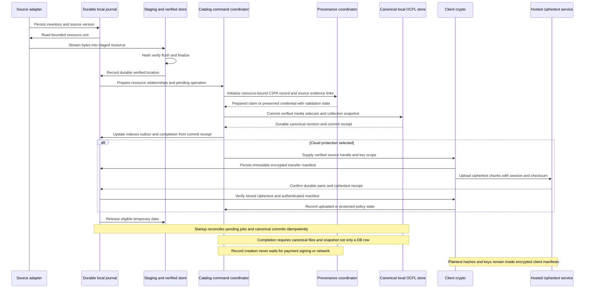

Local verification reads/hash-checks the finalized destination under the selected filesystem policy before `verified` status. Temporary files remain on the target filesystem for atomic rename when supported, and the directory/file durability contract is validated per platform. Where atomic rename is unavailable, a staged manifest plus final verification supplies a recoverable transition. Pending database commands retain operation IDs and expected canonical revisions; the coordinator commits the resource, initial C2PA record, provenance/evidence links and required collection relationships into verified OCFL versions/snapshots before reporting durable import completion. A final database transaction updates indexes, outbox and job completion from that canonical receipt. The filesystem and database are not assumed to share an atomic transaction: crash recovery reconciles committed snapshots and pending intent idempotently, rebuilding missing indexes without repeating completed media work. A crash before the canonical checkpoint leaves work visibly pending even if bytes are verified; a crash after it cannot lose acknowledged collection state when the database is absent. Failed optional enrichment is pending; failure to initialize the required record blocks import-complete status while retaining verified staged bytes. Ordinary restart uses bounded pending-job/checkpoint reconciliation, not a full-media rescan; rebuilding a lost database is a separately reported recovery operation.

Cloud uploads operate on immutable ciphertext units. The endpoint persists key/nonce/manifest state safely before resume; retries retransmit identical ciphertext. Re-encryption uses a fresh encryption context rather than reusing a nonce with changed plaintext. The server checks ciphertext length/checksums and durably commits a receipt; the client validates stored ciphertext and, in restore/full-verification paths, decrypts and checks original hashes. A transfer receipt is not the same as a protected original: the latter also requires the chosen replication/retention policy and a recoverable encrypted manifest/key route. Garbage collection cannot remove resources still referenced by an active library, unresolved conflict, retained snapshot or authorized share.

**Connector recovery contracts.** Apple export/Takeout/folder adapters preserve raw export organization and late cross-part relationships. Archive extraction enforces traversal/symlink/expanded-byte limits and may replay a compressed processing unit while skipping verified destination resources. PhotoKit inventories only authorized accessible content and requests iCloud data explicitly; its documented resource interface provides chunks without an offset resume parameter, so interrupted extraction restarts that resource. [PhotoKit resource request](https://developer.apple.com/documentation/photos/phassetresourcemanager/requestdata%28for%3Aoptions%3Adatareceivedhandler%3Acompletionhandler%3A%29), [network permission](https://developer.apple.com/documentation/photos/phassetresourcerequestoptions/isnetworkaccessallowed?language=objc).

Takeout is the Google bulk route; Picker is optional selected-item access. The Library API's app-created-content restriction prevents assuming broad existing-library access. [Google API changes](https://developers.googleblog.com/google-photos-picker-api-launch-and-library-api-updates/). Windows imports detect underlying local/OneDrive/iCloud origin, hydrate placeholders and verify bytes in a destination outside provider synchronization. Optional Graph download resumption validates source version, `206`/`Content-Range` and expected lengths on the actual download URL; a `200` full-body response must restart the unit, never append. [Microsoft Graph download contract](https://learn.microsoft.com/en-us/graph/api/driveitem-get-content?view=graph-rest-1.0). Source capability matrices version these guarantees and every report counts logical items, physical resources and relationships separately.

### 4.2 Database Decisions

**Primary databases.** SQLite is the accepted desktop operational catalog/index and durable pending-job store; `filesquid-server` uses PostgreSQL for the same operational role plus accounts and groups ([ADR 005](./architecture/005-sqlite-local-postgres-hosted.md)). It is not the sole durable authority for committed media, metadata or organization: default managed local libraries use documented owner-readable OCFL media/sidecars and collection snapshots from their first supported release, with the MVP allocation owned by the PRD. Indexes cover library/status/capture sort keys, source identity/version, resource hash, membership lookup/order, pending jobs and change cursors. Writes use short transactions under one logical writer; snapshot reads and bounded checkpoints preserve UI responsiveness. SQLite WAL requires same-host access and must not be used as a shared multi-computer network catalog. Supported attached volumes must pass locking/durability tests. NAS media/backup storage or a service running on the NAS is distinct from sharing the live database file. [SQLite WAL](https://www.sqlite.org/wal.html).

Owners MUST be able to close the app, inspect supported canonical files with ordinary tools, copy the documented committed collection and reconstruct its supported metadata/organization without the original operational database or service. Copy guidance identifies a consistent checkpoint and all referenced files. Exact HEIC/RAW/video and signed originals remain in their source formats; optional TIFF/PNG or other conversions are additional lineage-linked renditions. Referenced originals retain external-location/availability limits; unavailable remote originals and explicitly encrypted libraries require their documented retrieval/decryption route. Secret-bearing HTTP evidence stays separately encrypted even in the readable local profile. Direct access does not authorize arbitrary edits to OCFL inventories, signed resources or immutable originals; external changes require explicit verification/reconciliation.

PostgreSQL is also the accepted operational store of the ciphertext-only hosted service ([ADR 005](./architecture/005-sqlite-local-postgres-hosted.md)). There it owns accounts, authorization, key-envelope routing, ciphertext object/part receipts, signed change-envelope ordering, snapshot pointers, service jobs and billing/usage. Sensitive catalog content and HTTP evidence remain encrypted; there is no server-side private EXIF/face/OCR/vector index. Publication jobs store scoped operational status/provider receipts separately from private-library authorization. Their approved disclosed payloads have isolated staging/retention controls. Application authorization is mandatory; appropriately scoped database roles and row policies provide defense in depth, with administrative bypass behavior tested. [PostgreSQL row security](https://www.postgresql.org/docs/18/ddl-rowsecurity.html).

**Schema management.** Each workspace packages forward migrations and compatibility rules. Library upgrades verify a pre-upgrade snapshot, free capacity and supported version, then use transactional/idempotent migration steps. Failed upgrades preserve the original snapshot and produce recovery states. Older software safely refuses incompatible writes; rollback does not mean silently running an old binary against a new schema. Recipe and synchronization schemas evolve separately from database layout, preserving old approved rendered appearances when old engines are unavailable.

**Cache and index strategy.** Thumbnails, display/decoded derivatives and eligible view/search results are replaceable caches; originals, canonical metadata/history and unique source sidecars are not. Finite memory/disk caches declare item, byte and decoded-pixel limits, pinning and eviction. Keys bind library, resource/version, recipe/engine/color profile, query/sort/filter revision and permission/visibility epoch as applicable. Edits, hide/delete, membership changes, logout/lock and stale query results invalidate or deny reuse before display; cached material cannot bypass current authorization. Eviction respects active jobs and pinned offline media, and never deletes authoritative state. SQLite full-text facilities are a local metadata-search candidate; semantic indexes are replaceable endpoint-owned artifacts partitioned by library/model version. No external full-text/vector/graph service is required by default. Browser indexed storage holds encrypted catalog/index shards and selected encrypted media under quotas; decrypted working state is bounded and cleared on lock. It is a cache, never a canonical OCFL root ([ADR 025](./architecture/025-client-side-filesquid-engines.md)). Quota refusal or browser storage loss produces honest availability/recovery states and bounded regeneration. Local at-rest encryption beyond the separate evidence requirement remains an explicitly selected capability; hiding an album never promises disk encryption.

**Private evidence storage.** Full HTTP evidence is encrypted at rest even in a local-only library, with purpose-separated evidence keys and an explicit unlock policy. Raw headers/body values, credential-bearing URLs and private source graphs do not become ordinary searchable plaintext catalog columns. The catalog retains opaque references, completeness and safe display projections; secret inspection requires the evidence capability. Stream encryption prevents plaintext temporary body files. Bounded decrypted views/buffers are cleared on lock; crash reports and operating-system dump behavior are tested against the evidence threat model. The ordinary local-library at-rest caveat does not waive this evidence requirement.

**OCFL roots and objects.** Default managed local collections have documented OCFL 1.1 roots with owner-readable canonical media/metadata, asset versions and collection snapshots. Local create/version/recover is usable without paid hosting; its durability contract is foundational, not a future export-only conversion. The separate hosted preservation allocation is an independently valid encrypted root per stable opaque user ID, such as `bucket/tenants/<opaque-user-id>/ocfl/`. It is the canonical store for the encrypted browser host, written by desktop, server or browser hosts after client-side encryption. The containing shared bucket is not another OCFL root. Staging and operational files stay outside the roots. Use deterministic object layout and independently recoverable root/profile documentation. Dedicated buckets serve incompatible residency, retention or isolation requirements; bucket names alone do not authorize access. OVH currently documents 100 buckets/project by default, up to 1,000 through support; bucket-per-user scaling is not assumed. [OCFL storage roots](https://ocfl.io/1.1/spec/#ocfl-storage-root), [OVH limits](https://docs.ovhcloud.com/en/guides/storage-and-backup/object-storage/s3-limitations).

One object preserves a coherent asset's original/compound resources, required sidecars, provenance, prepared C2PA data, original and later signed credentials, recipes and selected approved renditions. The OCFL inventory `id` for a file object is `urn:uuid:` plus that file's UUID ([ADR 021](./architecture/021-uuid-v4-identifiers.md)); collection-snapshot objects use their own UUID in the same `urn:uuid:` form. Separate library snapshot objects preserve albums/order/relationships, favorites/keywords/hidden states, confirmed identities/rejected matches, accepted metadata and exact asset/package-version references. Metadata-only and source-only changes receive recoverable versions/checkpoints. Coalescing can reduce cost, but uncommitted changes remain pending. Rebuildable caches/model weights need not become permanent history; accepted corrections and information required to reproduce the supported collection do.

Metadata correction, `dcterms:` / `schema:` statements and disclosure-policy revisions are part of that recovery set, including enabled/disabled mode, route/audience scope and namespace-qualified retained fields. Sidecar associations use immutable resource IDs/digests and exact object/version paths rather than filenames alone. Restore retains the policy and its history without automatically issuing a sharing or publication job.

**Ciphertext preservation profile.** Hosted preservation and an explicitly selected encrypted local profile use this separate contract; it does not make the default owner-readable local collection ciphertext-only. OCFL inventories and digest sidecars remain readable, use opaque paths and hash stored ciphertext; original names, source URLs, full HTTP exchanges, plaintext digests and personal assertions remain encrypted content. OCFL does not itself define encryption. Publish the FileSquid cryptographic/content profile and recovery tooling so another implementation can restore it. Wrapped recovery envelopes must be obtainable with independently held owner recovery material, without first decrypting the library they unlock. Preserve per-version data-key associations; rewrapping and content re-encryption are distinct operations, and historical ciphertext is not modified in place. Standard validators establish OCFL structure/ciphertext fixity, while authorized clients establish plaintext integrity and usable recovery. [OCFL inventory](https://ocfl.io/1.1/spec/#inventory).

**Commit and preservation verification.** A single writer with fenced leases assembles each new immutable object version outside the committed root, persists verified content plus version inventory/digest, and publishes the root inventory and matching sidecar through a recoverable state machine. Conditional object writes prevent conflicting heads; the root pair is not an atomic multi-object write. Readers detect an in-progress/mismatched pair and use a verified committed checkpoint or retry; recovery reconciles version inventories before declaring a completed valid root. A collection snapshot commits only after all referenced object versions meet the declared local durability/integrity policy; a separate protected checkpoint also requires the selected hosted copy policy. The canonical receipt, required metadata/history and operation IDs survive without the operational database. Database indexes and completion rows reconcile to that receipt after interruption; pending changes must not be acknowledged as canonically durable. This preserves a consistent library while different objects advance independently. [OCFL update guidance](https://ocfl.io/1.1/implementation-notes/), [OVH conditional operations](https://docs.ovhcloud.com/en/guides/storage-and-backup/object-storage/s3-conditional-writes).

Fixity verification records the bytes, baseline, algorithm, time, outcome and independently protected checkpoint used. It detects changes relative to that baseline; it cannot prove correct ingest, authorship or available decryption keys. A clean-device restore must reconstruct media, complete collection metadata, private evidence, provenance and key associations without the live service database. Free exit includes the continuously accessible canonical local root and documentation, the complete encrypted root where applicable, and owner-authorized plaintext export with freshly calculated inventories. Canonical local access does not require first running an export. Secret-bearing evidence export remains a separate explicit selection from ordinary media/publication export; a complete private recovery package retains it. Preserve source bytes when creating modern renditions, and distinguish bit preservation from future playback, editor availability or format-migration services.

**Synchronization and conflicts.** Each endpoint records mutation/outbox intent with an operation ID, then commits required canonical files/snapshots before publishing durable collection completion. The operational mutation/outbox transaction reconciles idempotently to the canonical receipt; the two stores are not assumed atomic. Desktop, server and browser hosts commit OCFL versions to the encrypted hosted root through `filesquid-ocfl` (WASM in the browser host); until the fenced head publication succeeds, its changes stay visibly pending in the browser cache ([ADR 025](./architecture/025-client-side-filesquid-engines.md)). Operations carry a stable ID, source device, causal parent/revision, membership/key epoch and signature. The service persists authorized encrypted envelopes with a monotonic transport cursor; this ordering is delivery order, not authority to overwrite concurrent edits. Applying a received operation commits its required canonical revision before advancing the durable applied cursor; a transactional local index/cursor update is recoverable from that revision. Repeated delivery is harmless. Clients retain enough causal context to identify concurrent changes instead of comparing unsynchronized wall clocks.

| Concurrent operation | Resolution policy |
|---|---|
| Different independent fields | Merge field changes with provenance; preserve each operation ID |
| Same caption/title/date/GPS/identity or `dcterms:` / `schema:` field | Keep both values as a conflict; show a deterministic display choice pending explicit resolution, without discarding the alternative |
| Album membership additions/removals | Apply observed-operation membership semantics; concurrent add/remove is visible in history and policy-tested, never physical source deletion |
| Ordering/folder moves | Retain stable order keys and detect competing moves; reject cycles and expose unresolved alternatives |
| Edit recipes | Preserve branches against their base version; a resolved chosen version does not delete other approved renders |
| Delete versus edit | Tombstone removes ordinary visibility while retaining the concurrent edit and recovery action; permanent purge waits for policy and independent retention checks |
| Revoked device or obsolete membership/key epoch | Deny new remote writes; retain the endpoint's local unsent work for authorized re-enrollment/manual export, never silently upload under obsolete grants |
| Long-offline device after tombstone compaction | Require rebootstrap from an epoch-marked snapshot; stale operations cannot resurrect purged IDs |
| Concurrent provenance/source corrections | Append separate observations/actions and retain their causal inputs; a display choice cannot rewrite a signed artifact or prior evidence |
| Concurrent OCFL/publication work | Fenced commit per object; publication binds a frozen input/consent revision. Later edits form another output/job, not a change to signed bytes |

Backup snapshots capture a consistent catalog revision and a complete immutable resource set, encrypted before upload. Snapshot completion waits for every required receipt; incomplete snapshots stay explicitly incomplete. Restore uses an isolated destination, verifies key access and resources, and only then offers a merge/switch. Shared-library departure/closure uses a reviewed manifest of eligible retained copies, new personal identities/key wrapping where appropriate and distinct source provenance. Sharing ownership and payment obligations are explicit records, not implicit consequences of object storage location.

OCFL state deletion leaves prior content recoverable; permanent purging is a separate operation that preserves validity of the remaining archive, potentially replacing an object with revised history before deleting the original. Lifecycle expiry cannot remove files referenced by retained inventories. Object Lock/replica retention may delay actual erasure, including evidence containing expired credentials; the service states those deadlines and controls every eligible retained copy/key association. It cannot promise immediate erasure while compliance retention is active. [OCFL purging](https://ocfl.io/1.1/implementation-notes/#file-purging), [OVH Object Lock](https://docs.ovhcloud.com/en/guides/storage-and-backup/object-storage/s3-managing-object-lock).

## 5. Deployment/Physical Viewpoint (ISO 42010)

### 5.1 Infrastructure Architecture

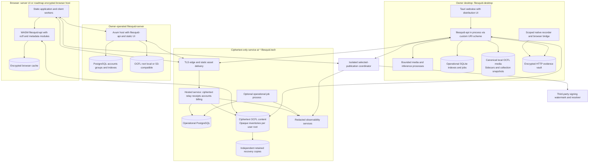

The desktop installation needs no PostgreSQL, cloud account or observability cluster to operate locally. `filesquid-server` needs PostgreSQL and an OCFL root; it runs as one binary or container next to them. Native installers bundle the required client runtime, migrations and licensed baseline processors; optional large model packs are versioned, verified and capability-aware. Credentials are requested when a feature is enabled, never as a prerequisite to opening a local library. An enrolled home worker may run the same resource-bound processing protocol; independent browser browsing does not depend on it.

The `*.filesquid.tech` topology begins as the ciphertext-only Axum service plus its operational database and object store, with an optional separate process for durable background control jobs ([ADR 004](./architecture/004-axum-hosted-ciphertext-mailbox.md), [ADR 032](./architecture/032-hosting-and-privacy-model.md)). Stateless API instances can scale against shared durable state; clients reconnect from cursors. Queue notifications are dispensable hints. A cluster mesh, Elasticsearch, graph extension, separate vector database or always-on GPU server is not inherent to this design. The hosted service and `filesquid-server` may run as compiled Rust binaries under a process manager or as containers; backing services may be managed or containerized. No desktop deployment uses the server Compose stack.

Object storage needs immutable versions or an equivalent application-managed object contract, checksum-capable multipart/chunk receipt verification, retention policy enforcement and independently recoverable copies. Provider, regions, number of copies, recovery isolation, delete propagation, quotas and egress costs require an ADR and measured operations approval. An object-store version feature alone is not backup when the same credentials can erase every retained copy. Service database backups and encrypted manifest/object retention must recover to a consistent documented point.

The preservation tier operates OCFL commits, scheduled fixity and demonstrated restoration, not just storage resale. OVH is an evaluated S3-compatible candidate, not a contracted deployment. Native asynchronous replication currently remains within one Public Cloud project, excludes bucket configuration and does not by default propagate delete markers/permanent deletions. Existing objects need explicit replication coverage. Cross-region copies under that same project do not establish independent administrative protection; separately controlled destinations/credentials and configuration recovery must match the published preservation policy. Restore time, retained metadata versions, verification reads, temporary staging and independent copies enter measured service costs. Do not count the same copy twice through both a multiplier and a separate charge. [OVH replication](https://docs.ovhcloud.com/en/guides/storage-and-backup/object-storage/s3-asynchronous-replication).

The proposed pilot budgets remain [NFR-005](./prd.md#nfr-005-recovery-and-service-reliability): control-plane availability ≥99.5% monthly, disaster RPO ≤24 hours for acknowledged catalog/recovery manifests and control-plane RTO ≤24 hours. These are internal targets awaiting validation, not an SLA. Bulk restore time depends on bytes/verified throughput; it is not included implicitly in the API recovery time. Protection status is withheld until originals and their recoverable catalog/manifest/wrapped-key associations meet the declared durability policy. The 24-hour control-plane RPO cannot authorize losing recovery associations for media already labeled protected: independently retained authenticated recovery packages must reconstruct those associations even if the operational database rolls back. Until that package commits, coverage stays pending. Local work continues during cloud outages, subject to local disk/key availability.

**Operational modules enabled in the hypothetical deployment.** Assistance/NAS agents stay on owner-authorized systems; physical-media processes store only encrypted packages; trusted-contact workflows distribute owner-created envelopes; professional gallery rendering happens on authorized clients before publication. Their hosted case/order/entitlement records are operational data. Public recipients and print partners receive only deliberately scoped content, not the operator's access to a private library.

The paid C2PA/watermark service is required when selected under F-044, distinct from optional F-035 expansions. Its coordinator uses separate storage/credentials and restricted egress to the chosen third-party publisher/resolver. Only frozen approved publication inputs enter that boundary; private OCFL/evidence keys remain on clients. Signing credentials belong to the approved publisher route and are never reused as library encryption keys. Provider outage does not stop free import records or private local use. Published resolution has declared hosting/retention terms and a portable credential/output export; it cannot depend on an unqualified promise of perpetual provider availability.

### 5.2 CI/CD Pipeline

**Orchestration/tooling:** Candidate hosted Git automation plus signed build runners; exact CI provider, test/format/report tools, native signing services and package repository require ADRs. No runnable application pipeline currently exists. Dependency resolution selects supported mutually compatible releases, records lockfiles/SBOM/license manifests and pins immutable build inputs; this document deliberately does not pin unvalidated versions.

**Target stages:** Format/lint and static/security checks → unit/BDD/contract tests → integration and fault tests → production builds → packaged/browser UI and media-golden tests → performance/endurance/security evidence → signed distributables → reviewed release → staged update/rollback verification. The MVP stops before signed distributables: it ships an unsigned early-access macOS DMG with no updater, so signing and staged update/rollback verification gate the first consumer release, not the MVP ([ADR 035](./architecture/035-macos-first-desktop-mvp.md)). The initial implementation/validation target is the macOS desktop host (the FileSquid MVP, [ADR 035](./architecture/035-macos-first-desktop-mvp.md)), followed by `filesquid-server`, Linux and Windows desktop, and the independent browser application; the mature matrix retains macOS, Windows and Linux with their actual webviews. Browser builds are tested independently with all desktops off. Linux export-file migration does not imply a portable PhotoKit adapter. Optional platform/capture/provider features cannot inherit a passing result from another engine.

| Verification layer | Architectural evidence required |
|---|---|
| Unit/contract | Pure matching, metadata precedence, recipe serialization, permission decisions, bounded queues, conflict resolution and package/API compatibility |
| Integration/fault | Real temporary library/object-store/database fixtures, source adapters with authorized export samples, interrupted writes, source mutation, duplicate retries, expired links, missing drives, full disk and archive attacks |
| Built UI/accessibility | Production artifacts mount; gallery/editor/share/recovery DOM states and resource availability are asserted rigorously; uncaught browser/SSR/hydration failures fail the run; keyboard and screen-reader review complements automation |
| Rendering/format | Immutable original hashes, same-recipe golden corpus, ICC/orientation/SDR tolerances, separately reviewed HDR/video/audio/capture paths, unsupported-resource preservation |
| Recognition/relevance | Consented labeled corpora, declared languages/classes and video moments, relevant-result judgments, approved precision/recall or task-success/error thresholds, class-specific results and correction regressions |
| Security | Device enrollment/recovery, malicious key substitution, revoked members/tokens, gallery isolation, XSS/hostile archives/extensions, privacy-free logs and independent crypto review |
| Performance/recovery | Correct useful-image paint and final readiness, scroll/frame and slide timing, warm/cold/evicted/missing caches, high decoded-pixel inputs, stale-work cancellation, peak memory/staging, fair background progress, resumed batches and completed-work reuse, 72-hour soak, cloud concurrency and clean-device recovery |
| Service exit | Retry-safe usage, cancellation/download window, private payer isolation, complete portable round trip and optional service evidence |
| Full HTTP evidence | Controlled GET/POST/form/API/multipart-upload exchanges with complete headers, request/response bodies, authorization/cookies, redirects, cache/304 and error pages; exact recorded-body comparisons, honest absent/unavailable/truncated states and browser/protocol matrix |
| Provenance/import C2PA | Every camera/desktop/web/free/offline import initializes a resource-bound record; preserved signed originals, missing credentials, pending trust checks, disclosure-relevant action appends, source-claim/observation distinction and acyclic JSON-LD/package bindings |
| Preservation | Close-app ordinary-file inspection/copy and reconstruction without operational catalog; independent local/hosted OCFL validation, interrupted canonical/index commits, metadata-only/`dcterms:` checkpoints, encrypted raw evidence, compound resources, wrong/missing keys and separate-copy recovery |
| Paid publication | Complete desktop/browser in-app workflow and retained-output retrieval; approved payload excludes raw HTTP secrets; retry/webhook idempotency; returned C2PA hard binding, trust/time/revocation observations, linked watermark lookup, format/transform robustness and resolver failure; both required results gate success |
| BYO AI | User endpoint/authentication binding, task-specific capabilities, absent discovery, unsupported parameter detection, no unauthorized fallback, provider limits, proposed-change validation/undo, no FileSquid-funded inference, standing AI Connections disclosure, inspectable How AI Connections work explanation, and per-job destination/input/hop overlay |
| Metadata fidelity/privacy | `dcterms:` / `schema:` single/batch/search operations, prefix display, populated-only disclosure, unknown `dcterms:` rejection, unknown-field preservation, duplicate-filename sidecar binding and export/reimport; exact raw extraction and IPTC/XMP → `dcterms:` mapping; conflicting and unknown time zones; correction/undo and metadata-only OCFL recovery; photo/video native/sidecar round trips; enabled-empty-retention, selective-retention and disabled policies on every sharing route and before/after paid publication; mirrored fields, stream/timing/color preservation, C2PA effects and explicit unsupported/scrub failures |
| Collection scans/history | Free unsubscribed/offline mixed-library scans, missing/invalid/unavailable credentials, bounded interruption/resume, item/summary coverage, privacy-safe export, retained PROV-O transformations and immutable prior-C2PA continuity |
| Institutional interoperability | Selected-profile import/delivery and collection-system round trips, metadata losses/rights mapping, authorized batch watermarking with per-item outcomes, annual service/cancellation terms and named professional-task evidence |

The capability register declares a nonempty minimum supported format/model/platform set for every committed conditional feature before its implementation gate. It maps every child item of the Photos inventory to a requirement, adapter/capture prerequisite and evidence. Declaring every combination unsupported cannot satisfy a mandatory feature; preservation-only remains a gap rather than editing parity. Source migrations likewise require zero unresolved in-scope items/relationships before full-success status; exclusions are separately counted and never renamed transferred originals.

The added evidence gates are [RC-009](./prd.md#rc-009-source-evidence-and-c2pa-lifecycle) for source capture and every-import/action C2PA history, [RC-010](./prd.md#rc-010-complete-ocfl-preservation-and-independent-recovery) for full collection recovery, [RC-011](./prd.md#rc-011-paid-third-party-publishing-and-watermark-delivery) for the paid publisher/watermark outcome, [RC-012](./prd.md#rc-012-user-funded-ai-connections-and-task-outcomes) for each supported BYO task, and [RC-013](./prd.md#rc-013-metadata-fidelity-and-configurable-sharing-privacy) for metadata fidelity and configurable sharing privacy. [RC-014](./prd.md#rc-014-institutional-interoperability-and-service-readiness) governs the later institutional interoperability/service boundary without making it a consumer-release dependency. Paid publication also satisfies service rollout gate C-7 before launch; satisfying another storage, signing or AI gate does not substitute for these distinct outcomes. Their delivery order belongs to the PRD rollout, while the complete-system boundaries here remain independent of release dates.

Structured reports, coverage, browser traces/screenshots and lint/test caches stay inside each workspace's `tests/` area. Each run cleans its own previous transient results; published immutable report summaries preserve history separately. Raw CLI results are copied into the task walkthrough. README commands are documented only after exact local execution against the implemented tooling. Functions stay ≤60 lines with inline documentation, bounded loops and explicit error/resource cleanup. A proposed PR follows the repository's external review process; no review or passing application tests are inferred from this design.

## 6. Security Viewpoint (ISO 42010)

### 6.1 Authentication Flow

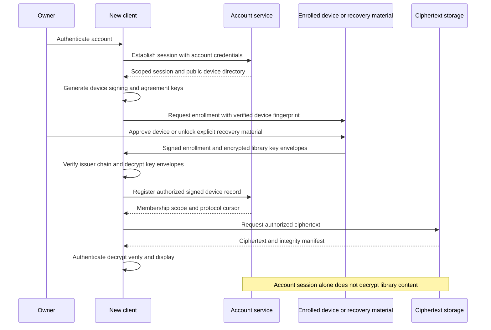

The diagram describes the proposed protocol responsibilities, not a finished cryptographic protocol. An independent security review must select vetted cryptographic implementations and analyze enrollment, rollback, concurrent membership changes and recovery. [F-029](./prd.md#f-029-client-encryption-and-key-custody) is the governing trust requirement.

**Key hierarchy and custody.** A local-only library needs neither a hosted account nor remote key enrollment. Enabling hosted protection creates random library encryption keys at the endpoint, independent of the account password. Per-resource data keys protect original and derivative resources; metadata/index/snapshot keys use purpose-separated library/epoch scopes. Device private signing/agreement keys stay in OS secure storage where available, with user-unlocked browser key material subject to the shared-device policy. Encrypted key envelopes may be stored remotely, but the operator lacks their unwrap keys.

A candidate interoperable suite can use reviewed authenticated encryption, HKDF-based domain separation, signed device/member records and an approved public-key envelope mechanism. AES-GCM and relevant derivation/signature operations are documented by the [Web Cryptography API](https://www.w3.org/TR/WebCryptoAPI/); final algorithms, nonce construction, password KDF parameters, key lengths, library bindings and platform fallbacks must be fixed together in the cryptography ADR, with test vectors and audit. API availability does not make a home-designed protocol safe.

Every encrypted unit authenticates its library/resource/version, key epoch, part index, declared size and manifest context as associated data. Whole-resource encrypted manifests authenticate ordered parts and expected plaintext hashes so truncation/reordering cannot be accepted. Crypto randomness and nonce uniqueness are protocol invariants. Ciphertext resumability persists a sealed immutable encryption manifest; a retry must either retransmit identical bytes or create a new encryption context. Private preservation operators verify ciphertext storage integrity; key-holding endpoints verify original content. A publisher can inspect only the selected output explicitly disclosed to it, not the encrypted private original by virtue of that role.

**Enrollment and recovery.** Existing trusted devices approve new-device fingerprints through an authenticated out-of-band/QR ceremony; clients verify signed key-directory changes to resist server key substitution. The account service's password reset restores account access only. Content recovery uses owner-held offline recovery material or a separately enrolled recovery device/contact policy. Onboarding tests recovery before protection claims. Loss of all such material means content is unrecoverable by the operator; the UI says so clearly. Recovery enrollment rotates affected credentials and marks compromised devices revoked. The audit must address directory rollback/fork detection and signed checkpoint consistency; a single server-supplied public-key list is not sufficient proof of identity.

**Sharing, rekey and revocation.** Personal libraries, shared libraries and individual galleries have separate key domains. Invitation acceptance binds the recipient's verified device/account keys to a signed role and membership epoch. Adding a recipient rewraps only authorized content keys; future-key rotation follows removal, departure or suspected compromise. The service immediately rejects revoked tokens/obsolete membership writes, and clients reject unauthorized or replayed signed changes. Retained old ciphertext/keys or plaintext already downloaded cannot be recalled. Re-encrypting selected retained resources and changing object access reduces future availability but does not promise cryptographic erasure of someone else's copy.

Sharing grants resolve only to resource versions and descriptive projections that match the selected policy revision. This applies to private shared albums/libraries as well as public galleries, native sharing and paid publisher inputs. An enabled scrub rule cannot leak an unsanitized fallback URL/key for the owner's original; intentionally retaining fields or disabling scrubbing requires the user's explicit scope-bound choice. In either mode the recipient receives only the frozen authorized delivery resource, never implicit source-original keys or private extraction/history/HTTP sidecars. Local free users receive the same controls, and client/API checks enforce the selected mode and retention list. Personal-device sync and owner-controlled archive recovery remain separately authorized original-preservation operations. Downstream transform/provider returns are checked again; failures of an enabled policy block delivery without automatically changing the rule or claiming disabled outputs are clean.

A public gallery is an explicit owner-created publication with its own restricted content/key scope. A proposed bearer URL carries the decryption secret in the fragment, which is not part of the HTTP request; client code must keep it out of telemetry, redirects and shared diagnostic records. Expiration/revocation disables future service delivery; key rotation and a new publication link apply to subsequent versions. Anyone holding the link can view the granted content, and copies remain outside revocation. Anonymous contributions encrypt into a separate intake scope; an authorized endpoint validates media and approves catalog inclusion. Untrusted contributors cannot publish arbitrary resource references into the owner's private library.

**Selected paid C2PA publication.** This sequence models the required complete service outcome. The user selects an image/output or a bounded recurring publication rule; implementation must support both third-party attestation and linked watermarking for a nonempty supported image-format/publisher matrix. Saved authorization covers only its named scope/recipients/terms, and expanded disclosure requires an updated grant. Private record initialization remains free/offline and independent.

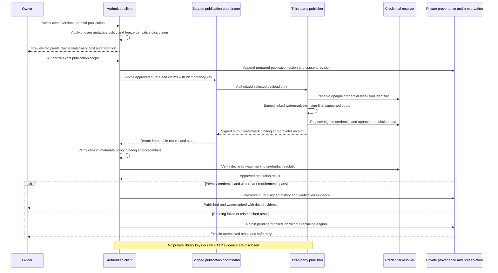

The publisher signs only assertions supported by its actual process. If it accepts client-submitted claims, those remain attributed client claims; it cannot retrospectively attest the original camera or historical source page. Reserve any watermark/resolver identifier before generating the final asset, embed the watermark before signing the final supported bytes, and then verify the returned binding. A provider-specific protocol may differ internally but must avoid modifying signed regions after signature or circular self-hash/manifest dependencies. Preserve exact signed output and previous manifests; later edits create another lineage/version.

A linked watermark supplies a recoverable association under tested transformations, not a cryptographic guarantee that transformed pixels still match the original signed asset. Validation distinguishes detection/lookup, retrieved credential validity and hard-binding validation of the actual available asset. The published compatibility matrix tests extraction after declared stripping/re-encoding/resizing cases, with false-match/failure outcomes and visual-quality limits. A metadata-stripped or transformed output may support provenance recovery without passing the original hard binding. No universal watermark durability or truth badge is promised.

The approved credential route must satisfy selected C2PA signing/validation requirements, certificate chain/trust-list policy, timestamp/revocation handling and conformance obligations. Becoming a trusted CA is not assumed. Returned artifacts include the watermarked derivative, signed manifest store or supported external manifest, algorithm/version/locator, signer/trust and timestamp evidence, and a unique operation receipt. Remote pixel watermarking requires the selected derivative; a digest-signing endpoint alone cannot perform that work. Provider-supplied client tooling may implement part of the operation only under the validated contract. Resolver access exposes only approved publication data; watermark identifiers cannot be private OCFL IDs, source URLs or bearer credentials. Cancellation stops future submission where possible, but cannot recall data already received or publicly copied. Provider cleanup, retained signed evidence, resolution availability and revoked/expired/unavailable statuses remain explicit. A missing watermark or broken required lookup is not silently accepted as a signature-only sale.

### 6.2 Security Measures

| Threat/boundary | Required controls and residual limitation |
|---|---|
| Stolen account token | Scoped/expiring sessions, enrollment controls and server authorization; tokens alone cannot unwrap private content keys |
| Family/group payer or service administrator | Billing and membership access separated; opaque operational IDs and encrypted private catalog; privileged operational access still requires auditing |
| Hostile browser delivery/XSS | Restrictive CSP, no third-party scripts on decrypting pages, output sanitization, dependency/build provenance, tightly controlled releases and isolation of untrusted content; browser-delivered E2EE still trusts delivered code, so a compromised origin/update can steal unlocked keys/plaintext |
| Desktop release compromise | Signed/verifiable installers and updates, immutable manifests, controlled signing credentials, downgrade/protocol checks and staged rollout; endpoint compromise remains outside E2EE protection |
| Malicious media/archive/extension | Separate decoder processes, finite bytes/time/expanded-entry/depth limits, sandboxed capabilities, denied traversal/symlinks outside selected roots and validated returned resources |
| Private discovery leak | Endpoint-only indexes; permission/hidden/deleted filtering before result ranking, suggestion generation, memories and notification formatting; external lookup discloses only explicitly approved input |
| Transport/server object confusion | TLS, library/role checks at every API and signed-URL issuance, short-lived scoped URLs, randomized object names, authenticated manifests and endpoint validation |
| Lost or replaced drive | Stable volume identity, resource fingerprints, paused jobs and explicit relink; path reuse alone is not proof of the same original |
| Local disk exposure | OS account protections and explicit local at-rest policy; hidden views/biometric unlock do not imply encryption of ordinary originals/catalog files |
| Shared/public downloaded media | Explain limits of recall, public bearer access and retained eligible copies; never promise revocation can erase third-party copies |
| Payment/partner webhook replay | Verify provider signatures, persist event IDs and idempotent state transitions, reconcile without charging twice; redact payment secrets |
| Support and diagnostics | Owner reviews bundle/scope, grants time-limited operations; media/keys/private paths excluded by default, access revocable prospectively, no support key override |
| Captured HTTP credentials and bodies | Dedicated encrypted evidence keys/storage, scoped recording session and unlocked inspection; safe display/export projections; no telemetry, ordinary thumbnails/indexes or publication inheritance; captured credentials never replay automatically |
| Hostile source page/provenance | Inert bounded evidence viewer, pinned JSON-LD contexts, isolated parsing, source statements treated as data rather than agent commands; links and enrichment are explicit new requests |
| Recorder/interception boundary | User-selected browser/session/request graph, validated destinations and redirects, scoped certificate/routing changes only when required by approved capture route; no unrelated history capture or silent privileged browser bridge |
| Publisher or resolver confusion | Frozen approved derivative/claims and consent revision, authenticated callbacks, exact output validation and separate watermark resolution; private evidence/store capabilities never enter provider requests |
| C2PA overclaim or history rewrite | Prepared definitions visibly unsigned, original credentials preserved, immutable signed resources and attributed actions; validity/trust/lookup/fixity/recovery remain separate evidence |
| BYO credential or model misuse | Destination-scoped credentials, per-task capability/disclosure gates, no silent provider fallback, minimal approved input and reviewed catalog proposals; provider policy/auth limits remain distinct from API compatibility |
| Cached or prefetched private content | Current permission/visibility checks and revision-bound cache keys before display; bounded speculation, invalidation and lock/logout cleanup; no unauthorized original fallback or remote plaintext processing |
| Institutional delivery | Explicit collection/profile/rights scope and metadata projection, no inherited private-library/evidence keys; batch failures remain per-item and do not broaden publication permissions |
| Metadata leakage or unsafe rewrite | Free enabled/disabled and field-retention controls enforced on all sharing/publication routes; independent readback before delivery and after provider processing, explicit policy changes, no automatic disabling or false clean status, immutable originals/credentials and isolated parsers |

**Secrets management:** Active user credentials, provider OAuth refresh tokens and content keys use secure endpoint storage. Hosted service secrets use an operational secret manager or deployment-injected protected credentials, selected in an ADR. Plaintext secrets never appear in environment dumps, ordinary migration manifests, task comments, logs or analytics. The user's full-evidence requirement deliberately permits captured Authorization/Cookie/Set-Cookie values, credential-bearing URLs, form/API/upload bodies and other observed secrets in encrypted private evidence. Their preservation is not permission to reuse them or disclose them in support bundles, public exports, C2PA assertions, resolver metadata or BYO requests. Ordinary displays/diagnostics redact expiring Graph/download/upload URLs; the raw evidence vault preserves observed values under its separate authorization. Encrypted key envelopes and sealed recovery manifests follow the reviewed key design. Operational correlation IDs are opaque and never plaintext content hashes.

**Network boundaries:** Public access terminates at TLS API/static delivery; operational databases, job control and telemetry stores remain private. Object access is explicit and scoped. The desktop custom URI scheme is confined to trusted application surfaces; remote origins and external extensions do not inherit desktop file/key privileges. `filesquid-server` authorises every API call; its static UI origin carries no extra privilege. Provider export/read permissions are least-scope and user-authorized. Default-deny API checks remain effective even when a malicious client bypasses the UI.

Evidence capture remains on authorized endpoints; `*.filesquid.tech` (and imagesquid.app) is not an implicit authenticated browsing proxy. Recording a user-selected request does not authorize issuing additional mutations or replaying uploads. Destination validation covers redirected/local-network URLs and newly initiated enrichment. A chosen local/user-hosted AI gateway is identified by its actual recipient/location; external selected-photo processing is a separate disclosure even while preservation remains E2EE. A subscription login is available only through a supported authorized runtime, not by collecting another application's token cache. Private content keys never become inference or publication credentials.

**Consent and deletion:** Turning off recognition/lookup stops future optional processing and offers index cleanup; it does not delete original media. Local recoverable deletion defaults to the PRD's proposed 30 days, with explicit permanent-delete scope. Hosted snapshot retention and cancellation/download windows are separately visible policies. Purge reconciles active jobs, conflicts, shares and snapshot references before eligible encrypted objects are garbage-collected; retained copies and provider backups have declared policy boundaries. Cryptographic deletion claims are limited to keys/resources actually controlled and verified by FileSquid.

## 7. Performance & Concurrency Viewpoint (ISO 42010)

### 7.1 Scalability Constraints

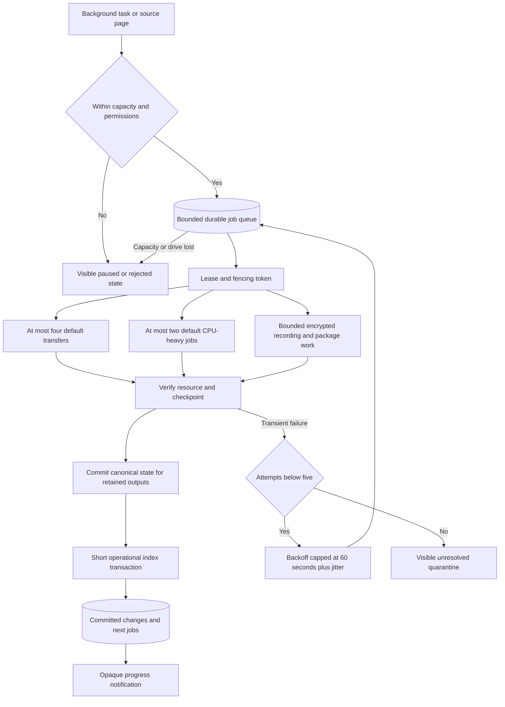

**Budgets from the PRD.** These are proposed acceptance envelopes awaiting SRS confirmation; this document reports no measured application performance.

| Area | Required target/constraint |
|---|---|
| Scale fixtures | Small 10,000 assets / 20,000 resources / 100 GB / 100 albums; Medium 100,000 / 200,000 / 1 TB / 5,000; Large 1,000,000 / 2,000,000 / 10 TB / 50,000 with 10,000,000 memberships |
| Large input | Stream a 100 GB single resource and 250 GB archive part; never allocate input-sized memory |
| Reference desktop | Declared 4-core / 16 GB / SSD; warm viewport p95 ≤100 ms, indexed metadata search p95 ≤2 s, first useful large-catalog viewport ≤3 s; at least 100 interactions/queries after declared warm-up, cold results separate |
| Browser/mobile | Separately declared 4 GB device/network; common browse/search p95 ≤2 s excluding unavailable-original download; limited decrypted/index working set |
| Warm feedback and prepared media | On declared desktop/browser/mobile profiles, interaction-to-visible feedback p95 ≤100 ms and resident prepared thumbnail/viewer/next-slide request-to-correct-image-paint p95 ≤100 ms; report preparation coverage and separate cache-miss/final-quality readiness; placeholders do not pass |
| Continuous presentation | Proposed 16.7 ms frame budget at declared 60 Hz; publish p95/p99 frame timing, stalls and slide lateness under concurrent work; other refresh rates require a declared budget |
| Acceptance profile completion | Declare cold/missing-cache useful-preview and full-quality deadlines by supported format/device/availability, permitted missed-frame rate, slide transition lateness, preparation coverage and adequate tail-sample counts before acceptance; do not substitute averages or a tiny prewarmed subset |
| Staging/disk | Default cap 10 GiB; reserve max(2 GiB, 5% destination capacity); choose a larger approved cap or segmented path before a resource exceeding available staging starts |
| Work admission | Default ≤4 active transfers, ≤2 CPU-heavy workers; every queue has an explicit finite limit and backpressure; model allocations separately measured/budgeted |
| Retry/endurance | At most 5 total attempts per resource including the initial attempt before quarantine; exponential retry backoff cap 60 s plus jitter; manual retry starts a new recorded recovery cycle under the same cap; 72-hour mixed/fault soak with ≤10% post-warm-up non-cache growth |
| Memory/resume | Migration process ≤2 GiB excluding separately budgeted ML models; resumable state within 30 s without rehashing all completed media; report replay bytes for PhotoKit/compressed-unit limitations |
| Rendering | Normalized SDR same-recipe mean ΔE2000 ≤2 and p95 ≤5; HDR/video/audio have separately reviewed perceptual/format fixtures |
| Hosted pilot | Load test 100 active sessions and 20 concurrent resumable transfers with declared infrastructure sizing; no implied universal capacity/SLA |

Source: [NFR-002](./prd.md#nfr-002-benchmark-envelope-and-responsiveness), [NFR-003](./prd.md#nfr-003-bounded-processing-and-migration-endurance), [NFR-007](./prd.md#nfr-007-compatibility-rendering-and-localization), [RC-002](./prd.md#rc-002-performance-and-resource-bounds).

The FileSquid U-11 performance contract (ImageSquid inherits it) applies to free use and MUST guide UI/catalog/decoder/worker/cache decisions before accepting a stack. Compare viable candidates using the same scale fixtures, high decoded-pixel counts, mixed formats, dense memberships and idle/concurrent import, thumbnail, provenance-scan and metadata-batch workloads. Record clock boundaries, warm-up, cache contents, sample size, percentiles, failures and end-to-end waiting with transfer/decode components; difficult supported media cannot all be excluded as unavailable. Packaged production UI evidence asserts the correct image/version, focus/selection and progress/failure DOM state without browser/SSR/hydration errors. Applicable gates repeat as workflows expand; a failed threshold requires resolution or explicit review before that release. These are proposed acceptance targets, not measured claims.

**Scheduling and resumable work.** Heavy decode, hashing, indexing, scans and metadata batches run outside the interactive rendering path. Admission uses explicit finite CPU/GPU/I/O/transfer/decoded-memory and queue budgets with deduplicated equivalent jobs; current controls/visible media precede bounded speculation. Under pressure, reduce or cancel stale prefetch before sacrificing foreground responsiveness. A declared measurable background-service guarantee or visible pause policy prevents indefinite starvation of preservation and other durable jobs. Fairness, progress, queue depth, eviction/redecode and speculative bytes are measured during sustained navigation. Hardware acceleration must pass the platform capability/budget profile and never authorizes remote plaintext processing.

Imports/uploads, thumbnail/index generation, collection scans and supported metadata batches persist bounded item checkpoints and idempotent operation identities. Resume revalidates source/version/authorization, reuses completed verified units and continues within-resource only where the adapter supports it. Crash, network loss, quota/full-disk faults or revoked access cannot force a whole-batch restart or duplicate retained history. Required affected-unit replay remains visible and measured. Cache recreation after intentional eviction is distinguished from replay of already committed work; neither may be reported as verified-original completion.

**Bottlenecks and mitigations.** SQLite write contention is controlled by short batched commits, prioritized UI mutations and a bounded writer queue. Thumbnails/rendering use tiled or streaming decode where supported and subprocess memory/time limits; unsupported decoders cannot bypass budgets. Recognition admits work by actual model memory, input dimensions and measured accelerator availability, not GPU core counts. Index/relationship construction uses paged joins and resumable partitions; late sidecars stay unresolved indexed records until targets arrive. No job or whole-library event document grows unbounded in memory.

Native worker crashes are isolated from catalog/UI processes. Leases expire with fencing tokens so a late old worker cannot commit after a replacement takes ownership. Retry-safe operations use immutable objects and idempotency keys; database job uniqueness alone does not prove exactly-once external effects. Every acquired file handle, decoder, memory buffer, connection and request has scoped cleanup. Shutdown stops admission, checkpoints bounded work, cancels or drains to a safe boundary and releases leases/resources. Browser termination relies on persisted committed checkpoints and later reacquisition, not an unload handler completing arbitrary work.

Synchronization pages changes and shards indexes by library/revision rather than transferring the entire catalog on each edit. The server can horizontally scale transport/control without seeing content. Transfer pressure is limited per device/account/service as well as globally; rate limiting, low free space, battery/thermal constraints and provider throttling pause or reduce admission visibly. If a resource cannot fit the selected route's bounded staging, preflight offers segmented transfer or explicit capacity change; a default 10 GiB cap is not a promise to extract a 100 GB PhotoKit resource into that space.

HTTP recording bounds bytes, exchanges, redirects, concurrent requests, duration, body buffering and capture retention with declared values in the future SRS. Stream request/response/error bodies into encrypted resources; a body cannot be silently dropped to satisfy a cap. Preserve a failed/partial evidence result when backpressure cannot safely pause a live response. Do not automatically retry state-changing source requests to improve evidence. OCFL work serializes per object, checkpoints collection revisions and measures cumulative inventory growth; metadata-only changes may be coalesced under a visible durability boundary. Fixity/restore work is scheduled without starving interactive imports. Publication queues use bounded retries and provider operation reconciliation so a timeout cannot trigger repeated paid signing/watermark orders.

Model/codec workers probe hardware and retain CPU or preserved-rendition fallbacks where supported. The inherited EXLA/Metal and GPU-partition claims are not adopted: XLA documents no built-in Metal and native Windows limitations, so it does not establish the cross-platform acceleration contract. [XLA platform documentation](https://xla.hexdocs.pm/). Every enabled accelerator/model combination has separate resource and accuracy evidence. User-controlled workers can pause when idle; this does not remove ongoing backup storage and hosted availability costs.

### 7.2 Observability & Monitoring

**Logging subsystems.** Applications emit unbuffered structured stdout events with UTC RFC 3339 timestamp, severity, opaque operation/job correlation, stage, duration and outcome. Catalog changes, resumable journals, OCFL inventories, backup manifests, encrypted HTTP evidence and provenance/C2PA histories are persistent product records; they must survive crashes and are not disposable telemetry logs. The raw recorder writes encrypted preservation content, not application log files. Progress notifications are coarse operational hints; private filenames, paths, titles, faces, coordinates, tokens, keys, original hashes and signed URLs are excluded. Evidence bodies/headers, unpublished assertions and publication content never enter stdout, trace attachments, proxy telemetry/export callbacks or analytics. Local-only use requires neither upload of telemetry nor a local monitoring cluster; user-reviewed diagnostics can be exported explicitly.

**Logging and health monitoring.** Every process writes unbuffered stdout JSON ([ADR 014](./architecture/014-stdout-observability.md)). FileSquid records 100% of its activity in an append-only activity journal in the operational store (domain operations in the same transaction as the change; other events with backpressure, never dropped) and keeps a process registry with heartbeats for live health; both are served by the API and shown in the FileSquid Monitor dashboard on every host that runs `filesquid-api` (desktop and `filesquid-server`; the ciphertext-only service keeps a separate service-event journal) ([ADR 033](./architecture/033-activity-journal-and-live-health-monitoring.md), [PRD F-061](./prd.md#f-061-activity-journal-and-live-health-monitoring)). OTLP export to external sinks (reference: VictoriaLogs and VictoriaMetrics in the Compose `observability` profile) is optional, off by default and store-and-forward from the journal. Promtail, Redpanda, Loki, Grafana, Alloy and Prometheus are not used.

The topology below is FileSquid's own tooling ([ADR 033](./architecture/033-activity-journal-and-live-health-monitoring.md)). It needs no broker, collector or dashboard server; external sinks are optional.

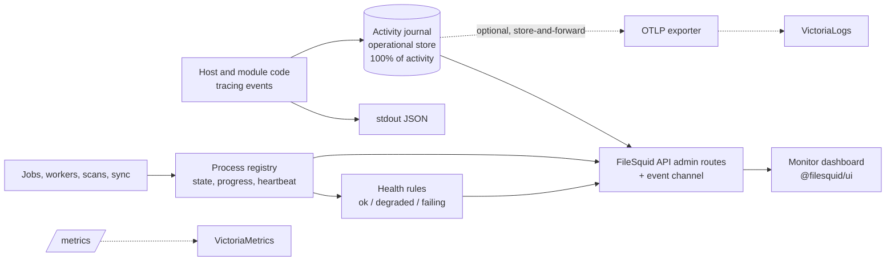

**Metrics/tracing/alerts.** Track input-to-feedback and correct useful-image/final-readiness latency, prepared-image coverage, frame/slide timing, cache/decoded memory, evictions, speculation, queue fairness and completed-work reuse alongside verified-byte throughput, queue age, stage latency, retries/quarantine, staging/free-space margins, restore coverage, sync lag, authorization denials, ciphertext durability receipts, database health and operational billing reconciliation. Avoid labels containing resource/account-private details or unbounded IDs. Traces use opaque correlation and cross process/network boundaries without private payloads. A trace storage backend is an explicit decision gap; having OpenTelemetry does not itself store traces.

Preservation metrics distinguish ciphertext fixity failures, incomplete package commits, missing replica coverage and failed client recovery. Capture metrics describe supported/partial/failed outcomes without URLs or payloads. C2PA metrics distinguish prepared records, signed-validation outcomes, publisher delivery and watermark/resolver verification; no aggregate counter becomes a claim that all images are authentic. AI diagnostics report connection/task failures and provider limits without private prompts or credentials. FileSquid service accounting excludes the user's inference bill; only connector support and applicable preservation bytes affect its own economics.

Alerting distinguishes an incomplete upload from unavailable original protection, stalled synchronization from failed backup, provider throttle from local failure, and control-plane recovery from bulk restore. Operational retention and dashboard access are role-scoped. Cost reports use minimal account byte/traffic aggregates and measured support effort; optional product research has separate consent. Public service claims follow [NFR-010](./prd.md#nfr-010-accurate-public-claims), without requiring surveillance of local-only users.

## 8. Technology Decisions Summary

Rows D-01–D-06, D-07 (suite), D-09/D-10 adapters, D-13 stdout, D-14 workspace, D-17/D-18/D-19 SDK, D-24 module reuse and D-26–D-28 are covered by [ADRs 001–016](./architecture), [ADRs 022–028](./architecture) and [ADRs 029–032](./architecture/README.md). ADRs 003 and 028 are superseded by ADR 031; ADRs 001, 002, 004, 008, 013, 023–027 are amended by ADRs 029–032. They install nothing. Remaining gaps (named region, recorder binary, model packs, payment, trace store, job SQL, SPA-asset signing) stay **Proposed / ADR missing**. Exact crate patch versions remain lockfile concerns.

| Layer | Technology | Rationale (Driven by ADRs) |
|---|---|---|
| Architecture style — D-01 | One product (FileSquid): module crates behind one API, two hosts now (desktop, multi-user server), one ciphertext-only hosted service, UI-only distributions | Fits offline ownership and minimizes deployment burden. [F-001](./prd.md#f-001-independent-local-library-and-ownership), [TC-004](./prd.md#tc-004-decision-status-and-repository-alignment), [ADR 001](./architecture/001-shared-rust-core-with-tauri-and-axum-hosts.md). Remaining ADRs must resolve inherited BEAM/workspace rule scope and package exportability. |
| Frontend — D-02 | Vanilla TypeScript with standard custom elements, Vite, no UI framework; client-rendered private UI; tokens and label tables per distribution | One component library (`@filesquid/ui`) for every distribution. [TypeScript](https://www.typescriptlang.org/), [Custom Elements](https://html.spec.whatwg.org/multipage/custom-elements.html). [ADR 031](./architecture/031-vanilla-typescript-ui-and-white-label-theming.md) (supersedes [ADR 003](./architecture/003-svelte-client-rendered-ui.md)). Remaining implementation ADRs cover browser replica, package boundaries, worker/runtime support, progressive useful-image paint, bounded adjacent prefetch, cache correctness and production UI evidence against FileSquid U-11 budgets. |
| Desktop — D-03 | Tauri 2 host serving `filesquid-api` through a custom URI scheme, with native adapters | Scoped native access and local execution with OS-specific webviews; no TCP port; one binary, many distributions through config overlays. [Tauri](https://v2.tauri.app/concept/architecture/), [Rust](https://rust-lang.org/). [ADR 001](./architecture/001-shared-rust-core-with-tauri-and-axum-hosts.md), [ADR 002](./architecture/002-tauri2-desktop-shell.md). Remaining ADRs cover signing/update trust, webview permissions, filesystem and native adapter matrix, with Linux/web-first validation and mature macOS/Windows coverage. |
| Local database — D-04 | SQLite operational indexes, pending jobs and short transactions | Canonical committed media/metadata/relationships reside in documented local OCFL files/snapshots; indexes rebuild without the original database, while pending jobs reconcile to canonical commit receipts; no multi-host WAL. [SQLite](https://www.sqlite.org/wal.html). [ADR 005](./architecture/005-sqlite-local-postgres-hosted.md), [ADR 007](./architecture/007-durable-jobs-and-interactive-performance.md). Remaining ADRs define library schema, file/database commit reconciliation, safe filesystems, bounded query/cache behavior, migrations, local-at-rest profile and independent repair/restore. |
| Server and hosted backends — D-05 | Axum on Tokio with SQLx/PostgreSQL in two binaries: the multi-user `filesquid-server` (plaintext, owner-operated) and the ciphertext-only `*.filesquid.tech` service | One API router for the server; a separate dependency graph for the hosted service. [Axum](https://docs.rs/axum/latest/axum/). [ADR 004](./architecture/004-axum-hosted-ciphertext-mailbox.md), [ADR 032](./architecture/032-hosting-and-privacy-model.md). Phoenix, LiveView and FastAPI are rejected. |
| Hosted data — D-06 | PostgreSQL plus S3-compatible ciphertext object storage | [ADR 005](./architecture/005-sqlite-local-postgres-hosted.md), [ADR 012](./architecture/012-s3-compatible-ciphertext-storage.md). Named provider/geography remain an operations decision. [PostgreSQL](https://www.postgresql.org/docs/18/ddl-rowsecurity.html). |
| Cryptography — D-07 | AES-256-GCM, HKDF-SHA-256, SHA-256, Ed25519/X25519, Argon2id wrap | [ADR 009](./architecture/009-cryptography-webcrypto-compatible-suite.md). Independent review and test vectors remain prerequisites to a hosted pilot. [Web Crypto](https://www.w3.org/TR/WebCryptoAPI/). |
| Sync/protection — D-08 | Signed encrypted operations, causal conflicts, immutable snapshots and resumable transport | Sync and backup remain distinct; membership and tombstones prevent stale replay/resurrection. tus or object-store multipart is a transport choice, not a media-identity model. [tus protocol](https://github.com/tus/tus-resumable-upload-protocol/blob/main/protocol.md). Automerge remains optional review/collaboration research. |
| Stills/RAW/HEIF — D-09 | libvips; LibRaw; libheif or OS HEIF decoder | [ADR 006](./architecture/006-libvips-native-stills-not-imagemagick.md), [ADR 011](./architecture/011-native-media-adapters-and-ffmpeg-license.md). Color pipeline and camera matrix remain implementation ADRs. |
| Video/audio — D-10 | Isolated LGPL FFmpeg worker; no GPL/nonfree default installer | [ADR 011](./architecture/011-native-media-adapters-and-ffmpeg-license.md). [FFmpeg](https://www.ffmpeg.org/legal.html). Counsel review of the linked inventory remains before public binaries. |
| Recognition — D-11 | Candidate ONNX Runtime native/web providers and versioned licensed model packs | Endpoint inference across supported hardware with CPU/bounded fallback and per-model quality tests. [Execution providers](https://onnxruntime.ai/docs/execution-providers/), [browser runtime](https://onnxruntime.ai/docs/get-started/with-javascript/web.html). Models, datasets, OCR/translation/lookup sources and licenses each require evidence. |
| Integration/extensions — D-12 | PhotoKit, source export/folder adapters, optional Picker/Graph, scoped OS/editor/print/companion contracts | Use documented version-tested interfaces; no private database reader as baseline. [PhotoKit](https://developer.apple.com/documentation/photokit/fetching-assets?language=objc), [Google API policy changes](https://developers.googleblog.com/google-photos-picker-api-launch-and-library-api-updates/), [Graph](https://learn.microsoft.com/en-us/graph/api/driveitem-get-content?view=graph-rest-1.0). Provider/music/map/print agreements and capability tests remain required. |
| Observability — D-13 | Stdout JSON; FileSquid activity journal (100% of activity) and process registry; Monitor dashboard in `@filesquid/ui`; optional OTLP export (VictoriaLogs/VictoriaMetrics reference sinks) | [ADR 014](./architecture/014-stdout-observability.md), [ADR 033](./architecture/033-activity-journal-and-live-health-monitoring.md). No Grafana, Loki, Prometheus or Redpanda; the desktop never runs a telemetry server. |
| Engineering/distribution — D-14 | Product-local Cargo workspace `apps/filesquid/` (crates under `crates/`) plus Vite/TypeScript packages `@filesquid/ui` and `@imagesquid/ui`; no root `Cargo.toml` or `package.json`; lockfile versions; signed releases later | [ADR 013](./architecture/013-cargo-svelte-workspaces.md) as amended by [ADR 029](./architecture/029-filesquid-unified-product-and-distributions.md). Lint/CI report tools still require executable verification. [NFR-008](./prd.md#nfr-008-maintainability-and-verified-engineering). |
| Billing/optional services — D-15 | Versioned entitlements, signed payment events, scoped assistance/NAS/assurance/physical/contact/professional modules | Paid operations cannot disable local ownership or weaken keys. [F-032](./prd.md#f-032-accounts-entitlements-billing-and-cancellation), [F-035](./prd.md#f-035-optional-service-extensions). Prices, retention/cancellation windows, inheritance trigger, licensing, provider geography and legal/service terms remain explicit gates. |
| HTTP recording — D-16 | Scoped native recorder/proxy plus browser instrumentation; exact implementation pending | [F-041](./prd.md#f-041-source-aware-web-clipping-and-http-evidence) requires full private request/response evidence including secrets and binary bodies. Resolve browser/protocol/hop coverage, body access, isolated routing/trust setup, encryption and finite bounds. CDP alone has documented [request-body gaps](https://chromedevtools.github.io/devtools-protocol/tot/Network/#method-getRequestPostData). At least one complete controlled desktop route must pass. |
| Source provenance — D-17 | Versioned PROV-O/JSON-LD profile; no graph database | [ADR 015](./architecture/015-prov-o-jsonld-and-c2pa-sdk.md). [PROV-O](https://www.w3.org/TR/prov-o/), [JSON-LD](https://www.w3.org/TR/json-ld11/). Exact context URLs remain an implementation pin. |
| Preservation — D-18 | OCFL 1.1 owner-readable local profile plus separate ciphertext hosted profile; crate `filesquid-ocfl` as a reusable engine | [ADR 010](./architecture/010-ocfl-1-1-dual-profile.md), [ADR 016](./architecture/016-rust-ocfl-library.md), [ADR 023](./architecture/023-filesquid-ocfl-engine-and-parquet.md), [F-042](./prd.md#f-042-ocfl-preservation-and-portable-recovery), [F-051](./prd.md#f-051-ocfl-module), [F-049](./prd.md#f-049-product-component-terminology-and-item-type), [OCFL](https://ocfl.io/1.1/spec/). Git MUST NOT be the OCFL library. SHA-256 digest. FileSquid application-layer collection snapshots and dual-profile encryption are callers. Exact object path layout remains the first-writer ADR. |
| OCFL module reuse — D-24 | `ocfl` module of FileSquid and a stand-alone FOSS OCFL 1.1 library and tool; independently publishable (per-crate repository extraction superseded); generic core API; later optional `parquet` Cargo feature; runs behind `filesquid-api` on desktop, `filesquid-server` and the browser host, never in the ciphertext-only hosted service | [ADR 023](./architecture/023-filesquid-ocfl-engine-and-parquet.md), [ADR 025](./architecture/025-client-side-filesquid-engines.md), [F-051](./prd.md#f-051-ocfl-module), [T-042](./product-vision.md#canonical-ocfl-state-and-evidence). Independent install without the FileSquid app, including by digital preservation programmes. The crate lives at `apps/filesquid/crates/ocfl/` and is published from this repository. Inventory-driven version-pinned logical state. Crash-safe `vN` publication and S3 CAS. Default graph excludes Arrow/Parquet/DuckDB/Iceberg. Analytical outputs stay outside OCFL reserved paths. |
| Metadata engine — D-25 | Stand-alone FOSS metadata CRUD engine; extract EXIF/ID3/XMP; CLI + CSV + XMP; persist through its configured `MetadataStore` (`sidecar`, optional `ocfl`, optional `sqlite`), with FileSquid selecting the `ocfl` store as canonical ([ADR 027](./architecture/027-filesquid-metadata-pluggable-stores.md)); no MODS or SQL; runs behind `filesquid-api` on every plaintext host, never in the ciphertext-only hosted service | [ADR 024](./architecture/024-filesquid-metadata-engine.md), [ADR 025](./architecture/025-client-side-filesquid-engines.md), [F-052](./prd.md#f-052-metadata-module), [T-038](./product-vision.md#descriptive-metadata), [T-044](./product-vision.md#canonical-ocfl-state-and-evidence), [T-045](./product-vision.md#canonical-ocfl-state-and-evidence). FileSquid and every distribution MUST route metadata handling here. The ciphertext-only hosted service MUST NOT link the crate. |
| C2PA and publication — D-19 | From-scratch `filesquid-c2pa` module behind `filesquid-api` on every plaintext host (official `c2pa` crate as CI oracle only); in-app third-party signing/watermark; no owned CA | [ADR 011](./architecture/011-native-media-adapters-and-ffmpeg-license.md), [ADR 015](./architecture/015-prov-o-jsonld-and-c2pa-sdk.md). [F-043](./prd.md#f-043-import-time-c2pa-records-and-action-disclosure), [F-044](./prd.md#f-044-paid-c2pa-publishing-and-watermarking). Publisher/watermark vendor remain a supplier decision. |
| BYO model integration — D-20 | Focused task interface with OpenAI-compatible baseline, Responses/native/specialist adapters, optional user-operated LiteLLM endpoint, and FileSquid-owned standing/per-job disclosure | [F-045](./prd.md#f-045-byo-ai-connections-and-per-task-model-choice), [LiteLLM](https://docs.litellm.ai/docs/), [Ollama](https://docs.ollama.com/api/openai-compatibility). Select packaged adapters and authorized login routes, test capabilities/privacy and preserve portable corrections. No FileSquid inference purchase, subsidy, resale or required gateway. Configuration copy and job overlays belong to FileSquid and its distributions, not to a bundled LiteLLM UI. |
| Metadata profiles and adapters — D-21 | Isolated photo/video extract/write/readback adapters, ISO 15836-2 `/terms/` register, Schema.org overflow, versioned correction/sidecar profile and free configurable sharing/privacy policy | [F-046](./prd.md#f-046-media-metadata-inspection-correction-and-privacy-exports) and [ADR 022](./architecture/022-dublin-core-descriptive-metadata.md) require exact raw extraction, `exif:` / `dcterms:` / `schema:` identity, IPTC/XMP → `dcterms:` mapping, populated-only progressive disclosure, reversible effective values and verified output matching enabled/disabled mode and explicit retained fields. Select parser/writer/verifier packages, native/sidecar mappings, unknown-field handling and video stream/container checks; no universal EXIF video schema or blanket privacy guarantee follows from one tool flag. OCFL/C2PA history and downstream provider checks are part of the contract. |
| Institutional interoperability — D-22 | Selected collection-system and IIIF import/exchange/delivery profiles using scoped adapters, metadata mappings and publication workflows | [F-047](./prd.md#f-047-institutional-dam-and-iiif-interoperability), [RC-014](./prd.md#rc-014-institutional-interoperability-and-service-readiness). ADR defines supported profiles, rights/metadata fidelity, bounded batch outcomes, authorized delivery and annual institutional service terms; partner/funding gates govern implementation scope, with no new dependency or identity platform selected here. |
| Single API — D-26 | `filesquid-api`: one versioned contract (OpenAPI 3.1, generated TypeScript types, drift test), transport-agnostic router, one event channel; HTTP plus WebSocket or the S1 outcome | [ADR 030](./architecture/030-filesquid-api-and-transports.md), [F-056](./prd.md#f-056-single-filesquid-api). Generator crates and npm packages are verified before an ADR names them. |
| Distributions — D-27 | UI bundle, tokens, label table, brand, view modules and module set per distribution; `distribution.json`; Tauri config overlay per distribution | [ADR 029](./architecture/029-filesquid-unified-product-and-distributions.md), [ADR 031](./architecture/031-vanilla-typescript-ui-and-white-label-theming.md), [F-058](./prd.md#f-058-white-label-distributions). |
| Hosting and privacy — D-28 | Desktop (owner only), owner-operated multi-user server (operator can read), ciphertext-only `*.filesquid.tech` (owner only), roadmap encrypted browser host (owner only) | [ADR 032](./architecture/032-hosting-and-privacy-model.md), [F-057](./prd.md#f-057-desktop-and-server-hosts), [F-059](./prd.md#f-059-hosted-encrypted-backup-and-sync-service). |
| Identifiers — D-23 | RFC 4122 / RFC 9562 UUID version 4 for newly generated domain IDs; OCFL inventory `id` is `urn:uuid:<id>` | [ADR 021](./architecture/021-uuid-v4-identifiers.md), [TC-001](./prd.md#tc-001-immutable-originals-and-explicit-identity), [F-049](./prd.md#f-049-product-component-terminology-and-item-type). SHA-256 remains the storage digest. |

The unresolved decisions delimit what must be ratified and proven before implementation or public claims. They do not reduce the modeled full-product scope: every capability has an allocated owner, data contract and failure/trust boundary, while its actual realization remains future work.
